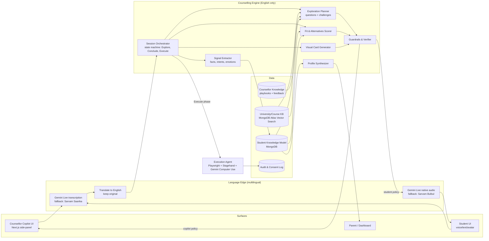
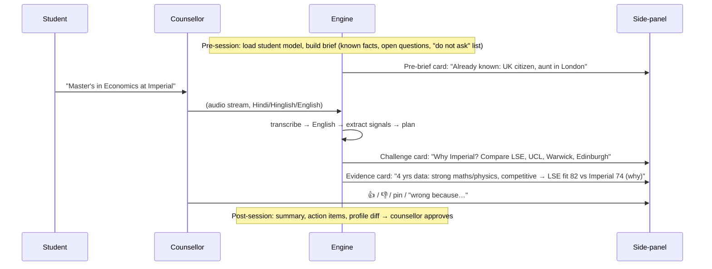
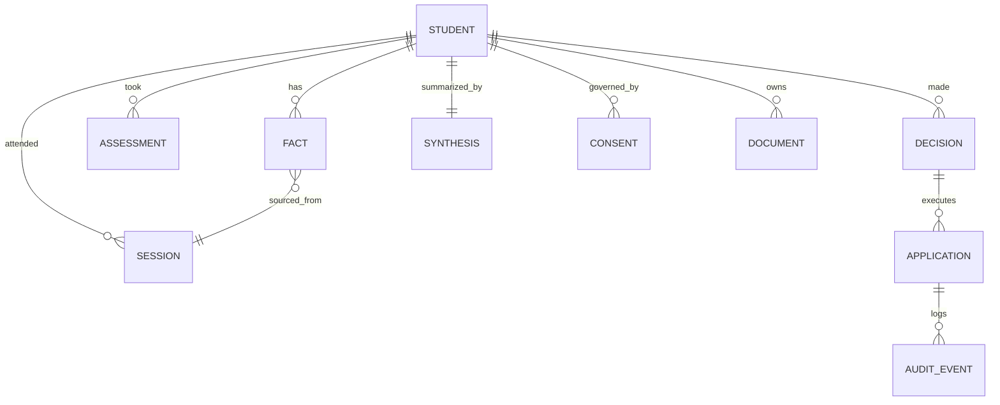
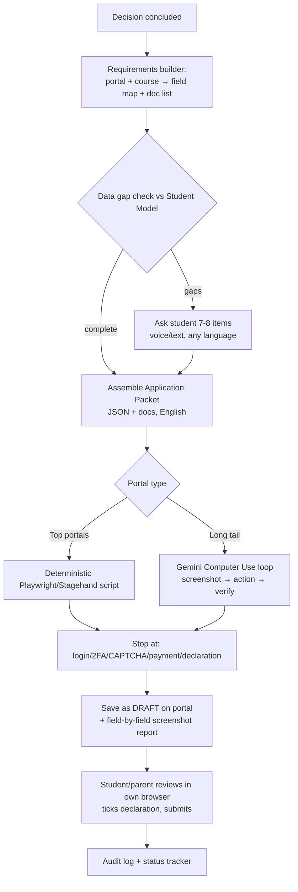
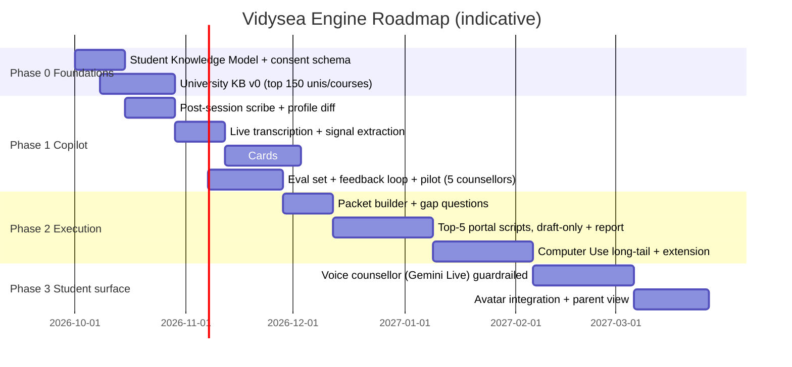

# Vidysea AI Counselling Engine: Research and Build Plan

**Build one Gemini + MongoDB "Counselling Engine" that turns every conversation into a structured, English-language student model. Surface its output first as a counsellor side-panel of cards (Phase 1), then as a draft-only application filler (Phase 2), and only then as a student-facing voice/avatar counsellor (Phase 3). One developer can ship Phase 1 in about 10–12 weeks. The "15-minute application" is only realistic for the data-entry portion of a form, never for a complete application.**

## TL;DR
- **Copilot first is backed by evidence.** In Brynjolfsson, Li & Raymond's study of 5,179 customer-support agents (Quarterly Journal of Economics, 2025), an AI assistant raised issues resolved per hour by 14% on average and by 34% for novice and low-skilled workers. The highest-skilled agents saw "small but statistically significant" drops in resolution rates and customer satisfaction. That fits the CEO's goal of lifting less-experienced counsellors, and it means the UI must show challenge questions and comparisons as cards, never a script.
- **Application filing can be built but is unreliable.** In Halluminate's WebBench benchmark, the best fully automated agent (Skyvern 2.0) completed only 46.6% of write tasks (logins, forms), while most agents passed over 75% of read tasks. CAPTCHAs, logins and 2FA are the main blockers. Build it as "pre-fill to draft plus checklist, human submits", with per-portal deterministic scripts for the top portals and a Gemini Computer Use fallback for the long tail.
- **Compliance is the hidden critical path.** All Pathlynks users (Grades 6–12) are "children" under India's DPDP Act. Verifiable parental consent and limits on tracking and behavioural monitoring apply, and child-data obligations become enforceable on 13 May 2027. Psychometric profiling of minors plus longitudinal memory is exactly what regulators will look at, so build consent and purpose-tagging into the data model from day one.

---

## Key Findings (prior art → what to copy)

| Product / study | What it does | Lesson for Vidysea | Open source? |
|---|---|---|---|
| Google Agent Assist (CCAI) | Listens to live calls. Shows knowledge suggestions as clickable tiles (title + preview), proactive query suggestions, sentiment, real-time transcript, post-call summary. | The copilot pattern is **tiles the human chooses to use**, not scripts. Timing matters: a suggestion that arrives after the topic has moved on is a nuisance. | No |
| Brynjolfsson et al. (QJE 2025), 5,179 support agents | AI assistant gave +14% resolutions/hour and +34% for novice and low-skilled workers. The most skilled saw "small but statistically significant" *declines* in resolution rates and customer satisfaction. | Validates North Star #6. Let senior counsellors switch to "quiet mode". Capture top counsellors' moves as the knowledge the AI spreads. | Paper |
| Morgan Stanley AI @ MS Debrief | With client consent, produces meeting notes, action items and a draft follow-up email, saved to Salesforce. Advisors review and edit before anything is final. Eval-driven development. | Copy exactly: consent per session, human review before any write, evaluation sets built per meeting type. The easy win is time saved: one advisor told Morgan Stanley, "It's saving me about half an hour per meeting just by handling all the notetaking." | No |
| Nuance DAX / Abridge (ambient scribes) | Ambient capture → structured clinical note → clinician signs off. | Post-session note + profile update with sign-off is the fastest ROI feature and a low-risk start. | No |
| Gong / Cresta / Observe.AI / Balto | Real-time guidance and post-call QA scorecards. | Build counsellor QA rubrics and session analytics. Balto-style "checklist of topics not yet covered" is a non-teleprompter nudge. | No |
| Cialfo **Saige** | AI assistant for counsellors and students: match/reach/safety lists, profile gaps, next steps. UCAS + Common App + Direct Apply in one platform. Used by Indian school groups (e.g., Pathways). | Your direct B2B-school competitor in India. Differentiate on **longitudinal psychometric data + live-session copilot**, not on list-building. | No |
| CollegeVine **Sage** (formerly Ivy) | Free AI counsellor. In its first year CollegeVine reported "over 81,000 students" and "nearly 1.4 million chats", with "nearly 30% of students" still using it a month later. | Reach is possible, but reviewers report factual errors (e.g., a wrong deadline). Facts must come from a curated knowledge base, not model memory. | No |
| Khanmigo | Socratic tutor that withholds answers. | An NBER study by Oreopoulos (University of Toronto) and Low of Hamilton County, Tennessee middle schools (w35620, Aug 2026) found "96 percent of students tried Khanmigo at least once, but the median student messaged it on only a third of the days they practiced". For Phase 3, pure cross-questioning drives students away; mix questions with useful answers. | No |
| Leverage Edu | Markets "One-Day Application Submission", AI eligibility checks, profile scoring. | The market already sells speed of execution. Your edge must be decision quality plus pre-fill. | No |
| DeepInterview (Apache-2.0) | Prep / live / post split, shared context "blackboard", rubric scoring, pre-rendered avatar loops. | Borrow the architecture pattern (blackboard + prep/live/post). Don't adopt its stack wholesale. | Yes |

---

## 1. Shared Engine Architecture

**Principle:** one engine, two "surfaces". The copilot and the student counsellor run the same pipeline. The only difference is the output policy: *show to counsellor* vs *speak to student*.

**Modules (build order in brackets):**
1. **Session Orchestrator** [P1]: explicit state machine (Explore → Conclude → Execute) with a shared "session blackboard" document in MongoDB. Plain TypeScript plus the Gemini SDK with structured output. Google ADK is optional later (it supports bidirectional Live streaming and multi-agent setups). For one developer, avoid LangGraph/CrewAI abstractions in V1; Claude Code handles thin, explicit code best.
2. **Signal Extractor** [P1]: every ~20–30 s of transcript → JSON: new facts (with source quote and confidence), stated goals, constraints (budget, family, citizenship), emotional cues.
3. **Exploration Planner** [P1]: produces 1–3 *question cards* per turn, of these types: *Widen* ("Why UK? Considered Ireland/Netherlands?"), *Challenge* ("Why Imperial over LSE for Econ?"), *Clarify* ("UG or PG?"), *Evidence* ("Your Grade-9 profile shows X"). It never produces sentences for the counsellor to read aloud.
4. **Fit & Alternatives Scorer** [P1]: given a stated target, returns 3–5 comparables with a transparent scoring breakdown (academic fit, psychometric fit, cost, visa/outcomes). The numbers come from the KB, not from the LLM.
5. **Visual Card Generator** [P1]: renders deterministic chart templates (comparison tables, radar of strengths, cost bars) from JSON. Don't let the LLM draw images.
6. **Guardrails & Verifier** [P1]: every factual claim must cite a KB record or a profile fact; otherwise it is labelled "unverified" or dropped. It also handles safety triggers (distress, self-harm, family conflict) → escalation card.
7. **Profile Synthesizer** [P1 post-session]: updates the student model and writes the "4-year synthesis" narrative.
8. **Execution Agent** [P2]: described in section 4.
9. **Student Voice Surface** [P3]: same orchestrator, stricter guardrails, Gemini Live speech-to-speech.

---

## 2. Phase 1 Copilot: Live Flow and UX Rules

**Anti-teleprompter UX rules (hard constraints):**
- Cards hold **questions, comparisons and evidence**, never full sentences to recite. Limit of 3 visible cards; they fade after the topic changes.
- Each card shows *why* (source: profile fact / KB record / transcript quote) and a confidence badge.
- The counsellor controls the cadence: "quiet mode" (post-session only), "nudge mode" (topic coverage checklist), "active mode" (live cards). Default experienced counsellors to nudge mode, given the finding that top performers can lose quality with heavy AI assistance.
- One-tap feedback on every card: 👍 / 👎 / "wrong fact" / "bad question" plus optional voice note. This is the channel for **cumulative counsellor knowledge**: approved question patterns and corrections go into the Counsellor Knowledge store and are retrieved as few-shot examples.
- Post-session: AI summary and profile changes are shown as a **diff the counsellor approves** (the Morgan Stanley pattern). Nothing enters the student model unreviewed in Phase 1.

**Hallucination control:** (1) facts only from the KB with citations; (2) LLM-as-judge verifier pass on every card before display (cheap Flash-Lite call); (3) a "golden sessions" eval set of 30–50 anonymised, annotated real sessions, re-run on every prompt change; (4) track card acceptance rate per card type. Types below 20% get cut.

**Audio capture:** run online sessions inside a Vidysea WebRTC room (LiveKit, open source, with a Gemini Live plugin; Python and Node SDKs), so the same pipe later serves the student surface. For in-person sessions, capture from the counsellor's laptop mic. Gemini Live audio sessions are capped at 15 minutes without context-window compression, and connections last about 10 minutes. You **must** implement compression plus session resumption (tokens valid 2 hours) for 45–60 minute sessions. Alternative for the copilot: stream audio to transcription only, and run reasoning as separate text calls. That approach is simpler and more controllable, and it is the recommended option for Phase 1.

---

## 3. Student Knowledge Model (longitudinal memory)

- **FACT** (atomic, the core of the model): `{key: "citizenship", value: "UK", source: session/pathlynks/school/document, quote, confidence, verifiedBy, validFrom, validTo, purposeTags: [counselling, application], sensitivity}`. Facts have validity periods ("wants engineering", Grade 8 → superseded Grade 11). This powers "skip what we already know".
- **ASSESSMENT**: raw Pathlynks psychometric scores, version and date, kept separate from interpretations.
- **SYNTHESIS**: regenerated after each session or assessment: strengths, personality pattern, trajectory, open questions, "do-not-ask" list, plus a short narrative with fact IDs cited. The side-panel shows this, not raw reports.
- **DECISION**: shortlist, rationale, alternatives considered, who challenged what. This is the storyboard of the decision.
- **Retrieval:** no graph database needed in V1. MongoDB queries on structured facts, plus Atlas Vector Search over session summaries. LightRAG/GraphRAG are unnecessary at this data size; revisit only for the university KB.
- **Language:** store the original-language transcript *and* the English translation. All facts are in English.

---

## 4. Phase 2: Application-Filing Agent

**Reality check:**
- In WebBench, the best fully automated agent (Skyvern 2.0) completed only **46.6%** of write tasks (forms, logins), and "infrastructure issues", namely proxies, captcha and login/authentication, "remain a huge blocker". Agents also falsely report success after clicking Submit when a CAPTCHA actually appeared.
- Gemini 2.5 Computer Use scores about **65.7% pass@1** on Online-Mind2Web. It exposes 13 UI actions, needs your own Playwright executor, and includes per-step safety confirmation for risky actions.
- Portals are fragmented. UK undergraduate goes through UCAS. Imperial's postgraduate programmes use Imperial's own "My Imperial" portal, where **references are submitted directly by referees**. So the "Imperial Master's in 15 minutes" example can never include references, SOP quality, transcripts or English-test scores that don't exist yet.

**Design rules:**
- **Never auto-submit in V1.** The student must read the declaration themselves. UCAS requires that anyone submitting on an applicant's behalf "have all necessary authority" and ensure the applicant has "sufficient time to read, understand and accept the applicant declaration". Many portals prohibit automated access. Treat each portal's terms as a legal review item (unverified for Common App specifically).
- **The student logs in themselves.** Best option: a Chrome extension or "bring your own browser" session where the student logs in and Vidysea fills fields (Claude-in-Chrome style), so credentials are never stored and 2FA stays with the student. A server-side browser holding student passwords is a security and ToS liability.
- **Hybrid reliability:** hand-write Stagehand/Playwright flows for the ~10 portals that cover most volume (UCAS, Common App, the top 5–8 UK/Irish/Canadian university portals). Use Computer Use only for the long tail. Stagehand, Browser Use (MIT) and Playwright MCP (Apache-2.0) are safe to embed. **Skyvern is AGPL-3.0**, so avoid embedding it in a closed SaaS without legal sign-off.
- **Verification:** after filling, re-read every field from the DOM and diff it against the packet. Produce a screenshot report. Mark any uncertain field red for the student.
- **Honest "15 minutes":** achievable for *personal details, education history, test scores, addresses, contacts* when the profile exists. Not achievable for: SOP/personal statement (AI can draft it, but it must be the student's own work and university AI policies vary), references (third parties), certified transcripts, fee payment, and portfolios. Reframe the promise as: "In 15 minutes we pre-fill everything we know and give you a checklist for the rest."

---

## 5. Build vs Buy (Gemini + MongoDB stack)

| Layer | Recommendation | Why / license / cost |
|---|---|---|
| LLM reasoning | Gemini 3.x Flash (cards, extraction); Flash-Lite (verifier); Pro (synthesis, rare) | 3.8 Flash is $0.75 in / $3.75 out per 1M tokens through 31 Dec 2026, **doubling on 1 Jan 2027**. Budget for the doubled rate. |
| Realtime voice | Gemini Live (Phase 3); transcription-only in Phase 1 | Gemini 3.1 Flash Live ≈ $0.005/min audio in, $0.018/min out. 70+ languages. |
| Indic fallback | Sarvam Saarika (STT, ~₹30/hr) and Bulbul v3 (TTS, 11 languages, handles code-mixing) | Use if Hindi/Tamil/etc. quality from Gemini is poor on your eval set. |
| Transport | LiveKit (open source, self-host or Cloud) | Same room for copilot and student; avatar plugins available. |
| Orchestration | Plain TypeScript state machine; ADK optional | Fewer abstractions for a solo developer. |
| Data / RAG | MongoDB Atlas + Vector Search | Already in the stack; no graph DB in V1. |
| Browser agent | Playwright + Stagehand (MIT) + Gemini Computer Use | Legacy 2.5 Computer Use is $1.25 / $10 per 1M tokens; the tool on newer Flash models is billed at normal token rates. |
| Avatar (P3) | **Buy/integrate, don't build.** Start voice-only + pre-rendered loops; then Simli or HeyGen LiveAvatar via LiveKit | LiveAvatar Lite ≈ $0.10/min (1,000 credits = $100; 20 concurrent, 20-minute session cap on Essential); Tavus Growth $395/month for 15 concurrent; Simli claims under 1¢/min; D-ID API from $18/month. All far below Resso's ~$800 quote. Open-source (MuseTalk, EchoMimicV2, Duix-Avatar) means GPU operations work, which one developer cannot sustain. |

---

## 6. Roadmap (one developer + AI coding tools)

**Milestone gates (don't advance without them):**
- **P1 exit:** ≥40% card acceptance; zero uncited facts shown in 50 audited sessions; counsellors rate ≥4/5; post-session notes approved with light edits ≥80%.
- **P2 exit:** ≥90% field accuracy on draft fills across the top 5 portals; 0 unintended submissions; logged parental/student authorisation per application.
- **P3 exit:** red-team pass on distress, manipulation and prompt injection; human escalation working within minutes; ≥100 shadow-mode sessions (AI runs silently next to a counsellor) with acceptable agreement.

**Start with the post-session scribe, not live cards.** It is the lowest-risk, highest-ROI feature (the Debrief precedent), it builds the student model, and it creates the eval data that live cards need.

---

## 7. Cost Estimates (V1, indicative, USD)

| Unit | Assumptions | Cost |
|---|---|---|
| Copilot session (45 min) | Transcription ≈ $0.009/min (≈$0.40); ~90 reasoning calls × ~8k in / 500 out on 3.8 Flash (≈$0.70); verifier + synthesis (≈$0.20) | **≈ $1.0–1.5** now; ≈ $2–2.5 after the Jan 2027 price doubling |
| Student voice session (30 min) | Live audio in/out plus context re-billing | **≈ $0.5–2** (re-billed context is the uncertainty; measure it) |
| + Avatar | $0.01–0.20/min | **+$0.3–6** per 30 minutes |
| Application draft (1 portal) | 50–150 agent steps with screenshots | **≈ $0.5–3** (scripted portals ≈ cents) |
| Monthly @ 1,000 copilot sessions + 300 drafts | Plus hosting (Atlas, LiveKit Cloud, Cloud Run) ≈ $300–600 | **≈ $1.8–3k/month** |

**Optimisation levers later:** context caching of the student model and system prompt (cached reads ≈10% of the input price); Batch/Flex (50% off) for synthesis; Flash-Lite for extraction; event-triggered cards instead of fixed intervals; scripted portals instead of vision agents; Sarvam or self-hosted Indic STT.

---

## 8. Missing From the Current Plan (add these)

1. **Consent and DPDP layer:** verifiable parental consent for under-18s (Rules notified 13 Nov 2025; child obligations enforceable 13 May 2027), purpose-tagged facts, recording consent per session, data export/erase, retention policy. Get legal advice on whether psychometric "profiling" of minors falls under the tracking/behavioural-monitoring restriction and which educational exemptions apply. GDPR applies when EU portals receive data.
2. **University/course knowledge base with freshness dates:** the fit scorer and challenge cards are only as good as this. Without it the product is a generic chatbot like CollegeVine's error-prone answers.
3. **Evaluation harness:** golden sessions, card acceptance metrics, regression runs on prompt/model changes (model IDs change often on the developer tier).
4. **Safety escalation:** distress and self-harm detection, family-conflict handling, handoff to a human, counsellor alerts.
5. **Counsellor QA and analytics:** topic coverage, talk ratio, "challenged the decision?" scoring, per-counsellor coaching.
6. **Parent surface:** summary views, consent, decision sign-off (Indian families co-decide).
7. **Handoffs:** loan, visa, accommodation, test-prep partners as structured referrals (a revenue line too).
8. **Model/provider abstraction:** Gemini Live is newer, and one analyst calls Google's 2026 platform reliability "the weakest part of the pitch". Keep STT/TTS/LLM behind interfaces.
9. **Prompt-injection defence for the browser agent:** university pages are untrusted input; never let page text change the agent's goal or data scope.

---

## 9. Risks and Honest Assessment

| Risk | Severity | Mitigation |
|---|---|---|
| Counsellors ignore cards (noise, latency) | High | Fewer, slower, better cards; event-triggered; acceptance metrics; quiet mode. |
| Wrong facts shown to counsellor | High | KB-only facts, citations, verifier pass, "unverified" labels. |
| Application agent mis-fills or auto-submits | Very high | Draft-only, DOM re-read diff, student submits, audit log. |
| Portal ToS/blocks, CAPTCHAs, 2FA | High | Student-side extension + student login; scripted top portals; accept ~50% autonomous success on the long tail. |
| DPDP non-compliance with minors' data | Very high (DPDP Act schedule: up to ₹200 crore for breaching children's-data obligations and up to ₹250 crore for security-safeguard failures, per instance, and they can stack) | Consent layer in Phase 0; legal review before Pathlynks data is joined. |
| Solo-developer bus factor and scope creep | High | Strict phase gates; thin code; buy avatar, transport and STT. |
| Price shocks (Flash doubling Jan 2027) | Medium | Budget at 2027 rates; caching; Flash-Lite routing. |
| Student disengagement with a Socratic AI (Phase 3) | Medium | Balance questions with concrete answers and visuals (Khanmigo lesson). |

**Brutally honest bottom line:** Phase 1 is very feasible and valuable. Phase 2 delivers real value as "pre-fill + checklist", but "AI files it for you" will fail about half the time on unseen portals and carries legal risk if it submits. Phase 3's avatar is a commodity to rent, not a moat. Vidysea's moat is the **longitudinal student model plus captured counsellor judgement**, so spend engineering time there.

## Recommendations
1. Weeks 1–4: consent schema, Student Knowledge Model, post-session scribe with counsellor-approved profile diffs.
2. Weeks 5–12: live copilot with three card types (Widen, Challenge, Compare), a KB covering the top 150 destinations, an eval set, and a 5-counsellor pilot.
3. Then Phase 2 draft-only filling for 5 portals via a student-side browser extension. Only then build long-tail Computer Use.
4. Phase 3 voice-first; integrate an avatar via LiveKit (Simli/LiveAvatar) behind an interface; decline the ~$800 Resso quote.
5. Commission a DPDP/legal review now; it is on the critical path for joining Pathlynks data.

## Caveats
- Model names and prices reflect Google's pricing page as of September 2026 and change frequently. Some third-party pricing figures (avatars, Sarvam) come from secondary sources and vendor marketing.
- Browser-agent benchmarks (WebBench, May 2025) predate current models and were co-authored by a vendor (Skyvern). Real portal success rates must be measured on your own targets.
- The Common App automation terms were not verified directly. Cost figures are engineering estimates, not quotes.