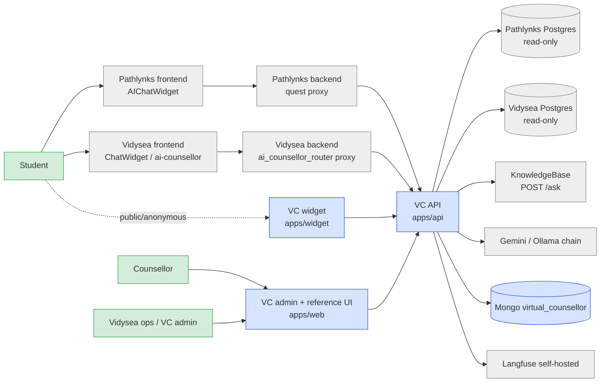

# VC High-Level Design

As of 2026-10-28 (D-122), on branch `codex/vc-completion`. This file describes the system as built. Decisions live
in `docs/DECISIONS.md`, hypotheses and open questions in `ARCHITECTURE.md`, the data model in the generated
`docs/schema.md`, and module internals in `docs/lld.md`.

## 0. One page (CEO)

**What it is.** The Vidysea Virtual Counsellor (VC) is one AI engine that helps a student think through study and
career choices. It follows **Explore → Conclude → Execute: the AI assists, the human decides.** It is never a script.

**Who uses it, and how far each surface is built:**

| Surface | What it does | Status |
|---|---|---|
| Student chat and voice inside **Pathlynks** and **Vidysea** | Answers from the student's real profile, shortlist and assessments; remembers confirmed preferences; keeps history | Code built and tests green locally. **Not yet run on real data** (credentials pending, D-122). Not deployed |
| VC Admin console | Partner sites, keys, data sources, encrypted credentials, admins, audit | Built and merged (10-27) |
| P1 Counsellor copilot: post-session scribe | Transcript → facts → summary → profile diff that the counsellor approves | Built (engine and API) |
| P1 live cards (Widen / Challenge / Compare / Evidence) | In-session prompts for the counsellor | Partial (T-010 split recovery) |
| P2 Application draft | Pre-fills an application; the student submits | Core built in a separate worktree, never checked (T-038) |
| P3 Avatar | Student-facing avatar | Not started |

**Current goal (D-122):** a local demo on real Pathlynks and Vidysea data. A test student logs in, chats, uses voice,
sees answers grounded in their own data, and gets memory and history across sessions.

## 1. System context

## 2. Containers

| Container | Path | Role |
|---|---|---|
| VC API | `apps/api` | Versioned HTTP API (`/v1/...`, OpenAPI at `/v1/openapi.json` and `/v1/partner/openapi.json`), voice WebSocket, admin API, partner keys, JWT verification, tenant stamping |
| Engine | `packages/engine` | LangGraph.js graphs: the **student chat graph** (tools, ranking, memory, crisis guard) and the **scribe graph** (P1). Guards: crisis/concern, no-script, citation, consent |
| DB layer | `packages/db` | The only path to Mongo `virtual_counsellor` (B12 guard), fence-aware writers, erasure and export, index plan |
| Schemas | `packages/schemas` | zod contracts at every boundary, redaction, source config |
| Providers | `packages/providers` | LLM seam: Gemini and the LiteLLM/Ollama chain, failover with 10 shared attempts, cost cap |
| Observability | `packages/observability` | Langfuse callbacks (self-hosted, telemetry off) |
| Platform port | `mcp/pathlynks` | Read-only SQL ports for Pathlynks **and** Vidysea Postgres (privilege check, read-only transaction, row caps) |
| KB / profile tools | `mcp/university-kb`, `mcp/student-profile` | University knowledge and student profile tools |
| Web | `apps/web` | Admin console (sites, keys, sources, admins, audit) plus a localhost reference UI |
| Widget | `apps/widget` | Embeddable chat and voice widget (key mode or proxy mode) |
| Skills | `skills/` | Prompts and soft rules as `SKILL.md` |

## 3. Main data flows

1. **Student chat turn (platform):** platform frontend → platform backend proxy (holds `VC_PARTNER_SERVER_KEY`, sends
   the student's platform user id) → `POST /v1/students/{id}/chat/threads/{tid}/turns` → crisis guard → student graph
   (tools read the platform DB for that user only; KB for university facts) → LLM → cited answer. The turn is then
   leased, staged and published (CAS) into `chat_turns`. Proposed memory facts go to `profile_facts` as proposals
   until the student confirms them.
2. **Voice:** `POST .../voice/sessions` → WebSocket → `VC_VOICE_MODEL` (Gemini Live), using the same memory and
   crisis rules.
3. **Counsellor scribe (P1):** transcript → facts and summary → profile diff → counsellor approval (`interrupt`) →
   `facts` and `decisions`.
4. **Erasure (DPDP):** request → counsellor double-confirmation → approver → fence → purge of every student
   collection → read-back zero. Export: `GET /v1/students/{id}/export`.
5. **Outbound:** signed webhooks through a durable outbox (fact-approved, erasure-requested, concern-flag).

## 4. Trust and data boundaries

- **Writes:** only Mongo `virtual_counsellor` (D-008/D-009). Every student-data write goes through a fence-aware
  module (guard test `packages/db/tests/db-scope.test.ts`).
- **Reads of real platform data:** Pathlynks and Vidysea Postgres, **read-only** (D-122). The port enforces
  SELECT-only SQL, `default_transaction_read_only=on`, a 5 s statement timeout and owner-bound queries
  (`u.id = $1`), and it refuses privileged roles unless `PATHLYNKS_ALLOW_PRIVILEGED_ROLE=1`.
- **LLM:** real student data may go to Gemini and the Ollama chain (D-122, an Approver-accepted risk for the local
  demo). Tracing stays self-hosted.
- **Identity:** the platform proves who the student is. VC verifies client-issued JWTs or partner server keys and
  stamps the tenant on every read and write.
- **Minors:** Pathlynks users are minors. Consent and guardian rules are in the data model; the DPDP legal review
  (Q3) is still open.

## 5. Runtime and deployment

Local demo first (D-122). Run the VC API with `MONGODB_URL`, the LLM keys, the platform DB credentials (env or the
encrypted admin store, keyed by `VC_ADMIN_MASTER_KEY`), and `VC_KB_BASE_URL`/`VC_KB_API_KEY`. Deployment notes are
in `infra/ubuntu/README.md` and `docs/runbook-golive.md`. Nothing is deployed yet.

## 6. Known gaps (2026-10-28)

- Never run against real data. Missing: `PATHLYNKS_DB_PASSWORD`, `VIDYSEA_DB_PASSWORD`, a real Vidysea read-only
  role (config still says `UNPROVISIONED_READONLY_ROLE`), KB URL and key, `VC_VOICE_MODEL`.
- The `partners` collection is used by a raw name, outside `COLLECTION_NAMES` (see `docs/schema.md`).
- Production `virtual_counsellor` has only 3 collections; the system has never run against it.
- `ARCHITECTURE.md` H3 still lists 8 collections. Updating it to point at `docs/schema.md` is authorized by D-122 for
  the next `/landplane`.
