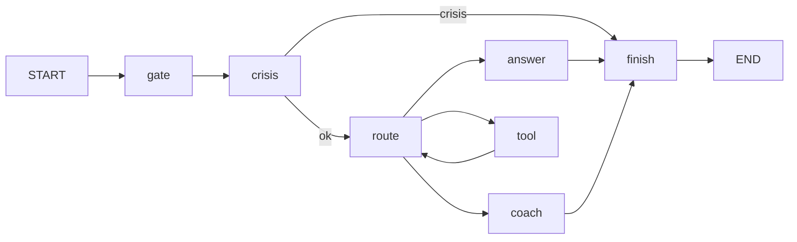

# VC Low-Level Design

As of 2026-10-28 (D-122), on branch `codex/vc-completion`. Context: `docs/hld.md`. Data model: `docs/schema.md`,
generated by `pnpm tsx scripts/gen-schema-doc.ts` (`--check` fails when the doc is stale). Partner wiring:
`docs/partner-integration.md`. Every decision cited here lives in `docs/DECISIONS.md`.

## 1. Module map: where each thing lives and what must not go there

| Module | Responsibility | Entry / key exports | Must NOT contain |
|---|---|---|---|
| `apps/api/src/main.ts`, `server.ts` | Process entry, HTTP server, route mounting | `main()` | Business logic |
| `apps/api/src/index.ts` | Composition root: builds the Mongo client, LLM chain, ports (`createLiveVidyseaPort`, Pathlynks port), KB client | wiring factories | SQL, prompts |
| `apps/api/src/auth.ts` | JWT verification, partner server keys → `{tenantId, studentId, role}` | auth middleware | Token minting for platforms (the platforms mint their own) |
| `apps/api/src/chat.ts` | Student chat routes: threads, turns, profile facts, decisions | `/v1/students/{id}/chat/*` | Direct `db.collection()` writes to student data (use `@vc/db` writers) |
| `apps/api/src/voice.ts` | Voice session issue and WebSocket bridge to the voice model | `.../voice/sessions` | Text-turn logic (it reuses chat) |
| `apps/api/src/anonymous.ts` | Public, persistence-free widget turns | `/v1/public/chat/turns` | Any write of the conversation (zero-persistence test) |
| `apps/api/src/partners.ts` | Partner sites, server keys, rotation; invalidates pending publications on change | `createMongoPartnerStore` | Raw `chat_turns` loops (use `invalidatePendingPublications`) |
| `apps/api/src/admin-routes.ts`, `admin-auth.ts`, `admin-cli.ts` | Admin console API: sites, sources, encrypted credentials, admins, audit, sync | `/v1/admin/*` | Plain-text secrets (use `packages/db/src/secrets.ts`) |
| `apps/api/src/openapi.ts` | Student and partner OpenAPI documents | `/v1/openapi.json`, `/v1/partner/openapi.json` | Undocumented routes (tests compare the route list) |
| `apps/api/src/go-live-gate.ts` | Refuses production start without the required env and gates | — | — |
| `packages/engine/src/student/` | Student chat graph: `graph.ts` (nodes below), `classify.ts`, `rank.ts`/`rank-weights.ts` (programme ranking), `claims.ts` (citation claims), `lang.ts` (reply language) | `buildStudentGraph` | Platform SQL (tools call ports) |
| `packages/engine/src/scribe/` | P1 post-session scribe graph with the checkpointer | `buildScribeGraph` | Auto-writing facts without approval |
| `packages/engine/src/cards/` | P1 live cards graph with verifier and relevance | `buildLiveCardsGraph` | Scripted answers (no-script guard) |
| `packages/engine/src/guards/` | Crisis, escalation, concern classifier, no-script, no-quote, citation, hard rules | guard functions | LLM calls on the crisis path before the deterministic check |
| `packages/engine/src/webhooks/` | Outbox, signing, delivery, KB gap reports | `enqueue`, `deliver` | Synchronous delivery inside a request |
| `packages/engine/src/ingest/` | GitHub ingest of skills and migrations | — | — |
| `packages/db/src/` | The only Mongo path. `client.ts` (B12 DB-name guard), `collections.ts` (names), `chat-threads.ts`, `profile-facts.ts`, `facts.ts`, `decisions.ts`, `edges.ts`, `consent.ts`, `erasure.ts` (purge + export), `admin-store.ts`, `secrets.ts`, `student-logs.ts`, `tenant.ts` | `COLLECTION_NAMES`, writers | Writes to any DB other than `virtual_counsellor`; unfenced student-data writes (`tests/db-scope.test.ts`) |
| `packages/schemas/src/` | zod contracts at every boundary, redaction | schemas | Runtime I/O |
| `packages/providers/src/` | LLM chain (Gemini / Ollama / LiteLLM), retry budget, deadline, monthly cost cap | `createChain` | Prompt text |
| `packages/observability` | Langfuse callbacks | — | Cloud telemetry |
| `mcp/pathlynks/src/port.ts` | Read-only SQL for **Pathlynks and Vidysea** Postgres: owner-bound (`u.id = $1`), `ROW_CAP` 50 (`LIMIT 51` to detect overflow), privileged-role refusal | `createPathlynksPort`, Vidysea port | Any non-SELECT statement |
| `mcp/pathlynks/src/connect.ts` | pg pool with TLS CA, `default_transaction_read_only`, statement timeout | `connect` | — |
| `mcp/university-kb/src/` | KB client (`POST /ask`), source kinds | `kb_sources`, `kb_source_detail`, `kb_gaps` | Local university data |
| `mcp/student-profile/src/` | Profile tools | `profile_view`, `profile_confirm`, `profile_correct` | Writes that bypass the student's confirmation |
| `apps/web` | Admin console (Next.js) and localhost reference UI | `/admin/*` | Direct DB access |
| `apps/widget` | Embeddable widget: chat and voice, key mode or proxy mode | `vc-widget.js`, `voice.js` | Partner server keys in the browser |
| `skills/` | `SKILL.md` prompts and soft rules | — | Code |

## 2. Student graph

Nodes are from `packages/engine/src/student/graph.ts` (~line 800):



- `gate`: consent and tenant checks, plus budget.
- `crisis`: deterministic crisis and escalation guard. A crisis exits with a safe reply and raises a concern flag.
- `route`: picks the next step: a direct answer, coaching (explore/conclude prompts), or a tool call.
- `tool`: the student-scoped tools:
  - Pathlynks: `pathlynks_profile`, `pathlynks_saved_careers`, `pathlynks_compare`, `pathlynks_assessment`
  - Vidysea: `vidysea_profile`, `vidysea_shortlisted_programmes`, `vidysea_profile_assessment`
  - KB: `kb_sources`, `kb_source_detail`, `kb_gaps`
  - Profile: `profile_view`, `profile_confirm`, `profile_correct`
- `finish`: citation check, then the reply language, then output.

Scribe graph: `consent → crisis → extract → summary → diff → approval (interrupt) → write`.
Live cards graph: `consent → crisis → profile → knowledge → planner → verifier → select`.

## 3. Sequences

### 3.1 Chat turn through a platform proxy

```mermaid
sequenceDiagram
  participant W as Platform widget
  participant P as Platform backend (proxy)
  participant A as VC API (chat.ts)
  participant G as Student graph
  participant D as Platform Postgres (RO)
  participant K as KB /ask
  participant L as LLM chain
  participant M as Mongo virtual_counsellor
  W->>P: message (platform session)
  P->>A: POST /v1/students/{uid}/chat/threads/{tid}/turns<br/>VC_PARTNER_SERVER_KEY
  A->>A: auth → tenantId, studentId
  A->>M: lease user turn (publication: pending)
  A->>G: invoke(thread history, memory)
  G->>D: SELECT ... WHERE u.id = $1 (read-only tx)
  G->>K: POST /ask
  G->>L: generate (failover, cost cap)
  G-->>A: reply + citations + proposed facts
  A->>M: stage → CAS publish turn; profile_facts proposals
  A-->>P: reply
  P-->>W: reply
```

### 3.2 Voice turn
Widget → `POST .../threads/{tid}/voice/sessions` (signed with `VC_VOICE_WS_SECRET`) → WebSocket at
`VC_VOICE_WS_BASE_URL` → `VC_VOICE_MODEL`. A crisis is text only, the same as chat (D-137): model audio is
muted at once and the widget shows the crisis message and helpline; no crisis audio file or hash is read. The transcript is written into the same thread history.

### 3.3 Crisis escalation
`crisis` guard (deterministic first, then the concern classifier at `VC_CONCERN_SAMPLE_RATES`) → safe reply →
`student_flags` concern record → outbox `concern-flag` webhook → the partner's counsellor.

### 3.4 Scribe → approval
`POST .../sessions/{sid}/scribe` → graph runs to `approval` and interrupts (checkpointer) → counsellor
`POST .../approval` → `scribe/resume` → `write` (facts, decisions, edges) → outbox `fact-approved`.

### 3.5 Erasure
`POST /v1/students/{id}/erasure-requests` → `/confirm` → `/reconfirm` → `/approve` (or `/reject`) → `/execute`:
fence the student (writers refuse), purge every student collection, read back zero, then audit. Export:
`GET /v1/students/{id}/export` returns monthly usage only; the `memory:<studentId>` revision marker in
`student_usage` is excluded.

### 3.6 Webhook outbox
Writer enqueues in the same unit of work → the delivery worker signs (HMAC) → POST to `VC_WEBHOOK_DESTINATION_URL`
→ retry with backoff → dead-letter.

## 4. API surface

The source of truth is `apps/api/src/openapi.ts`. Student routes under `/v1/students/{studentId}`:

- `chat/profile`, `chat/profile/facts/{factId}/decision`
- `chat/threads`, `chat/threads/{threadId}`, `chat/threads/{threadId}/turns`, `chat/threads/{threadId}/voice/sessions`
- `profile`, `pre-brief`, `export`, `erasure-requests`
- `sessions/{sessionId}/{approval, cards, cards/feedback, scribe, scribe/resume, transcript}`

Erasure workflow: `/v1/erasure-requests/{requestId}/{approve, confirm, execute, reconfirm, reject}`.
Public: `/v1/public/chat/turns`. Admin: `/v1/admin/*` (see `admin-routes.ts`).

## 5. Configuration

| Group | Variables |
|---|---|
| Core | `MONGODB_URL`, `VC_API_PORT`, `VC_ADMIN_MASTER_KEY`, `VC_ADMIN_JWT_SECRET` |
| Platform DBs | `PATHLYNKS_DB_PASSWORD`, `VIDYSEA_DB_PASSWORD` (refs in `config/sources.json` or the admin store), `PATHLYNKS_DB_CA_FILE`, `VIDYSEA_DB_CA_FILE`, `PATHLYNKS_ALLOW_PRIVILEGED_ROLE`, `VC_PATHLYNKS_TIMEOUT_MS` |
| KB | `VC_KB_BASE_URL`, `VC_KB_API_KEY`, `VC_KB_ANON_API_KEY` |
| LLM | `GEMINI_API_KEY`, `OLLAMA_API_KEY`, `OLLAMA_BASE_URL`, `VC_TEXT_CHAIN`, `VC_LLM_*`, `VC_CHAIN_MONTHLY_CAP_USD`, `VC_REPLY_LANGS` |
| Grounding and concern | `VC_GROUNDING*`, `VC_CONCERN_*` |
| Voice | `VC_VOICE_MODEL`, `VC_VOICE_WS_SECRET`, `VC_VOICE_WS_BASE_URL` |
| Tracing | `LANGFUSE_BASE_URL`/`LANGFUSE_HOST`, `LANGFUSE_PUBLIC_KEY`, `LANGFUSE_SECRET_KEY` |
| Outbound | `VC_WEBHOOK_DESTINATION_URL` |

## 6. Host-platform changes (outside this repo, uncommitted Codex work)

- **Vidysea backend** (`vidysea-main-service-backend`, `codex/vc-integration`):
  `app/api/v1/student/ai_counsellor_router.py` proxies to VC behind `VC_STUDENT_CENTRAL_ENABLED`, using
  `VC_PARTNER_SERVER_KEY` and `VC_BASE_URL`.
- **Vidysea frontend:** `ChatWidget.tsx`, the `ai-counsellor` page, `next.config.mjs`.
- **Pathlynks backend** (`vidyaksh-backend`): `pathlynks_quest_controller.js` VC proxy.
- **Pathlynks frontend:** `AIChatWidget.jsx`, `pathlynksQuestService.js`.
