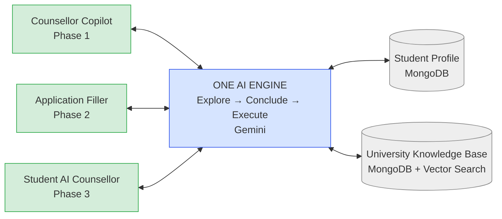
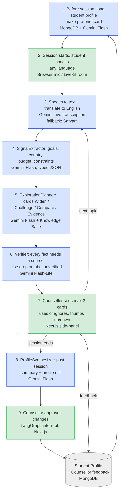
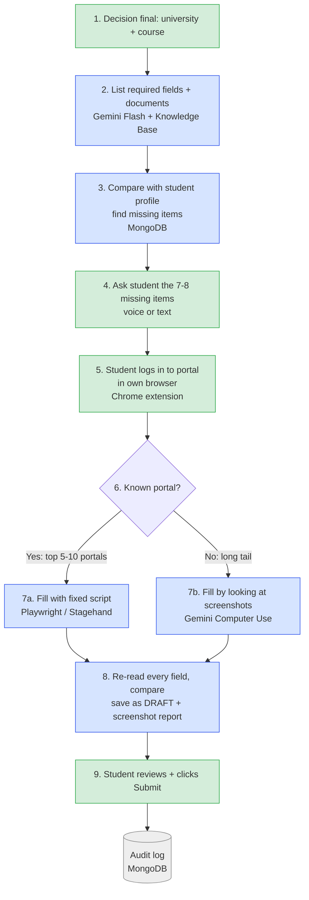

# Vidysea AI Counselling Engine — Plan

**Audience guide:** CEO reads §1, §2, §7. Team reads §2–6. AI coding tool reads §3, §4, §5 (plus the
Mermaid blocks and JSON I/O shapes inline).

---

## 1. Why

North star: **Explore → Conclude → Execute. AI assists, the human decides.** One AI engine turns every
counselling conversation into a structured, cited, longitudinal Student Knowledge Graph, and uses it to
help the counsellor widen and challenge the student's thinking until a decision is reached, then
pre-fills the resulting application for the student to submit. It is not a script — cards carry
questions, comparisons and evidence, never sentences for the counsellor to recite, so this is not a
cheating platform. The bar is decision quality, not just speed: research on 5,179 support agents found
an AI assistant raised issues resolved per hour by 14% on average and by 34% for novice and low-skilled
workers, while the most experienced performers saw small drops in quality when over-assisted — exactly
the profile we want, lifting less-experienced counsellors while giving seniors a "quiet mode." The
moat is not the AI model (any vendor can rent one) — it is the longitudinal student model built up over
years of sessions, plus the counsellor judgement captured and reused through the feedback loop.

---

## 2. Big picture

One engine, three surfaces, phased rollout: Counsellor Copilot (Phase 1) ships first because it is
safest and builds the student model; Application Filler (Phase 2) drafts only, the student always
submits; Student AI Counsellor (Phase 3) comes last, once the engine is proven with a human in the
loop.

One-line message: the engine is one system; only the screen changes. Counsellor screen first (safe),
then application filling, then a student-facing screen.

---

## 3. Phase 1 step-by-step (counsellor session)

Numbered steps:
1. Before the session, the engine loads the student's existing profile and builds a pre-brief card
   (what we already know, what not to re-ask).
2. The session starts; the student speaks in any language, online (LiveKit room) or in person
   (counsellor laptop mic).
3. Speech is transcribed and translated to English; the original-language transcript is kept alongside.
4. SignalExtractor pulls facts (goals, target country, budget, constraints) into typed JSON.
5. ExplorationPlanner turns facts into cards: Widen, Challenge, Clarify, Compare, Evidence — questions
   and comparisons, never scripted sentences.
6. Verifier checks every card has a cited source; uncited cards are dropped or labelled `unverified`.
7. The counsellor sees at most 3 cards at a time in the side-panel, uses or ignores them, and gives
   one-tap feedback; this loops back to step 3 for the next topic.
8. When the session ends, ProfileSynthesizer writes a summary and a proposed profile diff.
9. The counsellor approves the diff (a LangGraph `interrupt()` gate) before anything is written to the
   Student Profile.

**Module I/O (input → output, JSON shape):**
- **Pre-brief (step 1):** `StudentProfile` (Mongo doc) → `PreBriefCard {knownFacts: Fact[], openQuestions: string[], doNotAsk: string[]}`
- **Session start / audio capture (step 2):** `{sessionId, studentId, consentId, mode: "online"|"in-person"}` → `AudioChunk {sessionId, seq, pcm16k, ts}` stream (LiveKit room or laptop mic); no processing without a recorded `consentId`
- **Transcription (step 3):** `AudioChunk` (stream) → `TranscriptTurn {text, lang, translatedText, ts, speaker}`
- **SignalExtractor (step 4):** `TranscriptTurn[]` → `Fact[] {key, value, source:{type:"transcript", quote, turnId}, confidence, validFrom, purposeTags, sensitivity}`
- **ExplorationPlanner / card generator (step 5):** `Fact[] + KBQuery` → `Card[] {type: "widen"|"challenge"|"clarify"|"compare"|"evidence", prompt, sources:[{type, id, quote}], confidence}`
- **Verifier (step 6):** `Card[]` → `Card[]` (uncited cards removed) `+ droppedCount`
- **Side-panel feedback (step 7):** `Card + CounsellorAction {vote: "up"|"down", note?}` → `FeedbackEvent {cardId, action, ts}`
- **ProfileSynthesizer / post-session summary (step 8):** `Session (facts + transcript)` → `{summary: string, profileDiff: FactChange[], citedFactIds: string[]}`
- **Counsellor approval (step 9):** `profileDiff` + `CounsellorDecision {approve: bool, edits?}` → committed `Fact[]` in MongoDB (no write before approval)

---

## 4. Phase 2 step-by-step (application filling)

**Stop rule:** the agent stops at login, 2FA, CAPTCHA, payment and the declaration. The student always
does these steps themselves.

Numbered steps:
1. The decision is final — university and course chosen in Phase 1.
2. The requirements builder reads the portal and course to produce a field map and document list.
3. The engine compares the required fields against the Student Profile and finds gaps.
4. The student is asked only the 7–8 missing items, by voice or text, in any language.
5. The student logs in to the portal themselves, in their own browser (Chrome extension), so
   credentials and 2FA never touch Vidysea's servers.
6. The engine checks whether this is a known top-volume portal.
7. Known portals use a deterministic Playwright/Stagehand script (7a); long-tail portals use Gemini
   Computer Use, which looks at screenshots and acts (7b).
8. Every filled field is re-read from the page and diffed against the packet; the result is saved as a
   DRAFT with a field-by-field screenshot report, never submitted.
9. The student reviews the draft and clicks Submit themselves; the action is written to the audit log.

**Module I/O (input → output, JSON shape):**
- **Decision final (step 1):** approved Phase 1 `Decision {studentId, universityId, courseId, rationale, alternativesConsidered[]}` → `{portalId, courseId}` (starts Phase 2)
- **Requirements builder (step 2):** `{portalId, courseId}` → `RequirementSpec {fields: FieldSpec[], documents: DocSpec[]}`
- **Gap check (step 3):** `RequirementSpec + StudentProfile` → `GapList {missingFields: string[]}`
- **Gap questions (step 4):** `GapList` → `AnswerSet {field, value, source:"student-direct"}[]`
- **Application Packet (assembly):** `StudentProfile + AnswerSet + documents` → `ApplicationPacket {fields: {}, documents: [], lang:"en"}`
- **Student login (step 5):** `ApplicationPacket` + student's own browser session (extension) → `PortalSession {portalId, tabId, loggedIn: bool}`; credentials and 2FA never leave the student's browser
- **Portal router (step 6):** `PortalSession {portalId}` + `KnownPortalRegistry` → `{route: "scripted"|"computer-use", scriptId?}`
- **Portal fill, scripted (7a):** `ApplicationPacket + portal script` → `FillResult {filledFields, failedFields, screenshots[]}`
- **Portal fill, Computer Use (7b):** `ApplicationPacket + screenshot loop` → `FillResult {filledFields, failedFields, screenshots[], actionsLog[]}`
- **Verification (step 8):** `FillResult + live DOM read` → `DraftReport {field, expected, actual, match: bool}[]` saved as `status:"draft"`
- **Submit (step 9):** `DraftReport + StudentAction {submit: bool}` → `AuditEvent {who:"student", ts, portalId, result}` in the Audit log

---

## 5. Tech map

| Step | Job | Technology | Why |
|---|---|---|---|
| Voice input | Student's voice | Browser mic / LiveKit | Works online and in-person; the same room later serves Phase 3 |
| Speech to text | Any language to English | Gemini Live transcription (fallback: Sarvam) | Already the chosen stack, covers 70+ languages |
| Reasoning | Extract facts, build cards | Gemini Flash (structured JSON) | Cheap and fast |
| Fact check | Drop any fact without a source | Gemini Flash-Lite | Cheapest tier, runs on every card |
| Memory | Student profile, feedback, audit | MongoDB Atlas | Already in the stack |
| University data | Courses, fees, deadlines | MongoDB Atlas Vector Search | Facts come from here, not model memory |
| UI | Counsellor side-panel | Next.js | Same stack as the Ikigai prototype |
| Backend | Orchestrator (Explore → Conclude → Execute) | **LangGraph.js 1.x** (see note below) | Typed StateGraph with a Mongo checkpointer and `interrupt()` for counsellor approval |
| Form filling | Known portals | Playwright + Stagehand | Reliable, open source (MIT/Apache) |
| Form filling | Unknown portals | Gemini Computer Use | Reads screenshots and acts when there is no script |
| Avatar (Phase 3) | Face | Simli / HeyGen LiveAvatar (rent) | Building it is expensive; Resso's quote was also expensive |
| Workflow graph | Wires the engine's nodes together | LangGraph.js 1.x, thin `StateGraph`, Mongo checkpointer | Checkpointing and `interrupt()` give counsellor-approval for free (D-002); the graph holds wiring only, logic stays in functions |
| Agents | SignalExtractor, ExplorationPlanner, FitScorer, Verifier, ProfileSynthesizer | Typed Zod nodes inside the graph | Not a free multi-agent swarm — each node has a typed input/output boundary (D-002) |
| Skills | Prompts and soft rules | `skills/<name>/SKILL.md`, loaded on demand | Keeps prompts portable and swappable across model providers (D-005) |
| Tools | External capabilities the graph calls | MCP servers: student-profile, university-kb, session-store, portal-filler (P2) | Standard tool boundary, model-agnostic (D-005) |
| Hard rules | Rules that must never be skipped | Deterministic code guards before any LLM call: no-script, citation-required, crisis, consent | Rules that matter for safety/compliance cannot depend on a prompt being followed (D-005) |
| Knowledge graph | Student Knowledge Graph | Mongo-native: typed collections + an `edges` collection, vector search over summaries/courses | Structured facts plus vectors are enough at this data size; no Neo4j/GraphRAG in V1 (D-003) |
| Observability | Trace every graph run | Langfuse, self-hosted, `TELEMETRY_ENABLED=false` | Traces carry student transcripts, so a hosted tracer would be an external service under the data-boundary rule (D-004) |

**Note on the orchestrator row:** goal.md's original plan and the compass report both specify a plain
Node/TypeScript state machine to keep abstraction cost low for one developer. D-002 overrides this: the
orchestrator is **LangGraph.js 1.x** instead, because it matches the Vidysea agentic-architecture
standard and gives Mongo-backed checkpointing plus `interrupt()` for the counsellor-approval step for
free, while the graph is kept thin (wiring only) to preserve the compass's "fewer abstractions" concern.

**Reuse, don't rebuild** (from ARCHITECTURE.md H6 / D-001 — read-only, never written):

| Sibling repo | Piece reused |
|---|---|
| `D:/vidysea/ikigai-counsellor` | LangGraph template, prompts/rules, crisis-guard, student-memory, grader |
| `D:/ikigai_counsellor` | Gemini Live proxy |
| `D:/KnowledgeBase` | Provider seam, Gemini diarised STT, tenantScope, citation model, recall@k eval |
| `D:/counsellor_validation_judge` | Contradiction detection, mirror-student evidence |
| `D:/sop_mvp` | ContextObject profile, ApplicationConstraints |
| `D:/VirtualCounsellor_Avatar` | Phase 3 avatar |

Nothing described above is built yet in `D:/vc` — this section names what will be ported in, not what
exists today.

---

## 6. Milestones and success metrics

Roadmap timing (compass §6, indicative, one developer with AI coding tools):
- **Phase 0 — Foundations:** Student Knowledge Model + consent schema (2 weeks); University KB v0,
  top 150 universities/courses (3 weeks).
- **Phase 1 — Copilot, ~10–12 weeks total.** Start with the post-session scribe, not live cards — it
  is the lowest-risk, highest-ROI feature and it builds the student model and eval data live cards will
  need. Then live transcription + signal extraction (2 weeks), cards (explore/challenge/compare +
  visuals, 3 weeks), then an eval set + feedback loop + a 5-counsellor pilot (3 weeks).
- **Phase 2 — Execution.** Packet builder + gap questions (2 weeks), top-5 portal scripts draft-only +
  report (4 weeks), Computer Use long-tail + extension (4 weeks).
- **Phase 3 — Student surface.** Voice counsellor, Gemini Live, guardrailed (4 weeks); avatar
  integration + parent view (3 weeks).

**Exit gates (verbatim from the compass §6):**
- **P1 exit:** ≥40% card acceptance; zero uncited facts shown in 50 audited sessions; counsellors rate
  ≥4/5; post-session notes approved with light edits ≥80%.
- **P2 exit:** ≥90% field accuracy on draft fills across the top 5 portals; 0 unintended submissions;
  logged parental/student authorisation per application.
- **P3 exit:** red-team pass on distress, manipulation and prompt injection; human escalation working
  within minutes; ≥100 shadow-mode sessions (AI runs silently next to a counsellor) with acceptable
  agreement.

---

## 7. Risks and FAQ

**"Isn't this just a cheating platform?"**
No. Cards contain only questions, comparisons and evidence — never ready-made sentences for the
counsellor to recite. At most 3 cards are visible at once. A senior counsellor can switch on "quiet
mode" and get only the post-session summary.

**"What if the AI states a wrong fact?"**
Every fact must be sourced from the Knowledge Base or the student profile. The Verifier drops any card
that lacks a source. Nothing is written to the student profile without the counsellor's explicit
approval.

**"Will the application really be done in 15 minutes?"**
The data-entry portion, yes, when the profile already holds the answers. SOP, references, transcripts
and fee payment are not included. The honest promise is: "In 15 minutes we pre-fill everything we
already know, and hand you a checklist for the rest."

**"Why doesn't the AI just click Submit?"**
The student must read the declaration themselves — UCAS explicitly requires the applicant to have
"sufficient time to read, understand and accept the applicant declaration." Many portals prohibit
automated submission outright, and a wrong submission cannot be undone. So the agent always stops
before login, 2FA, CAPTCHA, payment and the declaration.

**"Why no avatar yet?"**
The engine has to be proven safe alongside a human counsellor first. Avatars are a rented commodity
(roughly $0.01–0.10 per minute) — Resso's quote for a custom build was far more expensive and it still
isn't the moat. The moat is the student's longitudinal profile and the counsellors' accumulated
judgement.

**"What does this cost to run?"**
A 45-minute counsellor session costs roughly $1.0–1.5 today, rising to about $2–2.5 after Gemini
Flash's rate doubles on 1 January 2027. At 1,000 sessions plus 300 application drafts a month, that is
roughly $1.8–3k per month. Caching and routing more calls to Flash-Lite will bring this down later.

**"How much time for one developer?"**
Phase 1 is about 10–12 weeks. It starts with the post-session summary feature because that is the
safest piece to ship and it is also what builds the student data the later, live-card features depend
on.

**"What about Hindi and regional languages?"**
The outer layer speaks to the student in their own language. Internally, everything is processed in
English. The original-language transcript is kept alongside the English version, so nothing is lost.

**"What if Gemini goes down or gets expensive?"**
Speech-to-text, text-to-speech and the LLM all sit behind one interface, so switching providers is a
configuration change, not a rewrite. Sarvam is the Indic-language fallback.

**"What's the legal risk with minors' data?"**
India's DPDP Act requires verifiable parental consent for under-18 users; child-data obligations become
enforceable on 13 May 2027. Consent and purpose-tagging are built into the data model from day one, and
a legal review is still required before any real Pathlynks data is joined (see Q3 in
ARCHITECTURE.md — this is not yet resolved).

**"How will we know it's actually working?"**
Phase 1 is judged passed only when: at least 40% of cards get used by counsellors, zero uncited facts
appear across 50 audited sessions, counsellors rate the tool at least 4/5, and at least 80% of
post-session notes are approved with only light edits. Phase 2 and Phase 3 have their own gates (§6).

**Risk table (compass §9):**

| Risk | Severity | Mitigation |
|---|---|---|
| Counsellors ignore cards (noise, latency) | High | Fewer, slower, better cards; event-triggered; acceptance metrics; quiet mode |
| Wrong facts shown to counsellor | High | KB-only facts, citations, verifier pass, "unverified" labels |
| Application agent mis-fills or auto-submits | Very high | Draft-only, DOM re-read diff, student submits, audit log |
| Portal ToS/blocks, CAPTCHAs, 2FA | High | Student-side extension + student login; scripted top portals; accept ~50% autonomous success on the long tail |
| DPDP non-compliance with minors' data | Very high (fines up to ₹200 crore / ₹250 crore per instance, can stack) | Consent layer in Phase 0; legal review before Pathlynks data is joined |
| Solo-developer bus factor and scope creep | High | Strict phase gates; thin code; buy avatar, transport and STT |
| Price shocks (Flash doubling Jan 2027) | Medium | Budget at 2027 rates; caching; Flash-Lite routing |
| Student disengagement with a Socratic AI (Phase 3) | Medium | Balance questions with concrete answers and visuals (Khanmigo lesson) |

## Recovery execution appendix — 2026-09-30 (D-029)

The full Explore -> Conclude -> Execute goal remains active. Application drafting is in the first pilot, per the directly recorded Umesh decision. Pilot exceptions do not constitute full-goal completion. Existing work will be integrated with its original history and independently checked; no new product module is proposed in this unit.

### Next product unit: T-035 safety-data lifecycle (independent plan APPROVED, 2026-09-30)

**Outcome:** crisis notification/review records are tenant-scoped, discoverable in the student's export, fully erased with independent read-back-zero, and cannot be recreated by a delayed or replayed writer. Registration, export/erasure and fencing ship together; a registration-only or fencing-only slice leaves a known privacy hole.

**Existing files/functions to edit in place:**
- `packages/db/src/collections.ts:24` — `COLLECTION_NAMES`: register `escalation_notifications` and `crisis_flag_reviews`.
- `packages/db/scripts/db-init.ts:82` — `INDEX_PLAN`: tenant-leading student/session lookup indexes for both collections, without any other database access.
- `packages/db/src/erasure.ts:1417` — `ERASURE_PLAN`: phase-1 `byStudent` purge and independent residue checks; `StudentExport:1800` / `exportStudent:1840`: add projected `escalations` and `crisisReviews` arrays, empty for students without records.
- `packages/engine/src/guards/escalation.ts:203` — `notifyAll`, `escalateTurns:254`, `runReview:326`, `acknowledgeEscalation:397`: bounded writer precheck/postcheck and ownership-qualified compensation on every mutating path, using existing `WriterDeadline`, `assertStudentNotFenced` and `compensateIfFenced`.
- `packages/db/tests/db-init.test.ts` — verify both index definitions are tenant-led.
- `packages/db/tests/erasure.test.ts:100` / `:332` — extend existing fixtures and lifecycle/export outcomes.
- `packages/db/tests/db-scope.test.ts:194` / `:257` / `:285` — register both student-data names in the scanner and require actual fenced-writer coverage; no blanket exemption.
- `packages/engine/tests/crisis-escalation.test.ts:328` — replace the stale assertion that the collection is absent; add writer/replay/acknowledgement race coverage in the existing test file.
- `apps/api/src/openapi.ts:250` — describe the additive projected safety export and its staff/provider-field exclusions.

**Export interface:** `escalations` projects escalation/session/student/turn identifiers, guard level and matched flags, student-related severity/reason, existing channel/status, flagged/notified timestamps and nullable acknowledgement timestamp. `crisisReviews` projects session/student/turn identifiers, guard level/matched flags, flagged timestamp, and the classified severity/likelyBenign/rationale/time or the existing unavailable status/reason/time. Use the actual existing enum literals. Omit internal Mongo IDs, staff recipient/acknowledger identities, model/provider/error/debug fields, sampling fields and write-ownership tokens. Preserve one entry per stored notification in deterministic ID order; do not invent aggregation. Keep the export types in existing db code to avoid a db-to-engine dependency cycle.

**Writer protocol:** each bounded write phase observes the student's fence before and after mutation. Insert ownership is recorded atomically through an invocation token on insertion; ambiguous timeouts get a compensator when the operation eventually settles. Compensation may delete only that invocation's inserted records, never a pre-existing deterministic ID. Classifier and acknowledgement annotations use compare-and-set with ownership-qualified rollback; acknowledgement never compensates by deleting the underlying notification. Recheck the fence after classification before any new write, and do not hold one writer deadline across an arbitrarily long classifier run. Dispose deadlines in `finally`.

**Test-first sequence and acceptance:**
1. Establish red tests in the existing test files for both missing lifecycle collections, then implement the combined behavior.
2. Seed tenants A/B with identical student/session/turn IDs. A's export includes only A's projected safety information; A's completed erasure has zero independent full-scan residue; B's raw records remain byte-identical.
3. Hold each writer across fencing: initial review insertion, notification upsert, classifier annotation and acknowledgement. Releasing it cannot recreate erased data; a replay/timeout compensator preserves a previous invocation's legitimate records.
4. Exercise records with no session anchor, unavailable classifier, already-acknowledged notification and ambiguous Mongo outcomes. Assert raw database state and public export JSON, not only helper return values.
5. Independent isolated mutations remove either purge-plan entry, writer precheck or ownership qualification and must make the appropriate outcome assertion fail. The checker owns mutation evidence; no shared-tree mutation is permitted.
6. Run existing db and engine test entrypoints, repository typecheck and the contract validator. Run one post-integration full suite when this unit lands. Tests are offline with fake Mongo and synthetic data.

This unit does not establish actual notification delivery, the no-consent API path, or live Pathlynks integration. Those remain required follow-up units. D-027 still requires identifiers plus a crisis flag only without consent and zero classifier/KB/summary/profile processing in that exception.

### Remaining full-goal tracks

- Resolve and independently test live-card B1/B18 leaks; integrate only with an honest criterion mapping.
- Implement approved-fact/do-not-ask personalization, then complete destination relevance for the full goal.
- Wire safety recipient resolution and real delivery; prove the no-consent crisis exception end to end.
- Establish authenticated Pathlynks integration with real issuer/rotation and webhook-consumer evidence.
- Obtain Sapna ma'am's reference rubric, then measure novice + VC >=90% on matching cases.
- Specify the first application target, implement cited draft/review/checklist behavior, and prove the available-data entry timing and zero unintended submits.
- Build and verify student voice/avatar through the shared engine and the declared Hindi/voice personas.

No application target, expert reference, new source file, external connection, publication or production action is assumed approved by this appendix.
### Source reuse evidence (read-only audit, 2026-09-30)

These are source-inspection findings, not live/provider verification:
- `D:/sop_mvp/backend/app/models/context.py:58` has real ApplicationConstraints/ContextObject; `services/draft_service.py:41` and `services/sop_weaver_service.py:19` provide section/SOP generation. They are SOP context/prose components, not UCAS/Common App field schemas. Reuse approved-fact mapping and prompt flow through VC's provider interface; do not import sibling persistence. Prompt-only word limits and fallback concatenation need deterministic validation and honest labelling.
- `D:/VirtualCounsellor_Avatar/apps/agent/src/deepinterview_agent/worker.py:95/218/647` provides transcript capture, STT selection and LiveKit AgentSession assembly. It is interview-specific and its language map currently omits Hindi; unknown languages fall back to English. Transport may be reused, but counselling output must remain under VC's authenticated graph and guards.
- The avatar repo's `apps/web/components/interview/live-room.tsx:636` has connection/reconnect UI; `components/avatar/avatar-stage.tsx` renders idle/speaking states but video-loop URLs are placeholders/404 with gradient fallback. `components/counsellor/counsellor-avatar-preview.tsx:67` resolves stored GLB models. None is proof of an available live avatar service or media asset.
- `D:/ikigai_counsellor/server/geminiLiveService.ts:129/165` is a real server-side Gemini Live audio/text bridge. Its direct Gemini reply generation bypasses VC's graph/guards; do not reuse that reasoning path unchanged.

External dependencies remain unverified: real client identity and recipients, LiveKit/microphone and STT/TTS configuration, Hindi speech, avatar media/model availability, and the selected application form. No vendor service or real student data was contacted during this audit. The exact application-target question remains pending; SOP generation alone does not satisfy the fifteen-minute application-draft outcome.

### Independent T-035 preimplementation plan decision — 2026-09-30

**PLAN DECISION: APPROVE.** Reviewer: fresh independent quality/checker agent `t035_plan_gate`, bound to `D:/vc`. This approves implementation of the combined nine-existing-file safety-data lifecycle plan above. It is preimplementation approval only: no Mode A PASS, issue closure, live-delivery certification, release approval or full Explore -> Conclude -> Execute completion is granted.

**Evidence reviewed:** the complete user goal attachment, current ARCHITECTURE.md (H8/H9/H10 and cross-cutting boundaries), recent D-027/D-028/D-029 decisions, counselling contract B4/B8/B9/B12/B14/B15/B16/B21/B22, the recovery plan and existing source. `escalation.ts:247`, `:296`, `:344` and `:404` currently mutate safety records without the erasure writer protocol. `collections.ts:24` and `erasure.ts:1417/1840` omit these collections from registration, purge and export; the scanner's student-data list at `db-scope.test.ts:194` also omits them. These records carry studentId directly, so phase-1 byStudent selectors repair the session-anchor-free case. The plan addresses the privacy defect as one unit without disguising actual notification delivery or the consent exception as completed.

**Mandatory implementation/checker acceptance within this approval:**
- Preserve the plan's projected export, empty arrays, deterministic order, tenant isolation and raw-record preservation for the other tenant. Verify both new collections independently of ERASURE_PLAN using full raw collection scans, including records with no session anchor. Exercise purge/read-back failures and retain the existing double-confirmation, approver/default-autoDelete and 24-hour fence behavior.
- Cover all four mutation paths separately: initial review insertion, notification upsert, classifier annotation and acknowledgement. Construct deadlines immediately before each bounded precheck/write phase, pass operation timeouts, run a finally postcheck even on rejection, and dispose the deadline. `WriterDeadline.run` at erasure.ts:617 races a promise; it does not cancel the underlying operation. A timeout therefore needs an observed late-settlement compensator, with a test awaiting eventual raw-state stabilization. A postcheck read error must fail safe and undo this invocation's changes, as compensateIfFenced at :698 already specifies; compensation failure must remain visible.
- Insert ownership must be set atomically with $setOnInsert, not inferred from a possibly missing Mongo result. An upsert replay must never claim or delete an earlier invocation's legitimate record. Classifier/acknowledgement rollback must compare the invocation's mutation token and restore only its own prior annotation fields; it must never delete the notification, resurrect a purged row or overwrite a newer invocation. Include already-acknowledged and unavailable-classifier cases. Resolve acknowledgement's studentId from the tenant-scoped stored row before guarding its mutation; never trust an unrelated caller-supplied student identity.
- Keep the classifier outside the writer deadline and recheck the fence after it returns before starting any write. No raw transcript text may be added to notification/review records, export, logs or compensation tokens. This unit does not authorize no-consent classification; the D-027 follow-up must prove identifiers plus crisis flag only and zero classifier/KB/summary/profile processing without consent.
- Register the two names in the existing scanner and support any fence-aware allowlist entry with actual behavioral tests for every mutation path; no blanket safety exemption. Independently mutate isolated copies to remove each purge entry, a writer precheck and ownership qualification. Each mutation must reach and fail the appropriate raw-state outcome assertion. Do not mutate the shared working tree.
- Before a completion verdict, a new independent checker must rerun the db/engine tests, repository typecheck and contract validator, then the post-integration full suite. Preserve existing B9 immediate-before-classifier and B16 guard-visibility behavior. This plan review executes no product tests and certifies no implementation.

**Authority and separation:** verified the updated user-level rule in `C:/Users/Lenovo/.codex/AGENTS.md:59`: routine reversible multi-file goal work receives explicit fresh quality/checker approval before implementation, followed by a separate independent PASS/FAIL check. The maker cannot approve its own plan or certify completion. Approval is limited to the nine existing files already named; new files, contracts/enforcement edits, production operations, external sending/publishing, unresolved product scope and named HUMAN_GATEs retain their existing authorization requirements. No additional manual plan confirmation is required for this approved offline repair.
### T-035 measured baseline — 2026-09-30

An independent standalone fake-backed runtime probe (`node --import tsx --input-type=module`, exit 0), without session anchors, verified that student export omits safety records and approved erasure reports `completed` while `escalation_notifications=1` and `crisis_flag_reviews=1` remain for the erased tenant. A second tenant using identical student/session/turn IDs retained both records, with raw-document JSON serialization byte-identical before/after. Assertions verified these outcomes using the existing testing, tenant and erasure helpers. This proves the fake-backed baseline defect, not real-Mongo or live deployment behavior. At the time of this baseline probe, plan approval was pending; the subsequent independent t035_plan_gate APPROVE supersedes that historical blocker.

### Safety integration source trace — 2026-09-30

Current main `apps/api/src/server.ts:855` createTenantWiring compiles the scribe graph at lines 872-875 with db/provider/skillsDir only; no escalation dependency or recipient resolver is supplied. `packages/engine/src/scribe/graph.ts:626` escalateSessionFlags returns on refused consent at line 632, contrary to the D-027 identifiers-plus-crisis-flag exception. Its existing comment also treats safety records as exempt from fence compensation; this cannot satisfy student erasure. The unmerged live-card graph `.worktrees/t-010-live-cards/packages/engine/src/cards/graph.ts:84` routes refused consent directly to END before its crisis node. Finally, `packages/engine/src/guards/escalation.ts:234` persists channel `record_only`; a queued database record is not actual notification delivery. These are source-confirmed missing paths, not live-service measurements. Follow-up must preserve zero classifier/KB/summary/profile processing without consent while implementing the minimal crisis exception, authenticated recipient resolution and durable delivery. No source changes were made during this trace.

### Pathlynks report-backend integration audit — 2026-09-30

Read-only source audit of `D:/pathlynks-combined-report` found no VC connection in the searched Python/JS/TS/HTML source. `src/api/main.py:169-174` registers health/recommend/recommend_stream/pdf/status/users routers; `src/api/dependencies.py:51` uses encrypted X-Auth-Key, not an established VC JWT issuer. `src/api/routes/users.py:23` and `src/db/user_profile_manager.py:104` provide a user-id profile path but do not establish tenant mapping. This repo has not been verified as the actual production Pathlynks integration owner. VC `apps/api/src/index.ts:128/165` provides opt-in HTTP and destination-controlled emission wiring; `packages/engine/src/webhooks/delivery.ts:163` defines drainWebhookOutbox, but no running drain-worker call was identified. Signed header machinery exists at `packages/engine/src/webhooks/signing.ts:9-11`. Existing components do not prove a connected client, issuer, webhook consumer or running delivery process. Verify the actual client owner and tenant identity before implementing the cross-repo plan; do not connect via inferred credentials or map user_id to tenant silently.

### Next personalization unit: B18 source baseline — 2026-09-30

Current `packages/engine/src/scribe/schemas.ts:118` ExtractInputSchema contains only turns/sessionEndedAt and SummaryInputSchema:133 contains turns/facts. `nodes.ts:1124` extractFacts sends only turns to the provider; `nodes.ts:1165` summarizeSession sends turns and newly extracted facts, with a B1 script gate but no approved-history/do-not-ask suppression. Existing `packages/engine/tests/b18-suppression-outcome.test.ts` documents and measures those missing input channels; its known-gap assertions are baseline instrumentation, not implemented personalization. The graph must carry authoritative approved facts into these existing paths before the engine can suppress a repeated known question. Pending/rejected proposals must not become a permanent do-not-ask source; a genuine newly stated changed value must remain reviewable. The next unit needs an independent goal-aligned plan with actual input/projection/filter and end-to-end graph tests, preserving changed-value handling and factual historical summaries. No personalization code was changed by this source audit.

### Independent T-035 rationale/consent clarification — 2026-09-30

**PLAN DECISION: APPROVE WITH EXPLICIT CLARIFICATION.** The original nine-file lifecycle plan remains approved; this corrects my over-broad plan wording, not the critical contract. My preceding sentence, "No raw transcript text may be added to notification/review records, export, logs or compensation tokens," must be read with the following authoritative distinctions; no blanket transcript-free guarantee is certified for a consented classifier rationale.

**Source evidence:** `ConcernClassifierOutputSchema` in `packages/engine/src/guards/concern-classifier.ts:94-100` accepts any nonempty string of at most 500 characters as rationale. Its parse at :295 and classified return at :296 do not compare that string with the input turn. Current `escalation.ts:390-404` persists that annotation, and `erasure.ts:1899-1901` exports its rationale. A schema-valid rationale can therefore quote an actual turn; projection alone cannot make it transcript-free. One tiny synthetic schema probe was attempted but failed on shell quoting before module execution (exit 1), so this finding rests on inspected source, not claimed runtime proof.

**Authoritative requirements:** B4 says the no-consent escalation carries "identifiers and the flag only, never transcript text" and allows no other processing. D-027 repeats that exact exception. Those prohibitions apply to all fields in a no-consent record, including indirectly copied text in a rationale, not merely to fields named transcript. No-consent therefore must never call the classifier, persist a classified rationale, log the turn or construct a summary/profile/KB result. That end-to-end path remains a required follow-up and is not certified by this lifecycle unit. Conversely, B2 explicitly requires the consented full transcript to be persisted and exported, while B15 requires a per-student access bundle and full erasure. B16 allows classifier annotations and does not require removing consented explanatory text. None of these contracts imposes a universal ban on the student's own text in an authenticated consented access export.

**Bounded behavior and validation acceptance:**
- Keep the approved rationale field for consented classified reviews. Treat it as untrusted, potentially transcript-bearing student personal data, not a validated fact or safe boilerplate. It remains tenant-scoped and covered by the complete purge/read-back/fencing obligations. Notification payloads retain identifiers/flags/structured severity and reason only; do not add rationale or transcript payloads there, to logs, or to ownership/compensation metadata.
- Keep schema validation at the classifier boundary. An invalid shape, unknown severity, wrong likelyBenign type, extra field, empty rationale or rationale over 500 characters is rejected rather than persisted as classified; the existing unavailable/error path records no provider message or raw output. Verify this with synthetic offline provider outputs and raw stored/exported state. A schema-valid consented quotation is not falsely labelled as having passed a no-raw-text check; prove its exact rationale survives access export and is erased with the review.
- Preserve safety independently of rationale validity: crisis remains immediately critical before classifier execution; every guard flag remains visible; effective severity is never below its guard floor (concern moderate, crisis critical); invalid/unavailable review on a guard concern follows the existing fail-open escalation. A valid high/critical classifier outcome on a sampled unflagged turn must not be discarded merely because its explanation quotes the consented input.
- Preserve actual no-consent validation separately: when its follow-up is submitted, assert zero classifier calls and no rationale/transcript-bearing fields anywhere in raw records, export or captured logs, while the identifiers-plus-crisis-flag notification remains present. Consent must come from authoritative tenant-scoped state, never a model assertion.

This clarification changes no B4/B15/B16 threshold, contract, model schema, source file, production behavior or full-goal scope. It does not approve blanket omission of rationale, a semantic sanitizer claim, or a consent bypass. A stronger policy forbidding all free-form personal text even in consented safety reviews would need its own explicit product/contract decision; it is not inferred here. Maker/checker separation, independent completion verification and all existing human gates remain in force.

### B18 approved-history implementation plan — DRAFT, awaiting independent plan approval

Goal mapping: make the existing scribe consume authoritative cross-session student history and prevent already-known-as-unknown requests without hiding legitimate changed values or historical session evidence. This is a necessary part of the full B18 obligation; destination relevance, live-card integration and a durable do-not-ask list remain required and cannot be credited by history plumbing alone.

Confirmed source: packages/db/src/facts.ts:984 readActiveProfile(db, studentId, SCRIBE_PURPOSE) supplies consent-gated, active, purpose-scoped persisted facts. Persistence through applyApprovedDiff is approval authority; needsReview:true is not proof a persisted fact is unapproved. Existing scribe proposeDiff at nodes.ts:1204 currently reads active facts without purpose filtering. PreBriefCardSchema at packages/schemas/src/schemas.ts:143 has doNotAsk, but no inspected DB/API/scribe source owns or persists that list. Pending/rejected proposals and caller/model/fixture prebrief assertions are not authoritative history.

Existing-file/function targets, to be refined before approval:
- packages/engine/src/scribe/graph.ts ScribeState:86 and buildScribeGraph:109 — load validated authoritative history on the continuing consent/crisis-approved path before extraction; propagate the same snapshot to extraction and summary. No public caller authority in ScribeInputSchema.
- packages/engine/src/scribe/schemas.ts ExtractInputSchema:118 and SummaryInputSchema:133 — typed projected approved context with durable identity/provenance, separate from current extracted facts; validate persisted facts before projection.
- packages/engine/src/scribe/nodes.ts extractFacts:1124, summarizeSession:1165 and proposeDiff:1204 — consume context, preserve current quote/review checks and genuine changes, use the same consent/purpose-scoped comparison, and enforce known-as-unknown suppression while keeping factual summaries. A prompt, captured payload or provider-authored semantic label alone does not establish that last outcome. The concrete bounded semantic verification design and existing provider compatibility must be specified before approval; a generic lexical blacklist is not accepted as full semantic proof.
- Existing skills/fact-extraction/SKILL.md and skills/session-summary/SKILL.md — document approved context and changed-value/historical evidence boundaries in place.
- Existing tests b18-suppression-outcome.test.ts, scribe.test.ts, scribe-persistence.test.ts, scribe-checkpointer.test.ts and scribe-per-fact.test.ts — independently derived graph-to-interrupt/raw-readback cases, not a parallel test module. Only genuinely repaired known-gap rows move to contract expectations; unresolved quarantined policy rows remain explicit.

Required acceptance: approved score across a fresh session produces no known-as-unknown ask; structurally changed values remain reviewable and unwritten before approval; pending/rejected/retired/wrong-purpose facts cannot drive false suppression; identical IDs in other tenants/students never disclose context; consent loss/fence fails closed before provider exposure; edited provenance is not relabelled as a new transcript quote; historical discussion remains faithful while fabricated future re-asks, including paraphrases/Hinglish and a context-ignoring synthetic provider, are prevented. Unknown fields remain available. Checkpoint replay creates no duplicate writes. Each claimed guard needs an isolated runtime mutant reaching and failing its independent outcome assertion.

[UNRESOLVED PRODUCT INPUT] Durable do-not-ask owner, approval/revocation and exact-key versus topic semantics are not established by the current schema. Human policy clarification was requested asynchronously on 2026-09-30; no answer is assumed. This does not block approved-history planning. The read-only AI engineering review is refining semantic guards; this draft grants no implementation approval or product PASS. T035 independent verification currently owns the test mutex and its nine-file candidate remains frozen.

### B18 approved-history plan refinement — proposed maker plan, awaiting fresh quality approval

This refines the preceding draft to include an actual fail-closed semantic guard, not merely prompt/input propagation. Existing source targets: graph.ts ScribeState/buildScribeGraph; scribe/schemas.ts ExtractInputSchema/SummaryInputSchema and adjacent existing summary schemas; nodes.ts extractFacts/summarizeSession/proposeDiff; providers/src/index.ts rulesSummarizeSession:926 and RulesProvider.generate:950; existing fact-extraction and session-summary skill bodies. Existing test targets only: engine/tests/scribe-fixtures.ts mockProvider:82/makeHarness:122; scribe.test.ts, scribe-persistence.test.ts, scribe-checkpointer.test.ts, scribe-per-fact.test.ts, scribe-rules-e2e.test.ts, b18-suppression-outcome.test.ts; providers/tests/rules.test.ts and index.test.ts. No new source, skill or test files. Additional existing targets need explicitly recorded fresh quality approval before mutation.

Retrieve and schema-validate active, consent/purpose/tenant/student-scoped persisted facts only on the continuing post-consent/crisis graph path. Carry durable fact IDs and original provenance in a projected read-only context, separate from current-session facts. Never accept authoritative context through public ScribeInput. Use readActiveProfile with SCRIBE_PURPOSE for proposeDiff as well; reuse its existing canonical value comparison and write-time conflict protection. Do not blacklist known keys: changed values and historical mentions remain available for review, pending/rejected proposals never become permanent suppression context.

Generate summary with explicit task='generate' and approved context. Preserve existing B1 recital withholding first. For a nonempty candidate summary with nonempty approved context, make exactly one additional top-level provider.generate request using the existing session-summary prompt and explicit task='verify-approved-history'. It reads the exact candidate text plus approved context/current evidence independently of the writer's claimed intent. Add a distinct Zod verification envelope adjacent to the existing summary schemas: verdict clear/violation/uncertain; confidence in [0,1]; exact offending spans with approved fact IDs; completeness covering supplied context. Validate IDs, exact substrings and verdict/evidence consistency in code. Clear requires complete validation, no offending spans, and confidence >=0.95; this is a conservative release gate, NOT a calibrated 95% accuracy claim. Fresh quality review must approve or revise the exact envelope/completeness proof before code.

No semantic-verdict regeneration loop or same-provider schema retry: issue the one verification request directly rather than generateWithRetry, whose current schema-error handler permits a second request. Existing configured provider deadline/cancellation/failover remains in force; a failover provider may spend its existing ten-attempt budget inside that top-level request. Any schema-invalid/incomplete/uncertain/low-confidence/violation response withholds candidate summary using a stable raw-free reason while keeping extracted facts/diff approval available. Provider unavailability follows the existing input-preserving unavailable/Retry path, never a false clear or implicit rules fallback. Recheck authoritative consent/fencing before context disclosure to each provider stage; a read error cannot masquerade as an empty authorized profile. Do not log profile values, candidate prose, spans or raw provider errors.

RulesProvider handles the verification task in its existing session-summary dispatch: reconstruct the exact deterministic generation rendering from validated current facts; accept only that exact candidate, otherwise uncertain. This is an explicitly narrow rules grammar, not a general semantic claim. MockProvider already supports skill-keyed response functions and cloned recorded inputs; existing fixture mockProvider supplies task-dependent generation/verification responses instead of response-order hacks. No changes to production model/provider selection or installed skills are implied.

Independent behavioral acceptance must cover real graph -> approval interrupt -> approved write/read-back for fresh sessions, structurally changed values, edited provenance, pending/rejected/retired/wrong-purpose history and identical IDs in other tenants/students. Include English/Hinglish/indirect known-fact reasks, writer instructions/injected false historical labels, faithful historical reports, unrelated unknown-field positive controls, consent/fence transitions before either provider stage, all verifier malformed/evidence/uncertain/low-confidence/unavailable outcomes, deterministic rules acceptance/rejection and checkpoint replay. Separate verification response mocks are independently authored expected verdicts; they prove orchestration/fail-closed behavior, not real-model semantic recall. A separate synthetic provider evaluation is mandatory before any live semantic-quality claim. Preserve existing 55 asserted/11 unsettled fixture coverage, moving only genuinely repaired known-gap rows to contract assertions.

Fresh checker must independently mutate isolated context wiring, verification invocation, fail-closed handling, purpose/tenant scope and changed-value preservation and reach the corresponding failing outcome assertion. Run affected existing provider/engine suites and nine-project typecheck under the shared test mutex after T035 releases it, then required broader checks. Full B18 remains incomplete until durable do-not-ask policy/persistence, destination relevance and live-card integration are separately implemented and verified. This proposed plan is NOT APPROVED and grants no source implementation authority yet.

### Independent B18 approved-history plan approval — 2026-09-30

**PLAN DECISION: APPROVE WITH MANDATORY BOUNDED CONDITIONS.** Bound to D:/vc. This is independent implementation-plan approval under D-030 and the user-level edit-in-place rule, not a product PASS, semantic-quality certification or complete B18/full-goal verdict. I read the full checker skill, ARCHITECTURE, complete counselling-engine contract, D-029/D-030, both B18 plan sections and the existing scribe/profile/provider/test seams. No tests were run; T-035 owns that mutex. No source, contract, manifest or ledger was edited by this review.

**Approved existing targets:** the refinement's scribe graph.ts, schemas.ts, nodes.ts; providers/src/index.ts; two existing skills; existing engine tests scribe-fixtures.ts, scribe.test.ts, scribe-persistence.test.ts, scribe-checkpointer.test.ts, scribe-per-fact.test.ts, scribe-rules-e2e.test.ts, b18-suppression-outcome.test.ts; and existing providers tests rules.test.ts and index.test.ts. Explicit additional functions within those existing approved source files are nodes.ts generateWithRetry/ScribeDeps and providers/src/index.ts GenerateRequest, MockProvider.generate, GeminiProvider.generate, LiteLlmProvider.generate and FailoverProvider.generate, besides rulesSummarizeSession/RulesProvider.generate. They may carry and enforce the authorization hook described below. No new source, skill or test file is approved. Build in an isolated existing or managed worktree is permitted to preserve the frozen T-035 main candidate; main integration waits for a separate independent B18 completion verdict and the shared verification mutex.

**Authority and scope evidence:** D-029 at docs/DECISIONS.md:323-336 preserves Explore -> Conclude -> Execute, the scribe personalization pilot split and destination/live-card/full-goal gaps; D-030:338-343 authorizes fresh plan approval without another manual plan gate. B18 at qa/contracts/counselling-engine.md requires output-level suppression, while B2/B3 retain citation, changed-value review and counsellor write authority. graph.ts:109-143 currently passes turns/current facts alone; nodes.ts:1204 reads active history without purpose filtering; db/facts.ts:984-989 offers the consent-first purpose-scoped helper. FactSchema at schemas/src/schemas.ts:72 onward includes provenance and needsReview. Persisted approved facts can retain needsReview:true; do not mistake that flag for approval status. Durable do-not-ask ownership/revocation/topic semantics remain unanswered product input; caller/prebrief/model assertions, rejected proposals and temporary fixtures cannot become that authority.

**Required context boundary:** schema-validate every persisted fact plus its durable nonempty ID, matching student and verified tenant binding, active state and SCRIBE_PURPOSE before projection. Reject malformed stored context rather than silently reducing it to an empty profile. Preserve FactSchema source and editedFrom provenance without relabelling it as a fresh transcript quote. Context is server-loaded only, separate from newly extracted facts and not a public ScribeInput authority. Snapshot extraction/summary use the same validated context; proposeDiff re-reads through readActiveProfile for its purpose-scoped comparison. Preserve existing canonical structural value comparison and write-time conflict protection. Changed values remain citable review proposals and produce no graph write before approval; no generic blacklist of known keys is permitted.

**Exact verification envelope approved:** add a strict Zod object adjacent to existing summary schemas with verdict clear|violation|uncertain, confidence finite [0,1], reviewedFactIds:string[], reviewedRanges:{start:integer>=0,end:integer>start}[], and offendingSpans:{factId:nonempty string,start:integer>=0,end:integer>start,text:nonempty string}[]. All objects reject unknown keys. On a nonempty summary with nonempty approved context, generate one distinct verification request for the exact candidate, approved context and current evidence. Locally validate that reviewedFactIds equals the supplied unique fact-ID set with no duplicates/unknown/missing IDs; reviewedRanges are sorted contiguous nonoverlapping UTF-16 code-unit intervals from 0 through candidate.length, with no gap; every offending span has a supplied factId, valid bounds and text exactly equal to candidate.slice(start,end). Clear requires confidence >=0.95, complete structural coverage and zero offending spans. Violation requires at least one validated offending span; uncertain never releases a candidate. Contradictions, malformed IDs/ranges/evidence, invalid shape, low confidence or incomplete coverage withhold the whole summary under one stable raw-free reason while allowing facts/diff approval. This proves response completeness structurally, not that a model actually read or understood every span/fact. The writer cannot supply its own trusted clear verdict; the verifier judges candidate meaning, including indirect/Hinglish future re-asks, against the approved context and actual session evidence. The 0.95 threshold is conservative policy, never calibrated 95% correctness.

**Disclosure authorization and retries:** nodes.ts:1105-1121 currently repeats single-model schema failures and providers/index.ts:794-836 may disclose on each failover attempt. Recheck authoritative consent, SCRIBE_PURPOSE, verified tenant/student binding and fence immediately before every extraction/generation/verification provider execution, including generation schema retries and each underlying failover disclosure. Approve an optional asynchronous preflight on GenerateRequest, wired from the private db/student closure. Every leaf provider invokes it once before execution; FailoverProvider must pass it through to each leaf rather than double-invoke it. Authorization rejection propagates as a typed nonretryable raw-free refusal, not schema-error retry or AiUnavailableError; a read failure stops disclosure rather than masquerading as authorization. Checkpoint resume cannot reuse a stale granted boolean. Keep cancellation, real HTTP attempt timeout, ten-attempt budget, ordering and total wall-clock deadline unchanged. The preflight must be inside the existing deadline/cancellation accounting, and an expired/aborted attempt cannot start a new request after its hook completes. This is a bounded preflight guarantee; it does not claim atomic consent revocation with an already in-flight network request. No new attempt budget or automatic rules fallback is approved.

**One verification request and raw-free failures:** verification calls provider.generate directly, never generateWithRetry; there is no verification schema-retry/regeneration loop. Configured failover may consume only its existing bounded attempt chain within that one request. Invalid semantic output withholds; real provider unavailability retains the existing input-preserving unavailable/Retry behavior. Do not put candidate/profile/span/raw model output/provider error messages into failure reasons, logs, traces or schema-error retry feedback. Existing extraction citation checks and B1 recital withholding stay first; this unit neither widens B2 grammar nor changes B9/B16 safety handling.

**Rules and compatibility:** RulesProvider reconstructs the exact fixed rendering from validated current facts and clears only an exact candidate match, with mechanically generated complete reviewed IDs/ranges. Any changed candidate is uncertain. This covers that closed deterministic grammar only. Existing mockProvider responses become task-aware generation versus verification responses; explicit per-test response overrides must not silently return a generation shape for verification. Preserve no-context legacy behavior and justified call counts, but update assertions whose provider-stage count legitimately increases. No fixture expectation is erased or replaced merely to hide a failure.

**Mandatory independent acceptance before any implementation completion:** graph -> interrupt -> approved raw write/read-back across fresh sessions; known score asks withheld even when writer ignores context; English/Hinglish/indirect/injected future re-asks; faithful historical report and unknown-field positive controls retained; structurally changed scalar/object values survive as unwritten review proposals; edited provenance survives; pending/rejected/retired/wrong-purpose and other tenant/student facts cannot suppress or disclose; consent/fence changes before each leaf/retry prevent its execution; malformed/incomplete/unknown-ID/false-span/conflicting-verdict/uncertain/low-confidence outputs fail closed; unavailable and cancellation preserve bounded behavior; deterministic rules exact-match/rejection; checkpoint replay produces no duplicate writes. Independent checker must reach failing outcome assertions under isolated mutants removing context wiring, verifier invocation, fail-closed handling, purpose/tenant scope and change preservation. Retain 55 asserted/11 unsettled fixture coverage and report unrepaired destination/do-not-ask/live-card rows explicitly. Run affected existing suites, repository nine-project typecheck and required broader checks after the mutex is free. Hand-authored verifier mocks prove orchestration and fail-closed handling only; a separately scored synthetic real-provider evaluation is mandatory before any live semantic-quality claim and cannot be replaced by the model's own confidence/clear label. Full B18, live cards, durable do-not-ask, destination relevance, expert benchmark, application drafting and voice/avatar remain separately measured obligations.

These conditions are concrete implementation details within the authorized reversible scope and grant implementation authority now. They create no new human approval gate. The maker must preserve this written approval and submit independently checkable outcomes; plan approval cannot close a task or certify the product.

### Independent B18 provenance and scoped-fixture clarification — 2026-09-30

**PLAN DECISION: APPROVE the bounded clarification and exact fixture amendment below.** This corrects an unsupported premise in my preceding approval; it does not weaken B2 or certify its implementation. Source review only, no runtime tests under the T-035 mutex, and no source/contracts/ledger writes.

**Actual edit representation and full-goal gap:** canonical packages/schemas/src/schemas.ts:25-46 FactSourceSchema has transcript/kb/profile/student-direct only; FactSchema:72-101 has no editedFrom. packages/db/src/collections.ts:146 defines FactDoc from that canonical Fact. nodes.ts:1291 perFactDecision edits spread the proposed fact and replace value/purposeTags while retaining its source; decisionFromResponse:1319 accepts whole-batch canonical facts without generating counsellor-edit. db/facts.ts:521-527 persists that fact unchanged plus identity/student/hash/active fields. apps/api/src/server.ts:341-357 reads those actual stored facts and forwards them to buildFactApprovedEvent; webhooks/schemas.ts:134-142 forwards source unchanged. The webhook-only superset at webhooks/schemas.ts:31-39 can parse counsellor-edit/editedAt/editedFrom, but its own :13-22 explicitly says no engine fact produces that representation. A hand-built envelope test is not end-to-end provenance proof. D-021 at DECISIONS.md:210-229 and B2 at counselling-engine.md:123-127 require the real stored/API/client representation. Therefore canonical counsellor-edit + editedFrom remains an explicit existing B2 full-goal gap (also identified by existing ISS-t-027-rev-2), not an implemented capability.

**Bounded B18 preservation requirement approved:** preserve the actual canonical persisted source and approved current value byte-for-byte through validated read-only context projection; do not rewrite that source as fresh-session evidence, invent edit history/counsellor identity/time, or describe its retained original quote as proof the edited value was spoken. A persisted edited value is still approval-authoritative for already-known suppression even though its missing edit provenance is a separate defect. Tests may drive the actual existing edit->write->fresh-session path and prove approved current-value propagation/suppression; label original-source retention honestly and retain the B2 gap. They cannot claim counsellor-edit/editedFrom preservation until a separate canonical implementation actually exists. Unknown unsupported provenance must not be silently stripped and treated as valid context; fail closed rather than use an adjacent projection-only union to bypass canonical validation. No new counsellor-edit union in scribe schemas, source metadata shim or blanket additional canonical/API edit targets is authorized by this clarification. A future B2 repair needs its own concrete existing-file plan across canonical schema, authenticated approval/write and actual API/webhook outcomes; it does not require inventing a new human gate for routine authorized work.

**Maker's exact scoped-fixture amendment:** migrate only graph/harness callers and corresponding raw seeding/identity assertions in existing engine/tests/crisis-escalation.test.ts, scribe-concern.test.ts, scribe-erasure-fence.test.ts and scribe-tracing.test.ts to explicitly supplied trusted test tenant via makeHarness({tenantId}) or existing tenantScopedDb. These four additional existing test targets are independently APPROVED. Source evidence: tracing:37, concern:72 onward and erasure-fence:61 onward call the previously unscoped makeHarness; crisis-escalation:360/:409 builds the graph directly, while its :402 negative unscoped construction must stay a rejection test. Existing previously approved scribe-rules-e2e:62-92 and scribe-checkpointer:79-94 also build graphs from raw fake db/client and require correct scoped setup. Existing scribe-fixtures.ts makeHarness:122 gains an explicit tenantId option; callers that expect valid graph execution pass it deliberately. Seed raw collections with the actual stored tenantId and actual tenant-prefixed internal IDs where the existing tenant wrapper requires them; inspect raw outcomes with those actual identities. Existing tenantScopedDb at db/tenant.ts:345 and tenantIdOf:73 are the authority, not fixture input presented as public history.

**Safety and assertion limits:** graph verifies its private db tenant binding before every history query, including the empty-profile case. No unscoped product history exception, monkey-patched raw-ID masking/read adapter, automatic tenant inferred from student ID, or malformed-history-as-empty fallback is permitted. A negative unscoped test remains negative. Fixture migration may update actual stored ID expectations and tenant-qualified collection accesses, but cannot delete assertions, relax thresholds, hide raw residue, weaken B9/B16/B15 behavior or reinterpret a provider leak as passing. Preserve checkpoint client scoping as well as graph db scoping so replay is tested in the same tenant. These migrations occur only in the isolated B18 candidate; T-035's frozen main source remains untouched until its independent check finishes. Independently rerun all affected safety/concern/fencing/tracing suites alongside the prior required suites when the mutex is released.

The original APPROVE remains in force with this explicit correction: B18 current canonical context/provenance preservation is authorized, canonical B2 edit-provenance completion is not claimed. This is implementation-plan authority only; durable do-not-ask policy and all full-goal obligations remain unchanged.

### Independent B18 evaluation-runner amendment — 2026-09-30

Maker proposal: migrate only existing packages/engine/evals/score.ts seedConsent (line 26) and scoreSession (line 135) to a fixed explicit synthetic evaluation tenant. Import tenantScopedDb, retain raw fake DB for index declaration and raw consent seeding, stamp the actual tenantId and tenant-prefixed consent _id, and pass the scoped DB to graph compilation and concern reads. No gold data, scoring formulas, thresholds, provider selection, crisis checks, or product unscoped exception changes.

Independent quality agent /root/b18_quality_gate reviewed the actual source and approved plan and returned APPROVE this exact amendment. Required acceptance: existing evaluation suites and unchanged case counts/metrics, missing/wrong-tenant consent negative controls, and independently reached mutation failures when graph scope or seed tenancy is removed. No raw-ID masking adapter. This is plan authority only, not test completion or product PASS. The separate B2 canonical provenance proposal remains unapproved.

### B2 canonical edit-provenance recovery proposal — 2026-09-30

Status: PROPOSED, requires fresh independent quality approval before implementation. Existing authority: D-021 and answered B2 edit-provenance gate; ISS-051 and ISS-t-027-rev-2 remain open. No contract/architecture relaxation, legacy-record rewriting, production writes, or new source/test files proposed. Implementation must wait for the overlapping B18 candidate to freeze and coordinate isolation.

Exact existing targets: packages/schemas/src/schemas.ts FactSourceSchema:25 adds canonical counsellor-edit with authenticated counsellorId, ISO editedAt, original-citation editedFrom, preserving legacy variants and a bounded original citation across repeated edits. packages/engine/src/scribe/nodes.ts perFactDecision:1254 and decisionFromResponse:1302 compare approved changes against actual proposals; changed values use server-created provenance, unchanged approvals retain exact source, caller replacement citations/identity are refused. packages/engine/src/scribe/graph.ts ScribeRunOptions:279, runnableConfig:357, approval node:152, claim/resume:808 and recoverUnder:900 carry private trusted actor metadata; winning claim captures edit time once and recovery reuses its actor/time, never the recovery caller. Missing trusted metadata on an edit refuses before claim/write; ordinary unchanged approvals remain compatible. packages/db/src/collections.ts ScribeResolutionDoc:166 stores winning approval metadata with existing tenant/erasure/lease handling. apps/api/src/server.ts scribeOpts:269 and decideApproval:327 supply verified JWT counsellor identity, never body identity; actual stored-fact readback/event forwarding:341-357 remains authoritative. packages/db/src/facts.ts sourceEdgeRef:348 and applyApprovedDiff:384 handle the canonical variant, preserve original citation linkage without treating edited value as spoken, and retain validation, content identity, consent, purpose, scope, conflict and fence compensation. packages/engine/src/webhooks/schemas.ts WebhookFactSourceSchema:30 and buildFactApprovedEvent:134 use shared canonical schema and forward actual persisted provenance unchanged.

Guardrails: trusted provenance stays outside public ApprovalResponseSchema. Extraction remains transcript-evidence-only; canonical schema expansion must not allow model-manufactured counsellor edits. Existing legacy facts cannot acquire invented actors/timestamps/history. Their contradictory-source defect remains identified until separately authorized remediation. UI rendering targets require their own concrete approval if necessary to satisfy the saved-value display requirement; API/event proof alone must not claim UI completion.

Existing tests only: packages/schemas/tests/fact-source.test.ts and fact.test.ts; engine/tests/scribe-per-fact.test.ts, scribe.test.ts, scribe-persistence.test.ts, scribe-checkpointer.test.ts, webhooks-envelope.test.ts and b18-suppression-outcome.test.ts; db/tests/facts.test.ts; apps/api/tests/server.test.ts. Before edits confirm all named files exist and approve any necessary existing-target correction.

Independent acceptance: transcript September 2027 edited by verified counsellor to January 2028 reaches actual storage/API/event as January with counsellor-edit and exact original September citation in editedFrom; unchanged approvals preserve source byte-for-byte and rejection writes nothing. Forged body actor/time/source cannot override JWT/proposal. Competing counsellors, checkpoint replay and crash-after-claim recovery preserve winner actor/time without duplicate writes. Repeated edits retain original citation with latest actual actor/time. Wrong tenant, no consent, fence transitions and conflicts retain refusal/compensation. New canonical edited history remains authoritative in B18 without using editedFrom as evidence for the current value. Independently reached mutants retaining old source, trusting body identity, regenerating replay timestamps or rebuilding webhook provenance must fail matching outcome assertions. Run appropriate affected suites and full typecheck under the shared test mutex; retain every broader failure and skip. Offline local JWT/fake DB tests do not establish live Pathlynks integration.

This proposal was prepared from read-only engineering analysis, not independently approved by its author. No implementation or completion verdict is claimed.

### Independent B2 recovery quality decision — 2026-09-30

PLAN DECISION: APPROVE WITH MANDATORY BOUNDED CONDITIONS, reviewed independently by /root/b18_red_test_review against actual B2/D-021, source paths and existing test inventory. Implementation waits until the overlapping B18 candidate freezes. This approval is not completion or issue closure.

Both per-fact and whole-batch edit paths must structurally compare against the actual proposal, rejecting unknown/duplicate keys and replacement citations/actor/time. Trusted server actor/time is atomically persisted in the winning resolution claim and reused unchanged for replay/recovery; missing trusted metadata on a changed value refuses before claim/write. Repeated edits retain bounded original-citation editedFrom with latest actual approver/time. Do not inherit misleading needsReview:false/citation-match claims that the edited value was spoken; retain B2's closed auto-verification meaning. Preserve verifyCandidateFact's transcript-only guard (nodes.ts:1019), with an outcome test proving model-authored counsellor-edit cannot become an extracted fact. Keep tenant, consent/purpose, conflict, lease deadlines and fence compensation; claim metadata remains covered by student erasure. Actual persisted canonical source must be used in API readback/events, replacing the webhook-only schema superset.

All proposed existing test files were independently confirmed present. Replay/competition/forgery/fence mutants must reach intended outcome assertions; affected suites and typecheck remain required. Saved-value UI display and live Pathlynks integration are separately unverified obligations; API/event checks cannot certify either. No source edits or tests were performed by this plan reviewer. Existing ISS-051 and ISS-t-027-rev-2 remain open.

### T035 API / no-consent crisis recovery proposal — 2026-09-30

Status: PROPOSED, requires fresh independent quality approval before implementation; overlap with T045 graph waits for its freeze. Existing authority D027 plus B4/B9/B16, with B15/B21 privacy/fencing and checked lifecycle c971eb9 preserved. Actual transport delivery remains separately incomplete; record_only is never called delivered.

Exact existing targets: apps/api/src/index.ts StartApiHttpOptions:47/startApi:128 inject tenant-specific escalation dependency/resolver factory, validate configuration before connection, reuse existing classifier/provider config and skill loader, and handle alerts without raw text. apps/api/src/server.ts TenantWiringDeps:830/createTenantWiring:855 passes same verified tenant-scoped escalation dependencies into compileScribeGraph:872; body recipients/tenant assertions have no authority. Missing trusted recipient directory produces explicit existing unrouted records/alerts rather than invented addresses. engine/src/scribe/graph.ts startScribe:511/escalateSessionFlags:626 checks authoritative consent before any session/transcript/concern/checkpoint work; absent consent runs deterministic crisis detection only, ordinary/concern input refuses without writes, crisis uses guard-only escalation and typed outcome without raw-turn checkpoint. engine/src/guards/escalation.ts EscalationDeps:121/escalateTurns:298/notifyAll:245 adds internal authoritative-consent-selected guard-only path for every crisis turn through existing fenced writers, with no sampling, reviews, classifier, or rationale. runReview:386 rechecks authoritative consent and fence before classifier disclosure/annotations while preserving guard visibility, cancellation and floors. apps/api/src/openapi.ts existing scribe operation:83 documents actual refusal/escalated outcomes and record-only status accurately. Lines refer to current root baseline; reconcile after T045 freeze.

Existing tests only: apps/api/tests/index.test.ts/server.test.ts; engine/tests/crisis-escalation.test.ts, scribe.test.ts, scribe-persistence.test.ts, scribe-concern.test.ts, scribe-erasure-fence.test.ts; existing DB erasure tests. Required actual signed-JWT HTTP-to-raw-record proof, missing/tampered JWT zero reads/writes, same IDs across tenants, private recipient factory authority; no-consent crisis IDs+structured flag/status/timestamps only, ZERO classifier/extraction/summary/KB/profile/diff/concern/transcript/checkpoint work, multiple crisis turns/retry idempotence, non-crisis refusal. Preserve fence transitions/ambiguous-write ownership/CAS compensation and no-session-anchor export/erasure. Consented concern and immediate crisis remain intact, delayed classifier cannot hide/downgrade guard. Independent mutants restoring pre-consent persistence, guard-only classification, missing tenant factory wiring or removed compensation must reach matching assertions. No new collection, email module, contract relaxation or production writes.

Missing external integration facts: trusted tenant admin directory and concerned counsellor/session assignment lookup; actual transport owner/destination/auth/ack semantics; durable drain/retry/dead-letter monitoring owner. JWT actor alone does not establish all concerned counsellors. Existing erasure-approval email_outbox has no sender and cannot prove crisis delivery. Offline injection/record tests are useful implementation proof, not B16 delivery or pilot-readiness evidence. These missing facts do not block the authorized no-consent/privacy/API wiring repair.

### Independent B18 raw schema-error amendment — 2026-09-30

Maker proposal: existing providers/src/index.ts ModelOutputSchemaError constructor/parseModelOutput and FailoverProvider.generate schema-error exhaustion branch must stop exposing model-derived raw Zod issues/messages through verifier failures and logging. Existing providers/tests/index.test.ts and engine/tests/b18-suppression-outcome.test.ts provide malicious-invalid-verifier outcome controls. No new files or unrelated functions.

Independent /root/b18_red_test_review inspected constructor:272, parseModelOutput:285 and failover callback:870-871 and returned APPROVE. Mandatory conditions: expose a fixed synthetic schema-failure issue with no original messages, paths, unknown keys, enum values, nested issues, input or cause; sanitizing message alone is insufficient. Preserve instanceof ZodError and ModelOutputSchemaError, strict validation, schema retry eligibility, attempt order/count, deadlines/cancellation and nonretryable unrelated internal Zod errors. For schema errors only, the exhausted callback receives a fixed raw-free lastErrorMessage while callback count and AiUnavailableError remain unchanged. Actual invalid verifier output must be rejected and withheld; inspect message, String(error), serialization, issues and captured exhaustion callback/logs for hostile markers. Implementation waits for the current worker-owned test handle to become terminal. Prior graph-owned cancellation and source-order findings remain unresolved until separately verified; this approval is not completion PASS.

### Independent B18 snapshot-consistency amendment and review state — 2026-09-30

Maker proposal: existing graph.ts extraction/summary private preflight closures compare freshly validated server-loaded history to the exact payload snapshot before every leaf execution. Independent /root/b18_red_test_review inspected graph.ts:127/:134 and returned APPROVE. Durable IDs and structural content comparison ignores fact/object-key ordering but preserves meaningful value-array order; include key/value/source/purpose/sensitivity, binding and every projected payload field. Any addition/removal/change, including empty history becoming populated, throws typed raw-free nonretryable authorization refusal before execution. No silently replaced context, regeneration loop, DB writes, new fields/files or public authority. Existing cancellation/deadline accounting encloses the read/comparison and must prevent late execution. Existing B18 test controls add/retire/change between writer and verifier -> zero verifier execution/no released summary, while order-only changes permit valid verification. Fresh invocation may reload; no atomicity claim after the final check.

Observed maker progress: initial regression RED session77163 terminal1, 20/20 reached intended assertion failures; first targeted GREEN session35693 terminal0, 20/20 pass, 330949ms. These are maker outcomes, not independent completion PASS. Independent SSE and AI source reviews both found missing graph-run AbortSignal propagation through extraction/generation/verification, requiring graph-owned held-preflight late-release regression controls and repair in already approved graph/nodes/provider-request targets. SSE also found source comparison incorrectly depends on JSON object-key order; valid reordered source must remain usable and unknown provenance must fail closed. All findings and remaining semantic/authority/readback/mutation acceptance remain unresolved until independently verified. Real model recall, durable do-not-ask, destination relevance, live cards and full B18 are not certified.

### Independent B18 final-release authorization refinement — 2026-09-30

Maker refinement: initially empty history skips semantic verification, so before-leaf checks alone miss history populated while summary generation is in flight. Independent /root/b18_red_test_review returned APPROVE exact existing graph.ts extraction/summary authorization closures and nodes.ts ScribeDeps/summarizeSession for a separate release gate. After generation, including empty snapshots, and immediately before returning a candidate (after verification if used), recheck authoritative consent/fence/binding and structurally compare the exact payload snapshot. Same invocation signal/deadline encloses the read; check cancellation after late completion. Lost authorization or changed/added/removed history propagates typed raw-free nonretryable refusal, order-only differences remain valid. Do not double-invoke leaf preflight, add provider calls/retries/budgets/writes or silently replace context. Existing B18 controls must prove empty->populated during generation, consent revocation after provider return and abort during release read prevent any released summary. No completion PASS.

Maker regression evidence: session67082 terminal1, three tests all reached intended assertions (no import/compile error): graph-owned abort still produced one provider execution; valid reordered source refused; typed provider schema error exposed malicious raw marker. Approved repairs proceed within recorded targets; independent rerun remains required.

### T035 privacy-outcome proposal amendment — 2026-09-30

Status: PROPOSED for independent re-review; the prior quality WARNING must be resolved before implementation. Add exact existing packages/engine/src/scribe/schemas.ts ScribeEscalationSchema:60/ScribeResultSchema:308 and graph.ts ScribeOutcome:315 to the preceding API/no-consent proposal. Preserve the legacy consented escalation representation. For no-consent only, define a strict distinguishable guard_only outcome with status escalated, identifiers (student/session plus every unique crisis turn), fixed literal crisis/guard_crisis flags, operation timestamps and explicit record_only status. No message/matched strings, transcript, quotations or rationale; return all crisis turns rather than the existing single turn. The validated type, not caller assertion, determines this minimal branch. Reconcile API result validation/OpenAPI/tests against that actual shape. Persisted no-consent notifications retain only identity/structured crisis fields and lifecycle metadata; matched must be empty and reason/severity fixed structured enums, with no review documents/classifier/concern rows. Validate uniqueness/representation rather than silently losing turns. No consented schema downgrade or delivery claim.

Authoritative consent must precede ensureScribeSessionRow, transcript/concern writes, graph invocation, checkpoints AND tracing. Guard-only must bypass all sampling/review creation/classifier scheduling. Consent/fence authorization belongs before EVERY actual classifier retry/failover disclosure and before annotation publication, under original cancellation deadlines, not only function entry. Preserve all four existing writer pre/post fencing, ownership/CAS and late compensation. Correct the stale graph.ts:621 compensation-exemption comment. Required signed-JWT startup-to-raw-record outcomes, multi-turn privacy, zero forbidden processing/persistence, tenant A/B no-session-anchor scans, revocation/erasure races and reached mutants remain unchanged. Implementation still waits for overlapping T045 freeze and independent amended-plan approval.

### Independent amended T035 API/privacy plan decision — 2026-09-30

PLAN DECISION: APPROVE WITH MANDATORY CONDITIONS by /root/t035_checker_final for06e247f plusb670c12, resolving the prior privacy/missing-target warning. Implementation waits for T045 graph freeze and reconciles actual signatures/authorization hooks. This is plan approval only, not artifact PASS or delivery completion.

Preserve the existing ScribeResultSchema outer status discriminator: do not create competing escalated members. Distinguish strict guard_only inside the escalated representation or existing ScribeOutcome envelope. Runtime-validate the minimal outcome before the existing API route serializes it; types alone cannot exclude raw fields. Existing server.ts scribe route/result handling and openapi.ts ScribeOutcome component (not only operation prose) are explicit targets. Existing schemas.ts input validation must reject duplicate turn IDs; the minimal nonempty unique crisis-turn list must exactly match deterministic detection over all valid input turns, surviving replay without omissions or duplicates. Existing consented compatibility remains intact.

Retain all recorded consent-before-persistence/tracing, guard-only zero reviews/sampling/classifier, fixed identifier/flag-only payload, every classifier retry/failover/release authorization and all four ownership-qualified fenced writer constraints. Missing trusted recipients remain visibly unrouted. Actual signed-JWT startup-to-raw-record, two-tenant/no-anchor privacy scans, revocation/erasure races and reached mutants are required before independent verification. No tests or edits were performed by the reviewer. Record-only evidence cannot certify actual recipient delivery or pilot readiness.

### Independent B18 new-approval interrupt release approval — 2026-09-30

PLAN DECISION: APPROVE by /root/b18_red_test_review for existing graph.ts buildScribeGraph approval callback. Extend its runtime parameter with the current signal; immediately before interrupt(request), invoke the existing private snapshot authority under the current cancellation/deadline, checking consent/fence/binding and exact structural history including empty context. Reauthorize every callback execution/resume/replay; closures/signals and granted booleans must not become checkpoint capabilities. Read failure, cancellation or changed authority refuses typed/raw-free/nonretryably with no approval payload. Preserve claims/conflict/writes/fencing and all provider budgets; no additional provider calls/retries/writes/files. Existing B18 controls require post-diff revocation/fencing/history change/read cancellation to prevent new interrupt, unchanged/order-only positives. This approval does not certify readOutcome/inspectScribe saved-interrupt retrieval; those extra functions require the pending concrete deadline-lifecycle review.

Actual maker consolidated session96457 terminal0:40tests/40pass/0fail/0cancelled/0skip,266849ms; includes20initial,3review-regressions,4snapshot and13semantic/authority/changed-object/rawretirement/replay/revocation controls. This is not independent artifact PASS, full-unit completion, full-repository green or live semantic accuracy. Remaining acceptance and affected suites/typecheck/mutation evidence stay required.

### B18 saved-outcome deadline-lifecycle proposal refinement — 2026-09-30

Status PROPOSED, requires independent approval. Current invokeFenceAware:462 disposes WriterDeadline:493 before outcome retrieval; startScribe owns deadline:529/finally574 but readOutcome:576 occurs after disposal; resumeScribe:810 owns its deadline/finally814, with recovery/lease paths inside. Extend the existing invokeFenceAware, startScribe, resumeScribe/resumeInternal, recoverUnder, readOutcome, inspectScribe and compileScribeGraph private binding targets: remove premature inner disposal without changing compensation/error logic; move start outcome read inside its existing try/finally; pass the same active invocation deadline through every resume/recovery outcome read and keep caller-only final disposal. Bound checkpoint and private authority reads under that remaining signal/time, never a disposed signal.

Inspection genuinely needs a new bounded read operation using existing WriterDeadline and its canonical maximum (optional shorter caller budget/cancellation, no extended maximum); explicitly own/dispose it in inspectScribe finally and bound checkpoint/claim/consent/history together. Do not call this a previously existing inspection budget. Reuse/relocate the existing private snapshot authorization rather than duplicate it or accept public history. Pending approvals require current authority and exact snapshot consistency; approved completed results check current consent/fence/binding without rejecting their own legitimate new profile writes. Preserve minimal refused/D027 outcomes. Additional read budgets do not alter provider attempt budgets or add provider calls/retries/writes. Existing B18/checkpoint/persistence/API tests must reach late-held-read cancellation/timeouts, pending stored-output refusal, replay and successful own-write positive outcomes. No implementation of this refinement until approval.

Independent saved-outcome deadline refinement decision: APPROVE by /root/b18_red_test_review after actual ownership/bounds review. Mandatory: startScribe/outer resumeScribe each own/dispose exactly once, active through outcome reads/auth/release; invokeFenceAware preserves all compensation/late-settlement logic and does not dispose caller deadline. Same active budget passes through resumeInternal/recoverUnder/readOutcome with final cancellation check, never restart/extend. inspectScribe owns the newly specified bounded read operation using existing maximum/optional shorter budget and caller cancellation, disposed in finally; late timed-out reads release no payload. Share existing private authorization; pending snapshots require exact current consistency, legitimate completed own-write results require current consent/fence/binding but not pre-write snapshot equality. Preserve minimal refused/crisis/fenced outcomes, raw-free failures and ownership. Existing B18/checkpoint/persistence/API tests cover remaining-budget outcome exhaustion, inspection cancellation, revoked consent/changed pending history, replay and successful own writes. Exact existing targets in the preceding proposal approved; no provider calls/budgets/retries/writes/new files. Plan authority only, no completion PASS.

### Full-goal Hindi/voice/avatar source audit — 2026-09-30

Read-only independent /root/b18_quality_gate audited actual B17/original-goal source and brain-routed voice-agent guidance. Hindi/voice-only counselling and student avatar are NOT implemented in current VC. Existing transcript/citation/crisis support consumes supplied Hindi/Hinglish text; AudioChunkMetaSchema:216 is metadata, not audio processing. Web labels.ts:7 is English-only, layout.tsx:8 uses lang=en; ApprovalScreen.tsx:276/:419/:435 requires buttons/typed edits/reasons; NewSessionForm.tsx:29 submits invented demo text. No microphone/STT/audio-upload/TTS/voice-command/avatar path found. T028/persona declarations do not establish ten usable flows; B22 remains not-yet-measurable without expert rubric. Contract P3 non-goal does not erase D029 full active voice/avatar goal.

Future concrete plan must separately approve existing labels/layout/ApprovalScreen/NewSessionForm, session-service.ts:47/server routes/contracts, authenticated API route table/OpenAPI, provider/configuration and existing audio metadata boundaries as needed. No vendor/API behavior or deployment is assumed. Real acceptance: actual synthetic Hindi microphone recording -> correct speaker/language/transcript -> Hindi audible review -> voice-only edit/reject/approve -> persisted readback; denied microphone/service outage/silence/interruptions/misheard numeric edits and explicit approval/erasure confirmations. Fake STT only proves wiring. All ten changed persona flows require actual browser/audio evidence and honest skips. Production Pathlynks UI integration and student avatar require verified sibling/service/assets rather than oversized edits to ApprovalScreen; no new source-file authority inferred.

Remaining transport/browser/device and speech processing/retention inputs must be specified; production UI belongs to the client perD021. Actual Pathlynks owner/repository and avatar ownership/integration remain unverified. These gaps are full-goal build requirements, not reasons to stop the currently authorized B18/provenance/safety repairs. No code/QA edits or browser/audio/provider calls were performed by the auditor.

### B18 actual saved-output regression evidence — 2026-09-30

Maker expanded session16187 terminal0:46tests/46pass/0fail/0cancelled/0skip,377987.8621ms. Extra saved-output RED session10884 terminal1:4tests/0pass/4fail/0cancelled,99958.9667ms; intended assertions reached for revoked pending inspection, changed pending inspection, saved getState returning after original5s deadline, and caller-aborted inspection returning a payload. No compile/import failures. Null-recovery assertions after earlier inspection failures were not reached and receive no credit; restructure independent observations and add post-diff/new-interrupt controls before corresponding repairs. Approved deadline/private authority plans remain implementation authority only. Required full affected suites/typecheck and independent mutation/artifact verification remain outstanding.

### Verified sibling reuse boundaries — 2026-09-30

Read-only /root/b18_quality_gate inspected only H6-named D:/VirtualCounsellor_Avatar and D:/sop_mvp source. Avatar has real DeviceCheck mic permission/level/cleanup, LiveRoom LiveKit audio/transcripts/rejoin and agent-absent states, AvatarStage/model-viewer lifecycle and personalised-model resolution. None is verified live VC integration: LiveKit/token/worker/storage are separate runtime dependencies, preview is static, video URLs are source-labelled placeholders/404, and Hindi is absent from the worker language maps. Its direct Python STT/LLM/TTS reasoning and unguarded session GET cannot be transplanted across VC's authenticated tenant/consent/approved-KG boundaries. Sibling locale scaffold supports en/vi with vi falling back to English, not Hindi. Preserve declared Apache-2.0/NOTICE attribution when porting and establish actual model/media asset availability; no avatar capability claimed from gradient fallback.

SOP ContextObject/ApplicationConstraints provide useful field taxonomy and draft structure, not portal completion. Its source performs direct Bedrock calls, model-reported limits with prompts permitting overflow, direct Mongo profile updates from model JSON, and empty-text provider failure fallback. These conflict with VC typed cited proposals, consent/purpose/tenant, counsellor-approved fenced writes, deterministic constraints and explicit unavailable/Retry behavior. Do not copy those write/failure paths. The first application destination/field limits/review artifact still needs specification. No source license was found in the bounded SOP inventory; the audit grants no new source-file or deployment authority.

Any concrete port plan must name existing VC UI/session/API/provider/schema targets and preserve governed engine authority, voice confirmation and privacy. A production speech worker/avatar module has no current VC owner: propose existing-file seams first and obtain explicit new-file authority if a genuinely new module is needed. Siblings remain read-only perH6. No sibling code/QA/secrets, provider/network/browser/audio/test operations were modified or executed. Source reuse candidates are not live-delivery, Hindi accuracy or student-avatar completion evidence.

### T045 bounded lease/claim deadline extension — independent approval

Fresh quality agent b18_current_quality reviewed actual graph.ts releaseLease/underLease and caller behavior. PLAN APPROVE WITH MANDATORY CONDITIONS (2026-09-30), not implementation PASS:
- Pass the same invocation WriterDeadline through existing helpers/callers; no replacement deadline or retries.
- Preserve lease on timeout, cancellation/AbortError or aborted signal. Recheck before cleanup; expired/aborted executions issue zero new cleanup writes.
- Settled work cleanup preserves token CAS, driver timeout capped by remaining budget and existing backstop, and same deadline.run.
- Explicit final deadline/signal check before successful resume return is mandatory; cleanup expiry cannot disclose personal results. Cleanup failures preserve an existing work error.
- Existing claim insertion/acquisition use original deadline; durable winning claims, late compensation and newer-owner protection remain. Already-issued Mongo writes are not claimed cancellable.
- Existing tests must reach RED then GREEN for held cleanup/acquisition/insertion, cancellation with late work, zero cleanup after expiry, original error preservation and token CAS. Independent mutants/affected checks remain required.
Actual consolidated run79146 terminated 59 tests / 58 pass / 1 fail / zero cancelled; only the known unapplied inspection fail-safe restoration failed. Existing restoration precedes next verification. No full-unit PASS.
T045 extension regression run28387 actual terminal: 5 tests, 1 pass, 4 fail, zero cancelled (20750.7687 ms). Held claim insertion, lease acquisition and cleanup each reached failure to settle before driver release; AbortError attempted one cleanup write instead of zero. Positive cleanup-failure control preserved the original work error. These are reached RED evidence for the independently approved existing-function repair, not completion results. Inspection restoration was separately read back with fail-safe catch and distinct deadline/cancellation checks.
T045 consolidated run83294 actual terminal: 64/64 pass, zero failures/cancellations/skips (17238.7213 ms). Maker evidence only; declared engine default suite and all package validation still pending. Fresh quality source review confirmed same-budget cleanup, AbortError lease retention and final resume deadline check, but BLOCKED completion on graph.ts late claim insertion: collection accessor has no fencing, and timeout can precede createdClaim assignment, bypassing existing invocation compensation. Required next controls hold insertion across expiry and erasure, release it, then prove raw student claim zero with tenant/newer-owner preservation. Ordinary unfenced durable claims remain; uncancellable Mongo is not an erasure exemption. A concrete existing-function compensation plan requires independent approval before implementation. Public resume caller-signal support is not claimed.
### T045 late claim settlement — independent bounded plan approval

Quality agent b18_current_quality APPROVE WITH MANDATORY REFINEMENTS (2026-09-30), not implementation PASS. Existing resumeUnderDeadline insertion/acquisition blocks only: capture original mutation promise, exact claim ID/hash/lease token/student binding and original checkpoint identity before deadline.run. After timeout, observe settlement and check fail-safe fence plus continuity of original checkpoint/student authority. Active fence, absent consent, unreadable authority or missing/replaced checkpoint requires compensation; recreated sessions cannot authorize old pending writes. Completed erasure removes audit student identity and fences eventually release, so active-fence-only checking is insufficient; no permanent tombstone is authorized.
Insertion compensation deletes only own _id+responseHash+lease.token; acquisition only unsets this call's token via CAS, never deletes a pre-existing durable claim. Preserve ordinary unfenced late winners only with valid original authority; never run graph/provider after expiry. Use canonical postcheck/undo backstops, no renewed invocation budget/retries or new files/functions. Existing FencedWriterDeadlineError settlement must expose compensation completion/failure, without raw driver errors or ignored undo failures.
Mandatory reached RED/GREEN: completed erasure with fence released before held mutation settlement; raw claim/session/checkpoint absence; other tenant/student preservation; recreated-session rejection; newer-token protection; observable fail-safe compensation. Current engine default run42187 remains immutable until terminal; broader checks remain pending.
Engine default run42187 actual terminal exit 1 across 36 existing test files, including eight eval files. Large tool output truncated the aggregate summary/failure inventory, so exact totals are unknown and no broad green claim is made. A bounded full-log rerun is required before fixture corrections to retain exact failing assertions. Existing T039 structural assertion in b18-suppression-outcome.test.ts:172 incorrectly freezes the former two-field schema despite authorized approvedContext addition; its oracle-preserving amendment is undergoing independent quality review. Full destination/do-not-ask policy and cards gaps must remain explicit, and original asserted/quarantined fixture counts must not change.
### T045 historical structural assertion — independent oracle amendment approval

Fresh quality agent b18_current_quality APPROVE WITH CONDITIONS for existing b18-suppression-outcome.test.ts:172: exact Extract/Summary keys include approvedContext, and both context fields assert canonical durable projection with fact/student/tenant identities and preserved source. Preserve explicit absence of dedicated destination-policy and durable do-not-ask inputs; facts can contain destination information, so do not claim the engine cannot consume it. Correct stale header claims of no B18 engine surface/no approved facts input, distinguishing new approved-history behavior from the legacy fixture adapter that supplies no context. Preserve 55 asserted rows, 11 quarantined rows, ground-truth expectations, known policy/live-card gaps and all skip/count boundaries. Approval is not B18 completion. Obtain complete broad failure inventory before other fixture repairs.
T045 precise summary retry assertion at scribe.test.ts:522 now independently read back as exact sanitized previousAttemptError, with two attempts and failure/no-write controls preserved; no root source edit was needed. Late-claim regression author dfbc4c terminated 0. First run reported three failures: insertion after completed erasure with released fence reached raw claim residue=1, and acquisition reached missing observable settlement; recreated-session control had an incorrect purpose fixture and is UNcredited pending correction/rerun. No compensation implementation PASS or all-three reached claim is made. Fresh independent acceptance review of these controls dispatched.
Corrected late-claim RED4c7d95 actual terminal: 3 tests, zero pass, three intended assertion failures, zero cancelled (1992.1451 ms). All controls now reached actual completed erasure/fence release; recreated same thread genuinely reached awaiting approval. Insert erased/recreated produced observable-settlement-finished=true and raw own claim count=1; acquisition produced true/0, exposing missing settlement binding. Fresh acceptance review requires full unrelated/recreated document snapshots, surviving pre-existing claim and newer-token CAS controls, and reached read/undo-failure observable rejection with sanitized errors. Existence-only unrelated checks and a deleted non-upserting acquisition target do not certify these invariants. Strengthening precedes final compensation verification; no completion PASS.
Late-claim compensation source patch b35887 and follow-up 8bab5a terminated 0 in existing resumeUnderDeadline blocks; test authors97bcc7/b478ef terminated0. Initial consolidated2036 terminalRED72/66/6/0: five error-classification/type failures plus recreated BSON snapshot comparison artifact. Direct checkConsent distinguishes verified ConsentRequiredError refusal from real read errors; own undo success resolves invalid-authority settlement, unreadable/undo failures reject typed sanitized ProviderAuthorizationRefusedError. Both snapshot sides now fully serialized without field exclusions. Log of rerun79936 emits72/72 pass, zero fail/cancel/skip (17498.5979 ms); wrapper terminal observation still pending at this recording. Consent-collection read-failure coverage and broad declared suite/typechecks remain required; no independent completion PASS.
Run79936 wrapper subsequently observed terminal0:72/72, zero failures/cancellations/skips. Consent-read failure control authored1afa9a; full engine declared36-file run79385 is live under shared mutex with complete TEMP log. New control and broad outcome remain uncredited until actual terminal/assertion evidence.

T045 full engine79385 terminal0:771/726pass/0fail/0cancel/45skip,77524.1022ms, independently read from full log. Typecheck19996 terminal0:11 named configs (all9 package entrypoints, engine source/evals/scripts) each EXIT=0. Status artifact helper produced null-path warnings but no omitted config/compiler failure; all actual compiler statuses verified. Fresh quality agent reviewed actual final late blocks898-925/979-1008 and limited source APPROVED: no additional confirmed blocker; bounded timer retention and existing consent policy noted. No tests run by reviewer, no frozen independent outcome/mutation verdict or whole-goal completion. Remaining sibling defaults and checker still required.

Provider oracle amendment independently APPROVED by b18_current_quality after sibling95161 terminal: existing litellm.test.ts:162 (new bounded existing target) and index.test.ts:42 only, import/type/title/assertion. Preserve invalid loopback response and cleanup; rejection must be both z.ZodError and ModelOutputSchemaError with exact synthetic custom empty-path issue and no answer field in String/JSON. Existing failover/retry tests remain required, no source/skip/count change. Sibling95161 terminal1: providers60/58/2; API46/45/1; db252/252; schemas61/61; observability59/59; MCP student12/12; university29/29; web38/12/26. Zero cancelled/skipped. Web root-tsconfig React undefined failures are harness configuration failures, not product-verification evidence; correct package-local declared-command runtime before determining source gaps. API webhook fixture phase amendment requires independent oracle review.
API webhook oracle amendment independently APPROVED WITH CONDITIONS: existing server.test.ts:522 inject fence-read failure only via actual post-write dropOneFromNextIdInRead callback; actualReadbackReached asserted before HTTP200; preserve options-less failure predicate, two durable facts, one event, both alerts and full gap ledger. Update stale helper comment to acknowledge current consent reads may also lack options. No authorization disablement, source change, skip or call-count heuristic. Apply after frozen runs terminal, rerun API.
Web correct package-local declared run98bf32 terminalRED38/23pass/15fail/0cancel/0skip (4130ms); eleven root-tsconfig React harness errors resolved. Remaining fifteen fail existing demo runtime tenant/history authority. Proposed bounded existing demo/seed.ts createDemoRuntime tenant-scoped fixture integration undergoing independent quality review; no seed edit approved yet, no unscoped graph exception permitted.
### T045 demo tenant authority — independent bounded source-plan approval

Fresh quality agent b18_current_quality APPROVE WITH CONDITIONS: existing apps/web/demo/seed.ts createDemoRuntime:168, consent/crashed-claim seed blocks, mock definitions, returned readback and imports only. No new helper/files. One explicit synthetic tenant; real tenantScopedDb and tenantScopedClient for both graphs and Mongo checkpoint saver. Raw seeds carry tenant and actual prefixed IDs; logical identities retained. Every raw readback filters tenant AND student. Session display uses stored SessionDoc.sessionId and validates expected prefixed _id, never generalized prefix stripping/masking. Task-aware canned verifier validates actual input and complete fact-ID/range coverage for controlled synthetic summary; label canned demo, no semantic-accuracy claim. Preserve FlakyOnce identical-input Retry, persisted approval/rejection, fencing, crashed-winner ownership and citation dropping. Run all package-local web tests without count/skip reductions and affected web typecheck after source change; independent UI/persistence binding remains required. No production/authentication/provider/deployment authorization implied.
Scoped demo source author4fe31d terminal0. Fresh independent actual-source review approved amendment: both scoped graphs/checkpoint client, tenant-prefixed seeds, tenant+student raw readback with stored logical session identity, schema-validated controlled mock coverage; Retry/citations/crashed-winner preserved, no generalized masking/unscoped exception. Reviewer ran no tests; package-local web tests/typecheck and persisted UI evidence still required. No model accuracy or production-authentication claim.

Affected run62730 terminal1: providers60/60, API46/46, web38/38 all zero cancel/skip; only webtype failed TS2353 because raw collection seed generics omitted tenantId. Existing seed annotations repaired as intersection tenantId:string (runtime unchanged), affected webtype rerun terminal0. Together with engine771/726pass/45skip and six unchanged sibling defaults, observed nine-package totals1328/1283pass/0fail/45skip across completed runs; no single-monolithic-run or independent-checker claim. Final eleven configs/nine type entrypoints green. Empty frozen-contract verifier PASS is vacuous, not product acceptance. Candidate freeze/manifest being prepared; browser evidence absent, full counselling goal unfinished.

T045 FINAL artifacta624f3d06314ef5922be841253639c27b4b3fa4e, source4b49c69c4ff13668234c6d26c89a9f95466bea12/base60db37c. Follow-up manifest-only correction verified (contract pointer and engine-consumer loader), all22 product hashes unchanged, checkout clean. Fresh independent t045_independent_checker dispatched with contract/diff/independent runtime+mutation obligations and final binding GO. Maker scores remain maker evidence; no browser or independent verdict yet. Full goal remains active and unfinished.

### T046 current-source freshness audit — independent refinement approval

Quality agent b18_current_quality reviewed frozen T045 source a624f3d; T046 canonical edit-provenance plan remains applicable, queued until independent T045 verdict/integration. Current existing targets: schemas.ts FactSourceSchema25; nodes.ts verifyCandidateFact1049/perFactDecision1337/decisionFromResponse1379; graph.ts approval175/ScribeRunOptions322/runnableConfig400/resumeUnderDeadline863/recoverUnder1033; collections.ts ScribeResolutionDoc166; facts.ts sourceEdgeRef348/applyApprovedDiff384; API server.ts scribeOpts269/decideApproval327; webhooks schemas.ts canonical source30/event builder134.
Mandatory refinements: verified ctx.auth.counsellorId supplies trusted actor; editedAt generated once for winning claim, recovery/replay uses stored winner metadata rather than caller identity/time. Same metadata validates before claim and replay; no serialized reusable authority/public body provenance. Preserve T045 original checkpoint/student identity, original deadline, observable late mutation settlement, response-hash meaning and token-CAS compensation. Whole-batch edits must compare actual proposals and reject replacement sources/actors, unknown/duplicate keys or unsupported edits; unchanged values retain exact source. Changed values do not inherit transcript verification; bounded editedFrom preserves original citation without recursive repeated-edit history. Approved context reuses canonical FactSchema source; no duplicate projection provenance union; extraction remains transcript-only. Webhook supersets become canonical validation with actual persisted readback. No source/test edits or new helpers/files in this audit; not implementation completion.
Independent checker observed engine58783 terminal0:771/726pass/0fail/0cancel/45skip. Checker-owned45830 terminal0: all8 remaining default suites pass (252/61/59/60/12/29/46/38), no skips/cancels, all11 tsconfigs EXIT0/empty diagnostics. Independent fresh oracle terminal0 with11 reached graph-to-interrupt/raw-approval cases: malformed envelopes, changed values/replay, snapshot mutation, consent/wrong-purpose and original-source preservation. Frozena624f3d unchanged (root22036f). Checker-owned runtime mutants and actual Next/browser evidence pending; this records independently observed partial evidence, not a checker verdict or full-goal completion.

### T045 independent browser and late-settlement evidence — 2026-09-30

Root inspected checker-owned browser-report.json and browser-raw-readback.json against frozen a624f3d. Real CUA IAB tab1 rendered cited proposals/disabled incomplete submission, then approved country/intake/summary, rejected intendedMajor and edited budget2800000. Persisted projected readback has exactly active Canada, September2027 and budget2800000, one claim and recorded rejection; summary remains independently approved synthetic summary. Fenced demo-session-2 exposes no student facts/summary. AI-unavailable demo retained all5 turns and Retry reached approval; console errors0. Hidden actual tab used due subagent visible-tab restriction; no live model, voice/persona, production/auth integration or full-goal credit. Next handle61896 intentionally stopped after browser, not timeout-restarted.

Independent checker reports fresh late-oracle terminal0 covering completed erasure after fence release, byte-identical recreated checkpoint preservation, original driver settlement, zero own late raw claim residue, raw-free observable read/consent/undo failures and newer-token preservation. Late runtime mutation checks and recorded independent verdict remain pending. Candidate tracked files unchanged; only checker QA evidence untracked. T046 remains queued until verdict/integration.

T045 independent late ownership addendum: initial mutant TypeError remains uncredited in original late-mutations.json. Checker strengthened oracle to assert winner existence; rerun0f6808 terminal1 reached AssertionError newer durable winner must remain (actual0/expected1). Frozen source unchanged. Final leaf-oracle QA corrects expected caller-abort classification to legitimate typed LiteLlmAbortedError, not a product fix; final outputs/verdict still required. Root integration preflight confirms main product paths packages/apps/skills have zero delta from candidate base60db37c (git diff --quiet exit0); root-only subsequent changes are QA/task/plan records, so source integration has no overlapping product edits at this observation.

### T046 final implementation refinement — independent APPROVE WITH CONDITIONS

Fresh quality review approved invocation-private AsyncLocalStorage in existing graph.ts around actual graph.invoke calls, bound graph/tenant/student/thread/winning claim; never serialized configurable grants or shared mutable actor. Pre-claim validation and approval execution use same trusted metadata; durable winner actor/time reused by recovery while current consent/checkpoint/deadline/fence authority is revalidated. Preserve per-fact scalar/same-type limits and distinct whole-batch Fact[] compatibility including structured values/subsets; compare against actual proposals, reject unknown/duplicate keys and changed canonical metadata, construct from authoritative proposal plus submitted value only. Preserve purpose normalization. Unchanged structural values retain exact source; genuine changes receive authenticated provenance, never caller actor/time/history. Bounded additional existing target scribe/schemas.ts ApprovalResponseSchema/PerFactDecisionSchema must reject unknown provenance fields before stripping. Controls include concurrent callers, forged body/configurable grants, different-caller recovery, repeated edits, structured unchanged/changed batches, scalar type refusal and unknown-field rejection. No new source/helpers; T045 original deadlines/checkpoint/settlement/CAS preserved. This is plan approval only; implementation awaits T045 verdict and local integration.

T045 scoped lifecycle closed: independent cycle0 PASS12/12+6/6, all22 source hashes match. Source cherry-picks4727d44/3a53914 and independent QA bcb0ccd integrated locally; git diff --quiet a624f3d HEAD -- packages apps skills exit0. Manifest checked-PASS/task done for bounded recovery only. T046 independently approved implementation now unblocked; no push/deployment or whole-goal completion.

T046 execution started: actual worktree835d69 created D:/vc/.worktrees/t046-canonical branchcodex/t046-canonical basef7d1681. Maker owns approved existing targets and RED-to-GREEN sequence; dependency junctions must retarget every @vc to this checkout, no installs. T047 independent read-only freshness review dispatched against integrated source, no overlapping implementation. Current startScribe567 persists session/transcript before explicit initial consent guard and API startup162 has no escalation factory; approved guard-only/API work remains necessary, not completed by T045.

### T047 integrated-source freshness review — target amendment required

Independent quality decision: REVISE TARGET LIST THEN PROCEED WITH EXISTING APPROVAL; Warning is plan preparation, not implementation PASS. Actual existing targets index.ts StartApiHttpOptions47/startApi128; server.ts TenantWiringDeps831/createTenantWiring855/start285; graph.ts startScribe567/escalateSessionFlags682/saved readers; guards/escalation.ts deps121/notifyAll243/escalateTurns299/runReview380; scribe/schemas.ts escalation60/result326/input turn identity; OpenAPI outcome/operation. Add existing guards/concern-classifier.ts ClassifyDeps239/classifyConcern273: request currently forwards signal without authorization preflight; forward private check through existing provider seam inside ORIGINAL classifier timeout, not an entry-only check/restarted budget.

Consent must precede sessions/transcripts/concerns/checkpoints/traces. No-consent ordinary/concern refuses zero persistence; every-turn deterministic crisis guard-only skips sampling/review/classifier/all model calls. Strict runtime-validated minimal response has fixed flags/IDs/status/timestamps and unique IDs exactly matching detection. Only that strict variant may bypass personal-history authorization in saved readers; consented outcomes still require current authority. Guard-only notification writes retain existing four ownership/CAS/fence compensators, no transcript/checkpoint anchor. Verified tenant binds escalation factory/resolver; absent recipients visibly unrouted. Recheck current consent/fence before every classifier disclosure and annotation publication; preserve T045 deadlines/signals/private history/observable late settlement and reconcile T046 private winner metadata after integration. Trusted recipient transport/ack/drain remains unfinished; record_only is not delivered. Target amendment recorded, implementation queued after T046 integration to avoid overlapping graph changes.

### T046 reference demo binding — independent bounded APPROVE

Quality approved existing apps/web/demo/seed.ts createDemoRuntime returned engine.resumeScribe binding only: wrap actual function with explicit fixed synthetic demo counsellor through trusted invocation option, preserve thread/deadline options and override caller demo actor metadata. Engine generates winning time once. Do not put synthetic identity/default in shared approval-service.ts or ApprovalRuntime; production authenticated web integration remains open. Existing apps/web/tests/api.test.ts controls actual persisted canonical counsellor-edit/actor/time/original citation, forged body identity/source refusal, replay metadata/no duplicates, fence/crashed-winner unchanged, no-trusted-actor real edit refusal. Extend existing DemoReadback fact projection with canonical source if needed, preserving value/count checks. Existing engine real-edit fixtures may explicit synthetic trusted actors, missing/forged negatives remain. No new source/helpers or production auth bypass.

T046 initial actual RED: maker run0dae26 terminal1,10tests/0pass/10fail/0cancel/0skip2233ms; existing fact-source and per-fact controls reach canonical variant rejection, transcript-labelled changed source, missing trusted actor accepting edit, stripped unknown body metadata, unchanged structured-edit provenance and accepted forged source/unknown/duplicate/confidence. Root inspected current75-line diff and actual temp log (canonical discriminator refusal at test assertion, not import failure). All@vc dynamic imports from engine independently located by maker9fa653 in NEW T046 checkout (100/29/36/6 exports); no dependency installation. Core approved implementation proceeding; fresh limited RED-control review dispatched. Concurrency, different-caller recovery, repeat edits, raw API/event readback, B18 edited-history and final independent mutants/defaults/type/UI acceptance remain required; initial RED is not completion evidence.

B1 full-goal recovery preparation resumed against preserved T010 diagnosis (read-only, no fourth fix cycle). Actual cycle3 diagnosis records fresh26/41 leaks versus exposed-row successes; adding phrase lists or certifying replayed rows is not convergent acceptance. Independent quality agent tasked exact existing card verifier/relevance/schema/node recovery plan, fresh unseen English/Hindi/Hinglish adversarial and legitimate controls, actual source-isolation/consent/crisis/citation/max3 boundaries and honest semantic measurement limits. This remains planning only; no retained-branch changes or provider calls. T046 implementation continues independently.

T046 product author8604aa terminal0: existing canonical source/schema/node edits now present (root inspected5file diff123+/25-). Canonical counsellor-edit bounded original citation, strict approval/per-fact schemas before unknown stripping, authoritative proposal/value-only metadata comparison, genuine-change trusted metadata requirement, unchanged-source preservation, needsReviewtrue/citationMatch removal and bounded repeated original editedFrom implemented but not yet verified. Graph invocation-private/winning metadata and DB/API/webhook remaining; no integration/PASS. Fresh context senior-software-engineer t046_source_review dispatched actualdiff/approvedcontract, read-only, expected incomplete callers separated from defects. All RED/core/recovery/concurrency/API/UI/checker obligations remain.

### B1 separate live-card recovery — independent draft plan (not implementation approval)

Read-only quality review of retained T010 identifies optional citation-focused keepIds verifier and skill/runtime envelope mismatch. Proposed separate D029 B1 unit (not fourth exhausted T010 cycle): mandatory exact per-candidate semantic no-script decisions clear/violation/uncertain, strict complete unique ID coverage and exact offender spans; malformed/incomplete/uncertain cannot release, rejected text never rewritten. Deterministic shape/citation/duplicate/length/max3 checks and clear-script backstops remain, noun/verb wordlists never authorize arbitrary prose. Existing retained targets cards/schemas.ts VerifierSkillOutputSchema64; nodes.ts LiveCardsDeps48/loadKnownFacts68/planCards186/semanticVerify218/selectCards256; verifier.ts liveScriptReason405/verifyCards462; graph.ts build82/run150; existing verifier/planner skills. Exact existing test/eval inventory and source integration mechanics must be confirmed and independently approved before edits. Preserve original-language input, canonical scoped active history, private per-leaf/current final authority, original deadline/cancellation, quiet mode, crisis-before-generation; deterministic check-ins need explicit review.

Independent withheld English/Hindi/Hinglish attacks plus legitimate positives must assert actual released unchanged cards/citations, not call/drop totals. Missing/duplicate/unknown envelopes/spans, outage/confidence/cancel, consent/tenant/history/citation errors and semantic/finalauthority bypass mutants required. Controlled mocks prove orchestration only; real semantic accuracy remains unmeasured without separate provider authorization. B18 do-not-ask/relevance, authenticated API/UI and tenpersonas/voice remain explicit whole-goal requirements. Plan Warning pending exact targets; no source/provider/runtime changes.

T046 fresh senior source review found no >80percent concrete defect in current schema/node edits; current graph193/955 metadata omissions and durableclaim metadata are unfinished targets, not completion. Concurrency/recovery/repeated runtime controls and canonical downstream consumers still outstanding.

T046 fresh source finding: graph.ts198 checks invocation graph's Db identity, not exact executing compiled graph. SameDb/student/thread nested direct secondgraph invoke can inherit outerALS winning metadata. Maker assigned existing private perbuild/graphidentity binding and independently reached nested invocation RED before repair; current start/resume/recovery ALS wrappers alone insufficient. Saved-decision recovery must also independently prove unchanged persisted winner provenance. No completion PASS.

B1 quality refinement confirms existing cards-eval/cards-fixtures/cards-graph/cards-verifier engine tests, cards-api/cards-ui web tests and qa/evals/cards-eval.jsonl. Approves isolated retained-artifact preparation/edits: preserve originalfb5959c checkout, separate recovery branch/worktree from it, reconcile integrated main with reviewed conflicts/current T045/T046 authority, no oldfile wholesale replacement, no exhausted cycle4. Exact absent-file addition list must be concrete/reviewed before explicit main integration authorization per user existing-file discipline; D029 does not waive it. This future integration gate does not stop isolated recovery. Original sameauthor eval is regression evidence, not independent efficacy. Failed wholebranch/B18 defects never imported as B1 completion.

T046 actual initial GREEN9d0f55 terminal0:10/10 initial controls pass. Fresh senior finding independently reproduced by nested sameDb/student/thread secondcompiledgraph RED562e43 terminal1:1test/0pass/1fail, Missingexpectedrejection; actual outeractor authority consumed. Existing test scribe-per-fact662 records negative zero-write boundary. Maker repairing existing build/compile exact private perbuild identity bound only compiledgraph; original deadline/CAS bodies unchanged. Required repair GREEN/source rereview and broader concurrency/recovery/persistedstructured/JWT/webhook/model/refusal/default/type/browser checks still pending. Initial10GREEN not wholeunit completion.

T046 exactgraph source re-review: fresh senior reviewer confirms existing build graph150 private identity, compile309 registration, approval201 exact equality before winning metadata, fixing prior sharedDb-only authority predicate. No remaining highconfidence concrete defect in this scoped review; reviewer ran no tests. Nestedcontrol actualGREEN, different-caller persisted actor/time recovery, concurrency and T045deadline/lateCAS remain required before independent completion.

B1 reconciliation preflight: maker read-only merge-tree main07b1727/retainedfb5959c commonbase3b8609a identifies API index/server/tests, webseed and engineloader tests conflicts outside assigned cardrepair targets. Root prohibits blind conflict blob adoption/wholesale failedbranch import. Maker must present explicit retainedaddition list and bounded existing shared export/package/schema/eval/runtime seam plan for fresh quality approval before source reconciliation. Current nonB1/T045 baseline preserved; authenticated delivery/fullB18 not inferred. Recovery checkout clean at this observation.

T046 nestedrepair actual2680d8 terminal0:1/1PASS0cancel1487ms after reached562e43RED. Expanded existingcontrols author da03d2 adds concurrentactors/winningtime/checkpointreplay/differentcallercrashrecovery/forgedconfigurable/persistedstructuredsubset/repeatedoriginalcitation/modelauthorededits/autoverifiedchanged-review plus JWTevent/bodyforgery; outputs not yet credited. AIreview identifies exact extraction pre-strip vulnerability: nonstrict model envelope95/CandidateFactSchema99-112/sourceunknown plus nodes1032-1040 sourceprojection/1112 transcript reconstruction strip injected actor/time/edit history rather than refuse. Maker tasked reachedRED for envelope/candidate/transcriptsource provenance extras and strict existingmodel shapes BEFORE projection, preserving established legitimate fields and raw-free schemafeedback. Existing approved modelprovenance refusal requirement applies; canonicalsource strictness alone insufficient. Full unit notPASS.

T046 expanded45ec8e terminal1:21tests/20pass/1fail/0cancel. Actual concurrency/winner/replay/differentcaller recovery/configurableforgery/persistedstructured/repeatedcitation/modelsource-type/changed-autoverification reachedPASS. JWT raw KG provenance passed; same new test profile query omitted mandatory purpose, actual400 at974. Maker corrects testURL purpose=profile_synthesis only, no APIbehavior change; combined21PASS not claimed before rerun. Separate envelope/candidate/transcriptsource actor-extra injectionRED authoring before model-boundary strictrepair.

B1 freshquality APPROVE with mandatoryfeedbackbuildability and exactcompiledgraph identity amendments. Existing shared index/package exports and check-in-only canonicalCardType/QUESTION_TYPES seams approved, preserving current T045/nonB1baseline. Explicit-unavailable existing recordLiveCardFeedback proposal submitted for freshreview: canonicalevent inlineinput shape, consent first then named unavailableerror/zero writes, no oldDBwriter import/fake success/newhelper. Fullfeedback staysOPEN, no API/UI integrationclaim; approval pending before reconciliation.

T046 freshAI source rereview confirms pre-strip defect fixed in currentbytes: strictenvelope95/candidate112; nodes1061-1064 canonicalstrict transcript source BEFORE projection; nontranscript/counsellor-edit explicit refusal. Fixed dropreasons1058 and fixed retryfeedback1137-1138 remain raw-free; peritem dropping permits validneighbors, envelope failure follows boundedretry. Reviewer ran no tests; actual injection/refusal/cleanneighbor/sentinel privacy and durableedit outcomes remain mandatory. B1 maker lacks isolateddeps; proven T046 perconsumer individualjunction recipe requested, every@vc must point b1checkout and immutablethirdparty cache, noinstalls/rootpackagefallback. Sourceunit authority/semantic accuracy not inferred from review.

T046 modelinjection actual67e33cRED3/3 intendedfailures -> e7dc52GREEN3/3 passes exit0. ExpandedJWT purposefixture correction landed but combinedrerun stillpending. Demo author used wrongrelativecwd and changednofiles; maker3326 live selectednonewcontrol, zerocredit, must pollsamesession terminal before correctedabsolutepath authoring. No restart-on-timeout.

T049 isolatedschema/db/provider import probe succeeds with check-in; initialmutex PATHattempts zero tests/uncredited then corrected Gitusr PATH. Currentmain private generateWithRetry import blocks retainedcards before assertions, noREDcredit. Freshquality refinement reviews publicprovider seam in existing planCards/semanticVerify: failoverone topcall preservesbudget; bareleaf max2 schemaonly attempts sameoriginaldeadline/signal/preflight fixedfeedback, authorization/cancel/fence/history/non-schema no retries. No private scribe export/newhelper; changedretry code helduntilqualityapproval, otherapprovedcontrols continue.

T046 actual expandedcore/schema/JWT GREEN24/24,0fail/0cancel/0skip3329ms (t046-expanded-green-2af78023c946408fa04fbf11b2e643b0.log). Demo92fe0a RED reached400!=200 (1/0/1), after uncredited3326 PATHharness failure was terminal1; approveddemo seed actorwrapper/readback author5b7e5b landed fixedvc-demo-counsellor overridingcalleropts, actualcanonicalsourceprojection. DemoGREEN and cleanneighbor injection stillpendingbeforedefaults/finaltypes/freeze/independentchecker. T049 initial graph/schema edits inspected; extra freshsenior spawn unavailable(agentthreadlimit), existing independentquality reviewer reused forlimitedsource review, no freshcheckerclaim. Runtimefeedbackunavailable and strictenvelope still require actualcontrols.

T049 reachedbehavioralRED terminal1:2tests/1pass/1fail/0skip; mandatoryfalseflag stillreleased3cards vs expectedempty, positiveexactclearjudgments pass. Isolateddeps/sharedmutex valid, priorimports/PATHfailures excluded. Freshquality BLOCK graph176 unscopedpersonalreads beforetenantvalidation and nodes245 citationjudgment lacking actualtranscripttext/originallanguage evidence. Maker assigned existingtenantcheck BEFOREallreads pluszeroREAD/write negative, resolvedcitation/originalturns privateauthorizedinput controls, thenmandatoryexactgraph/snapshot/deadline authority implementation. Code strictschema/refinedpublicplannerretry/oneverifierrequest nowpresent but no sourceunitPASS. Fullfeedback/modelaccuracy remain unfinished. T046 actualdemo seed/tests now13filediff; demoGREEN/cleanneighbor/finaldefault/type/checker stillpending.

T046 fullengine50271 terminal1(5fb5e6):793tests/742pass/6fail/45skip/0cancel; cleanneighbor passes. Root actuallogfailure inventory: approvededitedhistory; B3edit; purposewideningedit; twoeditrace; mixedrace; claimedcrashrecovery. Maker existingfixture correction proposal submitted freshquality: syntheticactor/currentcanonicalsource b18test561, actualpausedproposal scribe99/434/editBudget541 race/crash, preserve purpose/race/crash assertions. No correction approved yet, fullRED retained.

Sharedmutex discrepancy confirmed: B1 brief2/2GREEN reclaimed PID25368 asstale under sandbox while elevatedrootCIM observedsamePIDLIVE; source outcome only, no serializationcredit. B1 allheavycalls held; T046 immutable run polledsame50271 terminal then rootPID/lockabsent observed. Futuremutex shells must trusted/elevatedvisibility plus explicit serial coordination, never invalidsandboxlivenessbreak. No testrestart on observationtimeout, no harnessenforcement edits authorized here.

T046 sixfixture correction independently APPROVED: actor/canonicaleditedFrom/history source equality withscore8/withheldrepeat retained; wholebatchedits authoritativepausedproposal value-only; purposewidening input retainednormalizedprofile_synthesis; existing editBudget race/crash preservewinner/counts. Mandatory differing concurrentactors and differentrecoverycaller withpersistedwinneractor/time retained. Maker039a75 testpatch landed justbeforeHOLD, no rerunbeforefreshapproval; no productsource change or guardweakening. Existing durable repeatededit actualDBreadback stillrequired (pure decisionFromResponse not enough).

T049 expanded existingcontrols ready source review, heavytestsHELD whileT046verification owns slot. Sourcegraph mutable executingGraph perbuilder compile identified for freshreview (multiplecompiledinstances may invalidate earlierlegitimatecalls). Independentquality dispatched actualcurrentprivateALS/snapshot/leaf/final/deadline/evidence/feedback boundaries and11malformedvariants; no source-only completioncredit or freshcheckerPASS. Preserve originalmainauthority and futureexplicitadditiongate.

T046 sibling48122 terminal0(68419a):eightdefault suites DB253/schema62/providers60/observability59/API48/web39/MCPprofile12/MCPkb29=562tests allpass; root inspectedactualfouraggregate logs. Approvedretiredabsence+hasOwnProperty/oldvalue/source oracle applied AFTERwrapperterminal. Finalengine13014live(bbaa48), immutablecandidate;11configsnextserial. Freshcontext senior t046_final_source_review dispatched wholeactualpatch/approvedcontracts, notmakerclaims/finalcheckerPASS. T049 limitedsource rereview APPROVE: percompiledWeakMap/Symbol, finalposttailauthority underoriginalrace/timer, deadlinevalidationbeforehandlers allthreefixed; actualruntime/modelefficacy stillpending,heavyHELD.

T046 finalengine13014 terminal0(615481):793tests/748pass/0fail/0cancel/45skip82425ms; durable repeated actualPASS includes removedactive/validTo/oldvalue/source/exact2versions/latestcanonical/replaysnapshot. Nineobserveddefaults acrossserialruns1355tests/1310pass/45skip/0fail. Elevenconfigs11558 live(a6aa4b), DBfirst0, candidateimmutable. FreshfinalSSE medium exactactorfinding graph973/canonicalschemas49 trim acceptedverifiedIDs despiteauth242/246 returningoriginalnonblankIDs; ' counsellor-A ' conflateswith'counsellor-A'. Boundedexistinggraph/schema preservebytes/nonblankrefine withJWTclaim/fact/webhook testplan submitted independentquality; no edits untiltypewrapperterminal. Broadgreen remains preactorpatch evidence, notfinalcheckerPASS/fullgoalcompletion.

T046 types11558 terminal0(bd5cfc), rootindexinspected11namedconfigEXIT0. Exactactor boundedplan independentlyAPPROVED: preserveoriginalverifiedID, nonblankrefine nottransform, authunchanged; JWTclaim/fact/webhook/approvedhistory spacedID exact andblank/forgery/winnerrecovery controls. ActorREDddf465 terminal1:2intendedidentitymismatches(APIrawJWT/schema),0cancel, no liveheavy at handoff. T049 grantedbrieftrusted/elevatedmutex targetedcontrols+engineconfigs slot; T046heavyhelduntilhandback whileapprovedactorpatch maywrite separatecandidate. No candidatechangeswhileitsownrunlive, no sandboxPIDstale-reclaimtrust. Finalpreactorpatchnine1355/1310/45/defaults and11configs remain honestprevioussource evidence, finalpatchchecker stillrequired.

T046 exactactor GREEN actual18136f/a08d74 terminal: four JWT/schema/history/blank actor controls4/4pass. Malformed durable approval metadata RED61b15b reached1/0/1 with actual TypeError counsellorId.trim rather than typed ApprovalResponseError; preserved, not completion. Fresh independent quality APPROVE existing nodes.ts decisionFromResponse1406 guard: validate string/nonblank actor and string finite timestamp before use, preserve exact original strings, fixed raw-free ApprovalResponseError, existing replay negative asserts zero facts/webhook writes. Approval relayed to maker; repair/affected-suite/all11configs/freeze pending, T046 retains sole trusted heavy slot. Root currentmain0420f5d verified tracked clean. Fresh limited B1 compile-wrapper typing review dispatched read-only; B1 tests held until explicit slot return. Full goal remains active; no broad completion claimed.
T049 fresh independent limited source rereview APPROVE existing cards/graph.ts189-232 compiler typing repair: forwards original args unchanged, returns same compiled instance and preserves local LangGraph state.d.ts400 generic transformer tuple caller signature via typeof builder.compile. Per-instance WeakMap/Symbol authority and original deadline/final publication checks remain intact. Assertion not proof: actual package typechecks plus multi-compilation/runtime controls still required. Reviewer ran no tests; no completion PASS. B1 maker notified, heavy rerun remains held while T046 owns trusted slot. Application T038 in first-pilot scope remains unimplemented/spec-pending; Hindi/avatar T048 remains required, not removed by bounded repairs.
T046 final immutable postrepair wrapper17765 actualterminal0 cd1321; root read final index061daf667d6e49e69441252035c26fef and same wrapperPID9460 absent. Engine794/749pass/45skip/0fail0cancel, schema63/63, API48/48, web39/39; all11 named source/eval/script/package/MCP typeconfigsEXIT0. Earlier unchanged sibling results retained separately; fresh independent checker must rerun final candidate, no maker/selfcertification. Final targetedcontrols28/28 include malformed numeric actor/timestamp/invalid date/unknown metadata typed fixed refusal and zero invoke/facts, exact spacedidentity/replay/originalsource/modelinjection. Maker freezing source/hashmanifest ready-for-check; no integration before fresh verdict. T049 heavy tests stillheld pending checker scheduling, fullgoal active.
T046 maker frozen commit f61ce5d2a21df3ebeed1e449f8d41992f3701983 from f7d168151859d94d7ecf1b2fc2083f1d66d58ad1, codex/t046-canonical, isolated D:/vc/.worktrees/t046-canonical. Root actual HEAD/trackedclean verified and all16 manifest SHA256 entries recomputed match; changed17paths includes manifest only beyond16 existing product/tests. Fresh independent t046_independent_checker dispatched fork-none, contract-derived oracle received; checker owns sole trusted heavy slot for finalnine/default11configs/independent controls/mutations/actualbrowser. Candidate remains unintegrated until own bounded verdict. B1 worker assigned read-only T050 compatible existing-target feedback plan while heavy tests held; no new source/helper/DB writer port authorized.
T046 independent checker own24097 terminal0: nine finaldefaults1357/1312pass/45skip/0fail0cancel, all11configs0; checker actualconsumer realpaths frozenworktree. Root executed checker-derived visibleIABtab1 on offline3116 exactcandidate: mixedsession1 approveCanada unchanged/editbudget2000000->1800000/rejectmajor+intake/withholdsummary, actualResolvedwrittenCanada1800000 Summarywithheld; Reloadstable, consolewarn/error[]; screenshot emitted. Direct browser /api/demo/readback navigation rejectedERR_BLOCKED_BY_CLIENT, no browserrawprovenance/networkcapture claimed. Checker independently captured same-server browser-readback-mixed.json with canonicalvc-demo-counsellor/time/originalt5citation, unchangedCanadatranscript, oneclaim/rejectedkeys/summarywithheld; rawcitationMatchabsence requires itsstoragecontrols because readbackprojectsfieldaway. Fixture2 actualErasureinprogress/noapprovalcontrols. Newlocalstudent4 five-turn transcript initialAI-unavailable retainsinput, Retry succeeds to b08f7e5f-b0b6-40a1-bc7d-ad4866bc2ac0; all4Reject+Withhold thenSubmit actualResolvedrejected/WrittenfactsNone/Summarywithheld screenshot emitted. Checker requested independentzero-factreadback before approveall. No finalverdict/integration/fullgoalcompletion yet.
T046 checker independentcontrols9/9 terminal0, meaningful isolatedmutants exactactortrim/obsoleteverificationretention/structuredreferencecomparison/recoverycaller/exactgraphbinding eachintendedfailure; invalidinitialgraphpattern explicitlyuncredited. Rootactualapproveall freshstudent4session4ccc3fa8-ace1-4ffa-bdec-d3254900e9b9 allfourApprove+summaryApprove -> ResolvedwrittenCanada/computerscience/Sep2027/2000000 Summaryapproved; screenshotemitted, Reloadsamevalues, consolewarnerror[]. Rejectallprevioussame-serverreadback browser-readback-reject.json zero student4facts/oneclaim/fourrejectkeys/noapprovedsummary beforeapproveall. Checker requested actualapproveallrawreadback and ownfinalverdict/sourcehashretention. Separate maker assigned read-only nextapprovedT047 planreconciliation againstf61ce5d; source remains checkerowned, no overlapimplementation/newfiles/human gate bypass. Fullgoalactive.
T050 concrete read-only compatible plan received (noimplementation/tests): existing isolated cards/graph.ts runLiveCards237 authenticated issuance mode writes immutable opaque receipt for exactreturnedcards before ID; ordinaryT049graph read-only. Existing recordLiveCardFeedback257 replaces unavailable refusal INPLACE with scoped consent/session/receipt/fence writer, neverport recordRejectReasons. Existing cards/schemas LiveCardsResult120 optionalserverreceipt; main FeedbackEventSchema227 boundedreceipt/event IDs/finiteuntrustedclientts/boundednote, strictbodyidentity refusal; main SessionDoc97 internalservergeneration to rejectolderase/recreate receipts. APIserver existing deps117/sessionguard263/routes276/error548/569/tenantwiring855, indexstartApi128 validatedexpiryfailclosed, existingOpenAPI doc; erasureStudentExport1820/exportStudent1862 explicitrowprojection hidesownership/generationtokens. Existingdecisions kind-discriminated rows topstudentId inheritpurge/residue, no newcollection. Receiptbindsexacttenant/student/sessiongeneration/authJWTactor/purpose/contentversion/cardIDs/content/citations; recordsissued, notdisplayed. FeedbacksameeventID+identicalpayload retainswinnerID/serverTime; changedreuseconflicts, newclicknewID. Scope BEFOREreads, oneoriginaldeadline, perattemptownedtokens/CAS, observableambiguouslatewrites/ownedcleanup, freshconsent/fence/receipt/generation/readbackbeforeack; duplicate loser cannotdeletewinner/resurrecterasure. Existingrejectionwriterunchanged. Independentquality t050_quality_plan freshforknone dispatched beforeimplementation. Existingcardsgraph/APIserver/erasure/scope testtargets requireactualJWT→receipt→feedback→rawDB/export, adversarialidentity/content/generation/expiry/lifecycle/latecompensation controls andindependentmutants. AuthenticatedUIrestoreactualPOST+readbackseparate, mainabsent12retainedB1source/test/skill/eval +oldUI paths requireexactreviewedadditionauthority, no wholesaleT010merge. Missinglivesessionanchorrefuses; lifecyclecreationremainsrequiredseparate. Productreceiptvalidity+postsessionfeedbackpolicy askedonceasync (activeonly/24h/7days choices), pendingnotassumed; testsmayinjectboundedexpiry butruntimepolicycannotinvent. HeavyT049helduntilchecker handback, goalactive.
T046 boundedindependentPASS c0eaf55 inspectedactualverdict5/5criteria6/6invariants, nine1357/1312pass/45skip,11configs0,own9controls and7killedsemanticmutants/restoredcopy9,source16hashunchanged. Localcherrypicksource4e71afe + checkerQA9859163 actualexit0; gitdiffquiet f61ce5d HEAD --packages apps skills exit0 confirms testedproductbytesexact. No push/deploy/fullgoalcompletion. TaskboundedDONE. Runtime81038 actualCTRL-Cexit1expected, noheavycheckeractive. B1 grantedtrustedserializedslot forT049typefix/fullcardruntime, sourceimmutablethroughtests, noT050implementation. FreshT050quality Warning APPROVE boundedexistingB1planwithmandatoryissuancewriter/duplicatecurrentauthority/generationlifecycle/deadlinecleanupdistinction/sessions-exportprivacy/allcleanupownedtoken refinements; runtimeexpiry/postsessionpolicy pendingaskedonce, mainabsentintegrationauthorityretained. T047 read-only planreconcileusesactualintegrated9859163 beforefreshapproval. Goalactive.
T049 trustedB1 typewrapper14328 actualterminal0, source/eval/scripts configs EACH0; fullretainedcard suite actual55/54pass/1fail/0skip0cancel3909ms, sameauthor golden62/62 onlyregressioncredit. Sole failure existing cards-graph.test.ts122/128 prebriefmissingconsent expectsConsentRequiredError while currentcanonical loadApprovedContext wrapsProviderAuthorizationRefusedError. Actualgraphrefused/provider0/KB0 pass, no disclosure. Affectedcard/schema/guard30/30actual0. Sourcesfrozen/noheavyactive. Freshindependentquality t050_quality_plan assigned existingbuildPreBriefFor scopedtenant-beforeDB/requireConsentbeforecanonicalhistory plan versus justifiedtestoracle, no sourceeditbeforeapproval. T047readonlyreconcileactualmain6a1ccc6 delta9859163 product0 confirms consentafterpersonalwrites, sampledreviewbeforeguard-onlynotifications, classifierno preflight/timeraftergenerate, savedescalationauthorizationexemptionmissing; requiredexistingfencedWrite200 budget+classifierexistingtest targets proposedfreshrefinement, noimplementation. Goalactive.
T049 fresh independentqualityAPPROVE publicbuildPreBriefFor productrepair graph249: documentedConsentRequiredError245-247/test128 retained; inputparse→tenantIdOfbeforeDB→requireConsentLIVE_CARDS_PURPOSE→unchangedcanonicalloadKnownFacts251. Canonicalsecondauth muststillrefuse revocation/malformedrecords; existingcontrols unscopedzeroREAD/no-consentzeroPROFILE/provider/KB/writes/positivecanonical required. MakerGOinplace repair+fullcards+3configs trustedslot, no T050implementation. Separatefreshquality reviewing exact16fileT046 reconciliation:15nonoverlapsbyteadoptmain6a1ccc6, canonicalschemasmainbytesplusONLYexistingapprovedcheck-in CardType addition; no wholebranch/mainabsentrestorationauthority presumed. T047 concreteexistingplan fresh t047_quality_reconcile dispatched beforeimplementation: start583 consentbeforepersonalwrite/no-consenteverycrisisstrictminimal; escalate699; readOutcome429/inspect1112 narrowvalidatedminimalexemption; escalation121/200/243/299/380 ownbudget/guardonlyzero sampler/review/model/fourCASpreserve; classifier240/273 originaltimerbeforeprivateeveryleafpreflight/finalpublication; API47/128/832/856/286 verifiedfactory/validatedstartup; runtime/OpenAPIexistingseams. Necessaryauthorityreads distinguished fromforbiddenpersonalprocessing, D027E13oracleamend preservesunscopednegative, no realdeliveryclaim. Goalactive.
T047 freshindependentquality APPROVE actualintegrated-sourceplan, sevenmandatorycriteria retained (everycrisisguard-onlyminimalzeroPERSONALreads/models/reviews/checkpoints/tracing; originalstart/classifier/backgroundbudgets/auth/finalpublication; cancel/remainingbudget+fourownedCAS/observablelatesettlement; lostauthnopublication; verifiedtenant/JWT/T045/T046preserve; actualJWTtwo-tenant/lifecycle/mutants; record_onlynotdelivery). Actualgitworktreeadd -bcodex/t047-crisis D:/vc/.worktrees/t047-crisis7100f62 exit0; attachedartifactsnone and existingactive/frozencheckoutspreserved. MakerGOexistingtargets/setupcachedindividualjunctions/reachedREDbeforeproductrepair, no newsource/helper/function/contracts/history/enforcement. T047heavyHELD whileB1owns slot. B1 reconciliationfreshAPPROVE verified15nonoverlapsbaseline298014c andschemasonlycheck-in; aftercurrentrepairterminalfreeze adoptimmutable6a1ccc6 exact15bytes+schemascanonicalmainwithONLYcheck-in, verifyhash/schema/unrelatedpaths thenfinal11types/affecteddefaults/cards/provenance/forgery/no-consent. Mainabsentrestoration/policyboundariesretained, no wholebranchintegration. Goalactive.
T049 approvedpublicprebriefrepair actualtrustedfullretainedcard GREEN57/57 pass0fail0cancel0skip5165ms afterpreservedRED54/55; exposedsameauthorCARDS-EVAL62/62 regressiononly, no unseenmodelaccuracy proof. Rootactualsource buildPreBriefFor249 nowtenantfirst requireConsent thencanonicalhistory. Makerpostedit3configs running immutablecandidate, nexthandbackshortT047REDslot; B1canpreserverepairedsnapshotandnonheavyapprovedcurrentmainreconcilewhileT047ownsREDslot, no overlappingtests. T047 cachedsetupca951a actual0 83ignoredindividualjunctions, actualconsumerlocaldb/provider/schema/observabilitypaths100/29/36/6, trackedcleanbase7100f62; existingcrisis/scribe/classifierprivacyREDcontrols authoring, no productrepair/heavylaunchbeforeGO. Goalactive.
T049 approvedreconciliation actual15/15rawSHA256 rootrecomputed match maincurrentT046source andnormalizedGitblob6a1ccc6; sharedschemasfull diffONLYcheck-in enum, originalT010worktreeclean. Initial no-filtersblob comparison failedCRLFnormalization, corrected dualblob/rawproof retainedhonestly. Postcopygreen notclaimed. T047authoringnotyetready: roottrustedCIM noactualt047heavyprocess andgitdiff0, makerconfirmed noheavylauch; reservationreallocatedB1final11types/affecteddefaults/cards/provenancecontrols GO, T047existingREDauthoringcontinuesheavyHELD. Do not idle availableverificationwhilefutureREDnotlaunched. Goalactive.
T049 reconciled11configwrapper79669 actualterminal1: sevenpackage/engineconfigs0, fourAPI/web/MCPconsumerconfigs2 missingisolateddependencies—notproductGREEN. Slotreturned, ignoredindividualconsumerjunctionrepair+local@vc probesdoneactual0; fourfailedtypes/affecteddefaults/cardreruns awaithandback. T047fiveexistingREDcontrols authored54linesffcc04, focusedtwofile slotNOWGO afterB1terminal. Freshindependentquality explicitlyAPPROVE classifierbudgetrefinement preservingB16/E3/E3b concern-timeoutfailopen, REJECT earlierrootinference classifierexpiryprohibitsallfallback. ExistingtimeoutMs classifierallowance andwriterDeadline separate: eachreviewturn BEFOREfirstauth captureONCE absoluteclassifierDeadline and reviewDeadline(classifierallowance+EXISTINGeffectiveboundedwriterallowance), no newconfig/helper/files. Everyauth/modelleaf/retry classifierdeadline; expirationabortmodel raw-free timeout; annotation+recipientresolve+auth+fallback share remainingoriginalreviewbudget, never reset/addfullperphaseallowance. Timeoutexceptionmaypublishwithinreservedreviewbudget/currentconsent/fence; totalreviewexpiry/explicitcancel/authloss nopublication. ExistingfourCAS+observablelatesettlement/newerownerpreserve. Requiredexistingpositivefailopen/heldpreflightzeroexec/retrynoreset/delayedpub/annotationconsumesnotification/revoke-cancel/lateownedcleanup controls; makerapprovalrelayed. NoimplementationPASS/fullgoalclaim.
T047 focused53871 actualterminal1 fiveintendedREDfailures0pass/0cancel/0skip (notimport/harness): privatepreflight0/providercalls1, arbitraryerrorNameleak, crisisrefusedinsteadminimal, crisis1session4transcripts, ordinary1session3transcripts. Rootactualprivacyloginspected. SlotreturnedB1. Approvedpartialproductpatches classifier240/273 timer-beforeinvoke/privatepreflight/fixedlabels; graphstart583 consentBEFOREsession/transcript/invoke/tracing; schema326 strictnestedguard_onlyalluniquecrisisturnIDs; escalation299 no-consentzero sampling/review/model fixedseverity/reasonemptymatches. Originalstartwriterbudget/reviewauth/cancel/fourCAS/APIwiringstillpending, noGREEN/completion. Freshseniorfirstclassifierreview no confirmednewdefect, unusedexternal signal/publicationbudgetknownpending; freshAIengineering t047_ai_review dispatched afterLLMcode forentry/everyleaf auth/raw-free/delays. T049fourconsumerconfig70501 actual0 API/web/MCPx2, combinedfinal11configs0 withprevioussevenpreserved. Reconciledfullcards58/58actual0 inclcanonicaleditpreserve/forgeryrefusal; exposed62/62regressiononly. Affecteddefaults14576actualLIVE schema63/DB253/API48 complete0,web/MCP/enginepending immutablecandidate; B1soletrustedheavyslot. Goalactive.
T049 reconciledaffecteddefaults14576 actualterminal1: engine852/805pass/2fail/45skip0cancel40652ms; sixothers schema63/DB253/API48/web39/MCP12/29all0. Rootactualexistingb18structuraltest109 stillassertscardsABSENT andloaderexactinventory14/29expects11skills; actualretainedcards+explorationplanner make those inventoryoraclesstale. Freshquality APPROVE narrowlyexistingheader/pathPRESENT/count12/exactexploration-planner PLUSfalseb18skipreason173 correction tolegacyadapternotinvokingretainedauthorizedgraph; preserveALL55rows/11quarantine/outcomeexpectations/tripwires45skips/noB18closure. MakerGOtest-onlyexactamendments+twofiles/fullenginefrozenrerun trustedslot. T047freshAIreview actualbuilt-inprivatepreflightincludingMock/Rules/Lite/Gem/Failover sufficient; no establishedentryhookdefect. Classifierexternalsignal285-293/cleanup315 progressed, initialpendingclaimstale. runReviewprivateauth/sharedreviewbudgetstillknownpending; makerfinishapprovedexistingintegration. No test/selfsource-onlyPASS, goalactive.T049 final full engine session95758 actual terminal0:852total/807pass/45unchangedskip/0fail/0cancel30603ms. Targeted amended inventory tests93765 terminal0:149total104pass45skip. Frozen exact19path scoped patch SHA25669F7316508F72D0EFE28C9B113B950028B99BDCA55A3205B588A808102A21705 and manifest27765403568D47E51E2528AE28A66B7207D73B3E82E8E705317FB2A542108950 inspected; candidate remains uncommitted merge, not invented commit. Fresh t049_independent_checker dispatched bound isolated checkout, independently rederive fullgoal/contract checks/hashes; standard ready-for-check QA manifest requested maker. Checker allocated next heavy slot, T047 nonheavy continues. Mainabsent12addition authority/T050/liveUI/modelsemantic efficacy still open. T047 fresh senior budget review BLOCK: prior leaf authorization refusal must remain terminal even after consent returns; final awaited fence postcheck may outlast captured timeout, must recheck expiry/cancel and owned undo before successful publication. Exact existing-function repair plus independent RED controls assigned maker, preserving legitimate E3/E3b timeout failopen and originaldriver settlement. Goal active; no broad completion or production action.
T049 standard bound qa/manifests/t-049-b1-recovery.md inspected actual ready-for-check cycle0 with19hashes/commands/boundedcontractmapping and dualprivacycheck requirement; source remains frozen19/19 root SHA verification. Fresh independent checker GO after T047 short RED terminal returned slot. T047801f23 actual terminal1 log inspected:3tests1pass2fail0cancel0skip; typedclassifierrefusal missing rejection and runReview resurrected unavailableannotation despite terminalleafrefusal. Finalpostcheckdeadline control PASS102ms does NOT reproduce intended defect, zero REDcredit; maker strengthening exactphase oracle before repair. T049 QA-only alternateindex commit instruction refined to commit-tree/evidence ref without livebranch/index mutation; maker reports initial QA-only branch commit d049f65, correcting exactexpectedold branch CAS and retainingrefs/qa, product/MERGE_HEAD unchanged pendingverification. No candidate integration or wholegoal PASS.
T049 QA handoff rootverified HEADfb5959c/MERGE_HEAD298014c/refqa d049f65, sole102line manifestcommit, exact19 frozenhashes unchanged. Primaryindependent cards58/58terminal0; defaults4705 terminal0 engine852/807pass45skip andsixothers63/253/48/39/12/29allpass. Primarytypes+ownoracle41218 confirmedlive; no verdictyet. Secondaryblind t049_privacy_checker dispatched separate.bverdict,19hashesmatch, independentlyderiving prebrief finaltail consent/fence and nestedcompiledstream controls; sourcehypotheses notyetfindings/runtimeproof. T047 classifier308 typedrefusal rethrow nowimplemented followingtwo reachedRED, GREENpending; finalpostcheck testphase revised fromordinal2precheck toactualpostwrite rawnotifications3, reachedREDstillpendingbeforehelperrepair. Heavyorder primarycurrent41218terminal thenT047singleRED thensecondarycontrols; no overlappingruns/mainintegration/fullgoalPASS.
T049 primary41218 actualterminal0 all11configs0 plusown15controls15pass0skip/cancel, nofinalverdict; heavyreturned. T047 strengthened exactpostwrite phase d19359 actualterminal1 log rootinspected:1test0pass1intendedfail0skip/cancel170ms,3notifications existedbeforeheldfence, returnedsuccessbeyond original100ms. This is reached deadline regression, earlier102msPASS waswrongphase anduncredited. Maker existingfencedWrite budget/postcheck/ownundo repair nowauthorizednonheavy, preserveoriginalpromiseobservability. Secondaryblindprivacychecker GO own8testsnexttrustedslot, primarymutants/newtailcontrolnonheavy. No candidatechanges/mainintegration/production/fullgoalPASS.
T049 fresh independent runtime FAIL reached despite defaults/typesgreen. Secondary actual9/4pass5fail0skip/cancel controlslog rootinspected: prebrief consent+fence revoked duringfactsreturn stilldiscloses; finalgraph consent+fence revoked duringfinalfactsreturn stilldiscloses; samebuildersecondcompiled.stream inheritsfirstALS andemitsforgedserializedrow nestedRows1/refusedfalse. Positiveleafrevocation, unavailablefeedbackzerowrites andoriginaldeadline/listenercleanup pass. Primary independentlyauthored prebrieftailcontrol actual16/15pass1fail missingrejection confirmsB4 finaldisclosure defect; semanticcompleteness mutant6meaningfulassertionsRED, copiedQAonly/productuntouched. Bothchecksreturnedheavy; candidatecycle0FAILverdictfilespending. Repairmust preservefrozenartifactuntilbothverdicts, makerexistingfunctionplan +freshgoalqualityapproval before sourceedit; rootfirstfollowupmaker failedagentlimit(no dispatch), retryaftercheckersrelease. T047nexttargetedGREENallowedonlyifstable repairready; no broadgoal/completion/mainintegration.
T049 primarycycle0FAIL persisted qa/verdicts/t-049-b1-recovery.md retainedQArefd56309f; secondary06d85f8.bFAIL retained. Primary18actualcontrols15pass3fail withoneoverstrongdifferentbuildercallerinputechoUNSCORED;15/17defensiblecontrols twoactualconsenttailFAIL, no privategrantfromdifferentbuilderstream. Secondarysamebuildercompiledstreamprivatecontextfindingremains separate. Completenessmutant actual15/10pass5fail (nonfinite strictschemareject), restored15/15. All19hashes/indexHEADMERGEunchanged. Fresh t049_repair_quality planreview dispatched actualLangGraphmethods/exactpostread andprivatepermitdesign beforeimplementation; no blanketunsupportedAPI narrowing withoutreview. T047corrected14/13pass1cancelRED initialPromisefixtureuncredited; cleanedc96a04 actual1/0pass1intendedfail validheldclassifiedhighpublishesafterbackgroundabort. Originaloncecapture reviewbudget signalrepairassigned existingfunctions; fresh t047_final_budget_review source-only dispatched priorleafrefusal/postchecktiming/CASsettlement andpartialAPI. Goalactive nointegration/production/wholegoalPASS.
2026-10-01 continuation: T049 freshquality explicitAPPROVE revisedexistingrepair afteractualcachedLangGraphdispatchreview. Mandatoryordinary _streamIterator wrapper consumesprivateone-usepermit SYNCHRONOUSLYatcall thenreturnsoriginaliterator (notdeferredasyncgenerator); combinedstreamsignal recorded onsameinvocationauthority beforeiteratorreturn, originalcontroller/timer/raceceiling retained, batchindividualwrappedinvoke preserved. Exactpostreadconsent/fence/snapshot gates andtypedunsupportedstream/configroute refusal approved; makerGOinplaceexistingtargets, checkerQAimmutable. T04753168 subcommandsactualengine14/14 andAPI9/9 zero,3engineconfigs0/APItype2 duePromise-onlyRecipientResolvercallbacks. Exactexistingasynccallbackfix e02baa followeda1a6e1 APItype0/9controls0; finalwrappertypoexit$overallfailedafterbothactualcommands0, notproductfailure orrerunreason. CleanexplicitcancelREDc96a04 validheldclassifiedhighpublishedafterabort→approvedsignalrepairca177f→focused14/14GREEN; neworiginalannotation+recipientbudgetcontrolPASS. FreshSSEWarning independentlyconfirmscurrenttypedrefusal/postcheck/originallatecompensation/cancelrepairs nohighdefectsourceonly. Narrowlateundooraclelabel-only amendment APPROVEDSyntheticLateUndoError→ConcernReviewSettlementError preservingthrownerror/secrettranscript/lateownedundo assertions. RemainingCAS/authloss/erasurecontrols/finaldefaults/freshchecker/fullgoalopen.
T049 cycle1maker3groupRED actualterminal1 firstassertionsblockedlatercontrols(no sixvariantcredit). Existingtestsubgroups corrected thenactualcompleteRED16reported=13leafsubtests+3failedparents;4leafpass9leaffail,Node4pass12fail0skip/cancel. Prebriefconsent/fence andfinalconsent/fenceFAIL; profileconsent/fencealreadyPASS. Samecompiledstream/iterator andsecondstreamFAIL; synchronousiterator/configcloneFAIL; inheritedbatchconcurrency1/2 andreturnExceptionspositivesPASS. ApprovedmakerGOexistinggraph authorize89/profile123/compile187/prebrief249 repairinplace, no newhelpers/files/checkerQAedits. T047remainingCAS/authloss/erasurefullchecksnextserialslot afterB1terminal. T050actualsessionownerprerequisite rootread mainfacts688 onlypostsessionendedAt/scribeThreadIds insertion,SessionDoc97 commentassertsliveT008owner butnotverifiedsetter; freshreadonlydata-engineering t050_session_lifecycle_plan dispatched existinglifecycle/generation/receiptprivacy/races, productexpirydecisionpendingnotassumed. Goalactive/no production/integration/broadPASS.
T049 approvedcycle1 sourceactuallylanded existinggraphonlye4e38cf4: postreadcurrentconsent/fenceauthorize+prebrief/profilegates, synchronousordinaryiteratorpermit/actualcombinedsignal onsameauthority, originalinvokeceiling, inheritedbatchretained, typedunsupportedalternates. Fresh t049_cycle1_source_review dispatched, makerGREEN/typesHELD T04783426actualLIVEfullengine/APIdefaults+4configsserialimmutablecandidate. T050freshdata-engineeringreadonlyaudit confirmsZEROauthenticatedliveopen/closeroutes main; actualownerpostsession startScribe593→factsensureScribeSessionRow688 onlyendedAt/threadIds, SessionDoc97 commentT008owner notimplementation. ExportStudent1862/1882whole-session+decisionrows requirespublicprojectionbeforeinternalgeneration. Proposedexistingroute-table/server276 verifiedhandler594 +existingfacts688 discriminatedlifecycle branch/types/sessiondoc/export/OpenAPI/test changes, no receipt-timecreation/hidden-scribeopen. Stable servergeneration retry/newaftererase and staleattempt/generation CAS protections requireprecisecontract+freshqualityplan; policyexpiryanswerpendingnotdefaulted. This is prerequisiteplanonly/norecordsmeasured/no writeractivated/fullgoalopen.
T049cycle1GREEN25reported=21leaf+4parents allpass0skip/cancel,3engineconfigs0; sourcee4e38cf4 unchanged. FreshSSEWarning nohigh-confidencecurrentdefect, asyncpull/batch/optionsneededruntime controlsnowreached. Fullcards49956subcommand actual83/83terminal0 (58previous+25cycle1reported), fullengine SAME49956actualLIVEserialtrustedmutex candidateimmutable. T04783426actualterminal1 engine809/759pass5fail45skip0cancel80329ms; API51/51all0 and4configs0. Rootactualfailureloginspected. Freshquality confirmedD016startpreflighttimeout PUBLICfencedshape regression atgraph592, testMUSTremainunchanged; explicitboundedfencepostcheckrepairplan sent forapproval. Fourtest-onlycorrectionsAPPROVED fixedRecipientResolutionErrorlabel; E14unseededworldbeforeoriginalconsentinsert; T035armreadfailureactualownedrowpostwritephase+enteredflag preserveownundofailure/residue; mongoONLYconsentrefused no checkpoints/personalwrites/provider retainactualerasure whileconsentedcrisisexportunchanged. No blindoracleweakening/fullGREENclaim. Goalactive.
T049cycle1standardQAmanifest actualreadySHA50FE17D563D8055A83A5803A333B9491A52C1954F44E81A15B5417AA570FE0C5 retainedrefs/qa/t049-maker7fc2cc5(parentd049f65). Frozen19patchBB859974CCC1496433C0B8FC08797990C4B4108BDF19475204EC2F6900800C92/inventory0123A83250890756DC9FFCC2E367C0BD58BFDB21E8C895DADF2D0E8B484FE446 rootverified19/19 andsource/teste4e38cf4/2d869c6a. Freshblindprimaryt049_cycle1_checker andsecondaryt049_cycle1_checker_bdispatched. Primaryfullengine32654actualterminal0877/832pass0fail45skip0cancel21390ms; secondaryshortowncontrolsGOafterhandback, primaryremainingoracles/typespending. T047initialconsentcatch rootreadstillpendingandnoactualheavy—slotreallocatedprimarytoavoididle, makerD016nonheavycontinues. Explicitqualityapprovedappboundedfail-safepostcheckcatchpreserveoriginalD016oracle; nofullgoalPASS/integration/production.
T049cycle1secondaryown15controlsactualterminal0 (revocationprebrief/finalbothfences, samecompiled/secondcompiled/reentrantstream/iterator/staleauthority, actualcombinedabort, batch/returnExceptions, canonicaledit/publicconsent, originalretrydeadline/listenercleanup, feedbackzero); nofinalverdict yet. Secondarysharedledgerread incident exposedcycle0primarycorroborationonly afterownoraclesexecuted, no primaryverdict/evidence/currentcycle1resultsread; .bmustdisclose limitedexposure andavoidcurrentprimaryledger. Primaryremainingbatch56904 actualLIVE originaloracle0/restored0/mutant1expected,11configs+6defaults+cards/inventoryserialpending. T047approvedD016consentdeadlinecatchgraph592-608rootactualreadconfirmedappboundedfail-safefencepostcheck/timerfinally/ORIGINALunfencedrethrow; authorpartialexit1 aftergraphwrite beforefixturemarkermismatch recorded, fourtestcorrection932beeactual0. Boundedunreadable/heldpostcheck zero-provider/checkpoint/allpersonalcollections+release-noresurrectioncontrols fdbf32authoredexistingtest, originalD016fenced/unfencedunchanged. StableT047awaitsprimaryterminalfocusedslot; no heavyprocess claims/no fullgoalPASS.
T047focused46848 actualterminal0 logrootinspected8/8pass0skip/cancel19252ms: originalfenced/unfencedD016, actualread-errorfail-safe, heldpostcheck10131ms boundedappbackstop+held-readreleasezeroresidue/provider/thread, E6/E14/T035postwriteundo/mongo-refusedzeros. Fresh t047_preflight_source_review dispatched actualcode+fourapprovedtestcorrections source-only. T049primary56904actualterminal0 own42thenexpanded43controlsallgreen,11configs0/sixdefaults/cards/inventory0. PrimaryprivacyQA-copy firstERR_MODULE_NOT_FOUNDuncreditedharness, correctedexactbounddepsrepeat actualoriginal43/43→mutant43/37pass6intendedrejectionfail→restored43/43; noimport/parsefailurecredit. Exact14T046authoritytargets+approvedB18metadata/schemacheck-in/exact19residual12absentverified. Primaryboundedcycle1verdictretentionpending, no currentmainintegration. Secondaryfullmanifest+own17controls/mutation/restoration runnerGOafterprimaryterminal, noprimarycurrentresultreads; overallgoalstillopen.
T049 cycle1dualboundedPASS durablyretained primary5326b199/secondary52ac236e, .bcycle0prefixpreserved/disclosureincluded. Rootcurrentmain gitapply--check frozenBB859974 nineteenpathpatch actual0; noapply. Exact12mainabsentcreation/restoration gateaskedONCEasync underuserAGENTS57, recordqa/gates/t049-main-additions.mdpendinganswer; continueotherworknointegrationuntilanswer. T04722401actualterminal0 engine811/766pass0fail45skip0cancel/API51all0/ALL11configs0,13rawSHAafterUNCHANGED eachindexaac57c36; standardready-for-check/frozen13pathcommitbeingprepared makerNOTPASS, freshcheckerrequired. Fullgoalactive/T050policyandlivelifecycle/voice/application/realclient/modelqualityopenseparate.
T047standardready-for-check manifest qa/manifests/t-047-crisis-privacy.md sourceec48857b95c20a18faabe4aedd24ca61f0e354a3 /manifestHEAD36183f32a9e0a2aca45e1de70893de0f5a3adc0d/base7100f62581c6897e1b8f82a4777985f40e5c218e exact13existingpaths trackedclean, allfinalchecks actual22401terminal0/unchanged13hashes. Freshprimaryt047_independent_checker GO nextheavy +blindsecondaryt047_independent_checker_b readonlyHELD dispatched sameturn. Independentlyrederive privacy/lifecycle/typedminimal/API/D016/lateCAS/actualerasure andbrowserindirectbehavior, source-only/makergreensnotPASS. T049TASKS reconciled boundeddualPASS+pendingaskedonce exact12filegate; noapply/production/wholegoalclosure.

2026-10-01 T047 integration preflight: primary independent durable PASS 0aa6bee inspected (10/10 scoped criteria,5/5 invariants; engine811/766pass45skip,API51/51,11configs0,own3/3 and strict-schema mutant reached EXIT1). Secondary actual browser completed Retry/approve/written/Reload, independent raw readback4facts+summary/claim, consoleerrors0 and fenced-page refusal; secondary durable verdict pending, no integration yet. Exact source ec48857 thirteen-existing-path binary patch current-main git apply --check EXIT0; source ec48857 to primaryQA0aa6bee product diff empty. Minimal crisis UI, recipient transport, skipped58personas and full goal remain unverified.
Separate classifier-loader followup: fresh classifier_config_quality_plan explicit APPROVE loader-only AFTER T047 integration. Existing concern-classifier.ts loadConcernClassifierConfig:150 must require safe integer1..2147483647 and fixed raw-free timeout/sample error strings; existing concern-classifier.test.ts:104 adds boundaries/synthetic sentinel/default/valid-rate controls. Pure loader probe accepted2147483648 and9007199254740992 and echoed synthetic invalid inputs; independent Node timer probe confirmed2147483648 becomes1ms. No implementation yet, no new source/functions/files. Direct injected-dependency guards explicitly outside approval pending caller-traced fail-open contract plan. Independent startup counting-client zero-connect proof required. T049 exact12 additions gate still pending, no re-ask/no apply; full goal active.

T047 bounded repair integrated locally: source c781019, manifest f7f91d9, primaryQA8086e7b, secondaryQA9492678 and rawlogs ea5fc3c cherry-picked. Actual git diff --exit-code ec48857 HEAD -- apps packages mcp skills EXIT0 before next-unit changes; identical tested product bytes. Dual independent scoped PASS retained, no production/push/deploy; TASKS boundedDONE, fulldelivery/minimalcrisisUI/personas/fullgoal open. Approved classifier-loader maker dispatched on two existing files only, independent postimplementation checker still required.

T051 registered separate classifier-loader followup after bounded T047 integration. Maker actual working tree has configuration test edits; source/test verification not yet certified, root does not overlap heavy work. Fresh read-only session_lifecycle_quality_plan dispatched for existing authenticated lifecycle/export seams needed by actual T050 feedback; pending feedback expiry/postclose policy and T049 creation gates remain unchanged, no default policy/no new source authority.

T051 maker ready manifest qa/manifests/t-051-classifier-config.md inspected: exact two approved files, safe integer1..2147483647/fixed raw-free errors. Actual maker reached RED5/3pass2fail and GREEN22/22 retained; these remain maker evidence, not completion. Fresh classifier_loader_checker dispatched fork-none with independent startup zero-client proof, loader controls/types/source review and semantic QA-copy mutations; exclusive heavy slot assigned, source frozen/no source commit until verdict. Separate lifecycle quality audit found existing invokeFenceAware graph.ts:532 session compensation selects only sessionId/studentId; lifecycle generation/recreation plan must add generation plus attempt-owned CAS there to avoid deleting a newer owner. No lifecycle source edits or policy assumptions made.

Fresh session_lifecycle_quality_plan WARNING/APPROVE bounded existing-file lifecycle/export plan with mandatory replay/ownership conditions. Targets: SessionDoc collections.ts97; ScribeSessionRowInput/ensureScribeSessionRow facts.ts660/688 discriminated open/close/attach; graph CreatedByCall470/invokeFenceAware519/startScribe585 exact-generation+creation-attempt compensation; API context/sessionguard/routes/handler195/268/282/601 verified identity/strict bodies; StudentExport/exportStudent erasure1828/1862 public projections; existing OpenAPI/tests only. Concurrent retry must read persisted winner; close never upserts; attachment never activates/overwrites live metadata; stale close/receipts/latecleanup cannot affect recreated row, exports hide internal capabilities. Requires exact original deadline/current authority/driver-settled owned cleanup and independent CAS/authority/export mutants. Generation alone does NOT prevent stale old open after erase; missing-row upsert is not approved. Reviewer now tracing existing consent grant identity and retained erasure/fence semantics for concrete durable replay mechanism; no lifecycle implementation or policy default until reviewed. Root verified requireConsent returns void after fence+studentId lookup and ConsentDoc exposes _id, so caller cannot assume stable grant binding from its existing return. Pending receipt expiry/postclose decision remains asked once and unanswered; full T050 remains open.

Lifecycle replay followup source audit: ConsentDoc collections.ts149 only schema+_id, no immutable grant epoch; requireConsent consent.ts37 returns void after fence and findOne(studentId). Existing erasure release/redaction removes lookup authority, so neither consent _id reuse nor a cleared fence proves durable stale-open refusal. Fresh reviewer proposes two-step authenticated opening capability as discriminated existing decisions row with top-level studentId, erased with existing purge/residue; prepare never activates session, open requires PRESENT exact capability and must never recreate it. Final plan still reviewing stale prepare/late capability insertion/same-grant and concurrent-owner invariants, no implementation approval beyond those mandatory conditions yet. Root requested full stale-replay protection rather than initial-open-only scope. T051 independent checker actual owned process30350 live reported for own startup/loader/mutation controls, source frozen; root launches no overlapping heavy work.

Fresh lifecycle quality final explicit APPROVE under D032, mandatory target amendment D033 now recorded safe-door: existing validateConsentForWrite225 rejects externally supplied internal incarnation own-property even undefined, fixed raw-free error before schema parse; server-only CAS separate. All staleprepare/open/regrant/latecleanup/export full oracles retained, no feedbackpolicy assumed. Production consent writer guarded-boundary use remains unverified. No lifecycle source edits yet.

T051 independent durable PASS qa/verdicts/t-051-classifier-config.md inspected8/8criteria4/4invariants and seniorAPPROVE. Actual22/22,engine/APItypes0,13startApi fixed-error factory0/connect0 and3reached semantic kills/restored, both frozenhashes verified. Root narrow-committed exact twoexisting source/test files plus manifest/checker/maker QA and forced retainedlogs after checker's sandboxGitpermission refusal. Directdeps/realmodel/fullgoal remainopen. Fresh checker lifecycle_acceptance_contract owns existing QAcontract amendment underD032/D033; source lifecycle implementation notstarted.

T052 maker dispatched full-history with exact existing ownership targets under freshqualityAPPROVE/D032/D033. Mandatory dependency: read checker-owned B23 saved amendment before ANY source edits; source exploration may proceed meanwhile. No initial-open-only scope, no new helpers/sourcefiles, no feedbackexpiry default/cards activation. Heavy slot free after T051terminal; maker must serialize actual RED/GREEN/fullrelevant/types and freeze before freshchecker, no selfPASS.

T052 B23 checker amendment saved/read, clarified stale in-flight capturedgrant prepare cannot refresh versus NEW currently authorized invocation may issue NEW nonactivating capability; no erasedcapability reconstruction. Maker found genuine initial lazy-CAS race: held initialization on same consentId/studentId/incarnation-absent can land after purge/regrant identicalpublicfields and initialize replacement grant, so original staleprepare falselypasses. Root accepted defect and forbids lifecycleactivation/lazyCAS implementation pending fresh quality redesign; full scope remains, not narrowed to initial-open. Reviewer tasked authoritative grant-at-consent-creation/legacyrefusal and actualexistingwriter boundary design. Maker separately actual validator RED Missingexpectedexception EXIT1 then fullconsentGREEN8/8 EXIT0 in approvedexistingvalidator, source notcertified/committed yet, noheavyhandle. B23 retained as required outcome, unsafe proposedmechanism notcompletion.

T052 fresh revised quality APPROVE received and D034 appended actual safe-door EXIT0/ad6b9b3 superseding D032 lazy-init interpretation only. Lifecycle requires already persisted valid server-issued consent incarnation; missing/malformed legacy refuses, no initialize/repair/refresh or consent-route/metadata issuance. Original same-ID/publicfield regrant/heldprepare/staleopen/lateinsertion/concurrentwinner/purge/export/deadline oracles retained using properlyissuedofflinegrants; actualPathlynksgrantwriter creationintegrity remains mandatory fullgoal input, notcertified or re-asked. Checker assigned existing B23 correction before activation edits; maker instructed continue existing full mechanics once saved. External validator rejection RED/GREEN8/8/DBtypes0 remains maker evidence awaiting independent completion with full candidate. No newsource/helpers, guardianattestation or pendingfeedbackexpiry defaults.

T048 current-source recheck: rg voice/audio/speech/Hindi/avatar over apps/web/src apps/api/src packages/providers/src yields no implementation matches; existing web file inventory remains typed NewSessionForm/ApprovalScreen plus session/approval services/routes. Full Hindi voice-only and avatar requirement remains unimplemented, not closed by metadata/synthetic text. Fresh hindi_voice_quality_plan dispatched read-only AI review for exact existing UI/service/provider seams, real mic/STT/TTS/explicitvoiceapproval/numericmisrec/outage/privacy acceptance and provider/transport gaps, no runtime provider/policy invented or newsource authorization. T052 maker active under corrected committed B23/D034, root no overlapping heavy/source changes.

2026-10-01 original reference LIVE read-only refresh via Google Docs connector: Virtual Counsellor document11PEkFEyI9L67Y1tkTClxUNrDZBIpstVExlAgZqfADh4 revisionANLCKQknwZyohAfE6fm_Fhx29YwXnvFrw4NqPB8lTl5ZYw9mlINe4oCliWrY5xtmxmbrpZrBjqvrmvknhw62PcQVSL637EiHAKdCTiGLyEs. Native inventory5tabs: North star(t.0),virtual counsellor avatar(t.evawfz64kn1d),ikigai(t.tu7j1qz65dvy),Knowledgebase(t.bo52uq822dd2),cost -30sept(t.buz2aydrulhr). Northstar explicitly exploratory personalized sounding-board, knownhistory avoidsrepeatquestions, humanreview/applicationdraft~15min; no script/informationdump substitution. Ikigai currentworkflow text explicitly distinguishes Mongo+GeminiLivebackendWS/audio/reportPDF from older simulatedprototype; sibling D:/ikigai_counsellor exists, transportdirectreasoning cannotbypassVCguards. Costtab records31October roadmap<=INR50/student inclusiveEnglish/Hindiassessment/reports/cloud; this is ecosystem-wide target, noVC-only allocation/dateyear/billingnumbers inferred. Existing plan sessioncostroughestimates notmeasuredcompliance; unitcost/fullproductintegration coverage remainopen. Knowledgebase copiedstatuses and AvatarREADME claims are source material only, not liveverification. Voicequalityreview notified actualIkigaitransport/sourceandcosttarget; noGoogleDoc edits/providerpaidcalls or productionchanges.

T052 actual current source diff inspected8existingfiles230add/16remove: lifecycle types/helper API/OpenAPI/graphcompensation/export and consent/facts tests, no newsource. Maker reports terminal mechanics5/5 andDBregressions140/140/DBAPItypes0, still maker-only not completionevidence. Held-driver adversarial controls pending; maker identified legacy attachment broad session/student update could add a thread to recreated livewinner and is repairing capturedinitialgeneration+exactCAS within existinghelper scope. Fresh lifecycle_source_preflight senior agent dispatched read-only currentdiff/B23/D034 before freeze, no heavy sourceoverlap. T049 exact12additiongate remains pending-user-answer verifieddisk, noapply/reask; fullgoal active.

T053 fresh hindi_voice_quality_plan narrowed explicit APPROVE only existing NewSessionForm Screen58/NewSessionForm67/submit/render +existingnew-session-ui/session-api tests/browser-evidence-failover-c1. Prior localization/confirmation plan superseded; no typedflow extraapproval/labels/provider/schema changes. doneallowliststatus only, escalatedguard_only restrictedfixedstate noIDs/reasons/transcript/summary/deliveryclaim; fencednoresult/link; invalidfixedrefusal; inprogressneutral not Decisionrecordedwritepending. Actual browserresponse transitions/sentinel/noextraPOST/bytepreservedRetry/malformedresponse required, notSSRonly. Maker dispatched separateUIownership; heavy tests mustrootserialize withT052. Full Hindi voice/avatar remainsopen. Ikigai actualPCM/nativeGemini directaudio path bypassesVCguard; reusabletransportonly notdirectprompt/model/repository; noSTTretention/Hindicost/runtimeverified.
T052 independent current-source preflight Warning/high four findings sentmaker: finalcapabilityread precedesheldsessionread (staledeletedcap canack); close lacks creationAttemptCAS; legacyabsentattachmentheldpastpurge/regrant lackscapturedgrant; graphlatecleanupcurrentfenceonly and wholethreaddelete lackscheckpointowner. No testsrunbyreviewer/nofeaturePASS. Repairs and reachedRED required beforefreeze; checkpointexistinginterface/function scope mustfreshplanreview before extra target edits, no newhelper/source.

T052 maker reports actual terminalmechanics5/5/DB140/140/DBAPItypes0 and JWTAPI1/1 before finaladversarialrefinements, no liveheavyhandle; these are maker-only. UI T053 focusedwebtypes/tests explicitslotGO, lifecycle heavylaunchheld. Additional checkpoint high finding needs exact expanded existingtarget createScribeCheckpointer checkpointer.ts25 plus graph private invocation ownership/runnableConfig, installedMongoDBSaver put/putWrites/deleteThread document selectors and injectedMemory behavior—not merely stablethreadnamespace. Fresh lifecycle_source_preflight followup qualityplan dispatched read-only before extra target authorization. Legacyordinaryscribe missingincarnation compatibility requires explicitreview, not changingtestfixtures/refusingalloldflows or unsafe lazyidentity. Actualoriginalgrantwriter remainsmandatoryintegrationgap. No checkpointfactory editauthorizedyet; no newsource/helper.

T053 ready manifest inspected, existingUI source hash4DE064106317012FE05F569A34C86B7FC2D3AFE40EAC3E696445F314DADCAE65/browser script493482BF13E9440FF244534CE802614B9E1428D14E3F256D0E9322EF292B9EE5. Makeractualterminalweb7/7/types0/browser16/16 including12instrumentedresponse transitions, nofullengine/JWT/delivery/voiceclaim. Historicreport overwrite recovered toHEAD; T053evidence retained separately, postrununit/date/outputmetadata change disclosed. Fresh session_outcome_ui_checker forknone now exclusiveheavy/browser slot; independent full/minimalcrisis sentinel/byteRetry/started/malformed/noextraPOST/mutations required, sourcefrozenUI. Lifecycle currenthighfixes landed finalcapread aftersessionread/closeownerCAS/attachmentissuedgrant+ownedcleanup, tenexistingpaths and newadversarialtests UNEXECUTED, heavyheld; checkpointplan stillunapproved noedit. Root asked exact storage-mutationCAS MongoDBSaverProxy +Memoryatomic equivalent review, not poststamp or factoryonly.

D035 checkpoint expansion fresh explicitAPPROVE now authorized safe-door569dc5a, makerresumedactualimplementation existingfactory/graphadapter/Mongoexisting_idCASnoUpsert/absentdeterministic_id/MemorytupleCAS perprivateattempt; nonuniquelogicalindexes explicitly handled, no poststamp/broaddelete/sharedsaver. T053 freshchecker actualownedhandle7827 liveport3161 correctedloginPATH, independent16fixtures+timeout/unavailable/startedbyteRetry undertrustedmutex; canceled65203harnessbeforeassertions uncredited. Lifecycleheavyheld, sourceimplementationmaycontinue. Additional read-only consentwriter search in D:/erp,D:/counsellor_validation_judge,D:/vidysea: consentnamedsource filenames and specific guardianConsent/consentsCollection/lifecycleIncarnation/recordedAt-purposes source markers yielded0hits undernode_modules/worktree/evidence exclusions. This limitedsearch does NOT establish noexternalwriter; actualapprovedPathlynksgrantcreationcontract remainsunlocated/pending integrationinput, no route/attestation invented.

T053 independent actualbrowser17/17 terminal0 after exactownedserver43456StopProcess/original10960terminal; focusedwebtests7/7terminal0; semantic QA VMmutation wrote escalatedaswritten reachedassertion written!=escalated thenrestoredPASS, initialcrossrealmdeepStrictEqualharnessfailureuncredited. Sharedwebtypecheck currentlyFAILfourTS2322 graph329/332/370/373 from concurrentT052adapter, noUItypefailure; noT053completionPASSuntilactualrerun. Makerinformedexacterrors androotactualsourcehigh: Mongoabsentdeterministic_id queryonly_id withupserttrue/$set MATCHESnewwinner andoverwrites, requirescapturedexpectedabsence/attemptownerpredicate toforceunique_idrefusal. Fresh lifecycle_source_preflight followupsourceaudit dispatched actualadapter/privateALS/settlement/Memorysemantics, noheavy. Rootserializedslot/UItypesrerun coordinated aftertargetedrepair, nofalsegreen.

T053 independent durable cycle0 PASS verified qa/verdicts/t-053-session-outcomes.md: own browser17/17 actual10960terminal0, focused7/7terminal0, final sharedwebtypes terminal0 after lifecycle maker repair, semantic mutation killed/restored. Both frozen source hashes match. Root closes only typed session outcome UI delta; full B17 voice/Hindi/B19 matrix/engine/JWT/delivery/fullgoal remain open. T052 source/heavy slot returned to maker for original preattachment/resume authority capture plus reached stale-regrant/checkpoint ownership controls; no lifecycle PASS/commit yet.

T052 maker actual new DB/API adversarial batch terminal0 fourteen/fourteen including held prepare, actual erase/regrant, late cleanup, concurrent winner and export. Existing scribe erasure regression run terminal1 eleven total five pass/six fail: added originalGrant capture outside existing bounded consent catch changed timeout/fence behavior. Maker reverting capture placement and repairing in existing catch, no weakened oracle; adapter ownership controls still pending. Fresh lifecycle_capture_review independent read-only audit dispatched for original start/resume captured grant/session, explicit null no-adoption and Mongo/Memory CAS. No lifecycle ready/PASS claim.

T052 existing erasure rerun actual69545terminal1 ten/eleven pass; only H4b old Memory START checkpoint residue. Fresh lifecycle_capture_review explicit APPROVE bounded existing-test erasure-equivalence correction: H4b use existing makeHarness saver:mongo (real MongoDBSaver on same fake collections purged by executeErasure), extend existing threadStored50 in place to inspect both actual Mongo checkpoint collections and retain Memory branch. Zero residue/verified receipt/held writes/thread-empty assertions retained; separate Memory owned-attempt and recreated-winner controls mandatory. No runtime broad compensating deletion authorized. Maker owns approved test edit/rerun. Fresh reviewer also confirmed captured-null grant adoption and missing resume/recovery original authority highs; fixes still pending completion evidence.

T052 actual25292terminal1 combined erasure/persistence forty-one total thirty-nine pass/two fail: all eleven erasure checks restored including H4b real Mongo purge zero residue. Remaining first-put tests spy underlying saver method bypassed by graph-owned adapter; observation amendment undergoing independent review. Fresh lifecycle_capture_review explicit APPROVE D035 resumeUnderDeadline/recoverUnder existing seams: capture present tenant-scoped session by thread then grant before initial getState; validate snapshot student/session identity; preserve same original issued authority/deadline and revalidate current checkpoint after claim/lease/recovery awaits; include alreadyResolved/duplicate publication, refuse nullsession. Held old snapshot across actual erase/regrant/recreation and winner survival mandatory, positive ordinary resume retained. Maker implementing, no lifecycle PASS.

T052 maker actual combined regression77228terminal0 forty-one/forty-one existing erasure/persistence controls restored, no fail/cancel; both Memory/Mongo pre-first-checkpoint observation reached actual graph adapter and unchanged row/thread oracle. Source now captures original recorded thread session and grant BEFORE initial getState, refuses missing authority and rechecks through claim/lease/alreadyResolved/duplicate paths. No fresh independent completion verdict yet. Maker adding executed ownerless refusal, held checkpoint/pending-write same-key foreign-winner, nullgrant and oldsnapshot erase/regrant controls; original checkpoint identity revalidation and full types/regressions remain required beforefreeze. Root read-only process observation showed no matching process then maker polled SAME77228 actualterminal0; no restart from missing observation.

T052 new adapter controls current source inspected; fresh lifecycle_capture_review confirmed test-oracle gaps: raw Mongo saver seeds random_id/nonunique logical keys, so getTuple unchanged can miss stale deterministic second row; getTuple absent can miss orphan pending writes. Explicit APPROVE strengthen existing scribe-persistence tests in place: exact deterministic complete-key foreign-owned checkpoint/write collision, all matching rows exactly one with unchanged serialized winner/no stale values, ownerless relevant storage and pending counts zero; Memory tuple protection retained; rawlegacy random_id compatibility is separate from collision proof. Maker notified and owns edits/execution; no green credit from weaker oracle.

T052 fresh DB/API lifecycle_capture_review high facts768-780: close captured creationAttempt CAS can match zero after recreated samecap/generation/newattempt alreadyclosed, but final sessionBinding read omits oldattempt and returns borrowed closed success. Maker repair existing ensureScribeSessionRow retain originalclose attempt through finalreadback/refusechangedowner, preserve idempotent originalownerclose; heldclosed recreatedwinner byte-survival/refusal required. Reviewer found no additional confirmed validator/export/JWT defect, no testsrun/no PASS. Checkpoint deterministic collision strengthened controls still await actualterminal.

T052 new adapter controls actual99e003terminal1 five/eight pass: Memory controls and Mongoownerless passed; three Mongo held rawrandom-ID winner failures expose duplicate logical-row insertion after serde. Fresh quality APPROVE contained existing adapter refinement: postserde logical reread refuses appeared row; absent logical-key upsert uses ONLY setOnInsert deterministicid/fullrow/owner, existingmatch refuses unmodified; existingrow exactidownerCAS retained. All logical rows/helddriver oracle mandatory. Reviewer Warning nonunique logical indexes cannot certify arbitrary concurrent rawrandom writers; separate existing factory/init uniqueness or enforcedwriterisolation plan now under fresh review, no production migration/deletion or universalPASS.

T052 recovery targeted actual3f294aterminal0 fifteen/fifteen with adapters and concurrent lease winners/losers restored; capture d175da two/three reached, nullgrant fixture discriminant corrected but notrerun. Root current source capture test63-78 identified weakeroracle: actual erase helper fenceGrace0 still minimumhold, no release/notfenced assertion, fresh recreatedstart result notasserted and winner canundefined. Require real fence release, fresh awaitingapproval and nonempty winner/newgeneration/newattempt before oldsnapshot release; stale refusal must discriminate original authority from active fence. Nullgrant transcript zero assertion must inspect actual session_transcripts. Fresh qualityreview dispatched no acceptance credit for weakregrant oracle; D036implementation may proceed independently.

T052 actual adapter matrix781501terminal0 seventeen/seventeen: Memory serialization/ownerless and Mongo held serialization/originaldriver execution, deterministic plus rawlegacy random-ID foreignwinners, ordinary/special pendingwrites, full logicalrow/byte survival. Maker-only evidence, not independent completionPASS. D037 nullish comparator/unique:true assertions approved and next; full serial DB/API/engine regressions/types and fresh completion checker remain. D036 runtime indexes source landed tenant-aware names, no productionindex command/liveMongo proof. Regrant capture earlier13/13 reached actualunfencedreplacement positives after strengthenedoracle.

T052 full DB maker actual5f191cterminal0 two-hundred-sixty-three/two-hundred-sixty-three after approved .next source-scanner exclusion with authored runtime reach/pattern falsification retained. Previous6d4967terminal1 exposed generatedbundle scanner and forbidden direct db call; init now existing getVcDb helper, source DBscope scanner unchanged. Engine24399d/DB3498dd/API2566fe types actual0 BEFORE narrow helper/scanner repair; final currentbyte type reruns required. Root currentsource verified scanner roots/pattern retained, .next omitted and authoredruntime asserted; diffcheckactual0. Maker full engine/API serial next, independent completionmanifest/verdict still absent; no lifecycle PASS.

T052 fullengine7398terminal0 eight-hundred-five total seven-hundred-sixty pass/forty-five existing skips and fullAPI4174d4terminal0 fifty-two/fifty-two BEFORE latest leaf/transcript repairs. Fresh source review found claim id/hash cleanup must include originallease and transcript ids/student require token. Actual59496terminal1 stale facts two != zero despite recreatedclaim/checkpoint survival; root samehandle later unknown aftermakerterminal, not restarted. D035 freshqualityAPPROVE exact privateowner guards pre/postauthorizeSnapshot and actualwriteApproved node/matchingcompiledbinding/originalclaimlease; D038 safe-door0 e87f0b9 authorizes existing transcript tokenstamp/publicprojections. Maker implemented both; initialb051d5 lexicalscope failure repairedexistinggraphDeps/binding. Actualfad2bbterminal0 four/four capture/identicalresponse cleanup controls with zerostale facts and freshwinnerwritten positive. D038 sameturn/latewrite/APIpubliccontrols and finalcurrentbyte fullsuites/types remain; no independent completionPASS.

T052 D038 actualb8b95eterminal0 two/two reached held alreadyinserted oldtranscript through verified erasure/actualfencerelease/regrant/freshidenticalturn winner and heldoriginaldriver lateinsert own-token cleanup. Public directread/export projections exercised; signedJWT transcript rawtoken storage/publickey-value omission assertions added, final API execution pending. Enginetypesb96027actual0 latestbytes. Maker fullfinal DB/API/engine serial sourcefreeze underway; fresh lifecycle_capture_review finalreadonly D038/leafguard source snapshot audit dispatched. Prior fullsuite results remain historical until final currentbyte reruns; independent completionmanifest/verdict pending.

T052 latest D038 fullDB6d6b3bterminal0 two-hundred-sixty-three/two-hundred-sixty-three and fullAPI21af23terminal0 fifty-two/fifty-two including storedraw transcript token/public omission; finalengine17923 reportedlive sourcefrozen. Fresh final source reviewer APPROVE transcript stamp/actualsink/tokenownedcompensation/publicallowlists and originalwriteleafbinding, Warning remainingacquiredrecoverylease gap. Explicit D035-contained APPROVE existing private CreatedByCall separateclaimAuthority id/student/hash/leaseToken from insertednewclaim or exactacquiredrecoveryclaim; originalowner checks lease through awaitedleafauthorization, never refreshes; cleanupownership staysseparate and never deletes borrowedclaim. Holdrecoveryleaf lease-remove/reassign oldpublication0/newholderbyte survival +ordinaryrecovery/concurrentloser controls mandatory. Maker instructed finishSAME17923terminal beforeedit; no sourcecompletionPASS.

T052 priorfinalengine17923 actual729e8cterminal0 eight-hundred-eight total seven-hundred-sixty-three pass/forty-five existing skips BEFORE latest recoverylease patch. Approved privateclaimAuthority implemented separate fromcleanupownership; actual49b921terminal0 seven/seven removed/reassigned lease heldactualinvoke zerostale facts/borrowedclaim byte survival, freshremovedlease written/newholderinprogress and existingconcurrentrecovery positives. Fresh lifecycle_capture_review boundedSOURCE APPROVE current583/649/658-660/1297-1298 no tokenrefresh/no borrowedcleanup. Maker latestgraph fullengine/finaltypes readyfreeze next; independentchecker notyetdispatched/no completionPASS. Root TASKS T052 updated D032-D038 currenttracking, fullgoalscope retained.

T052 final latestgraph engine qa/evidence/t052-maker/engine-final.log inspected actual reached totals eight-hundred-ten tests/seven-hundred-sixty-five pass/forty-five existing skips/zero fail-cancel; maker owned38864 terminalconfirmation and finalAPIrerun queued. Maker reports latestall eleven typeconfigs actualterminal0 (engine9e8bf8/API3156e4/nineremaining15513final38bb6d) and frozen seventeen sourcepathhash snapshotc41b48. Root no blanketcompletion from log alone; ready Fixcycle0 manifest and actualterminal/API prerequisite before freshforknone checker dispatch. Fullgoal and all integration/voice/model gates retained.

T052 ready-for-check Fixcycle0 manifest inspected; root independentlymatched all seventeen rawsourcehashes actualexit0 no mismatch. Maker actualfinalDBf02594exit0 two-hundred-sixty-three/two-hundred-sixty-three, API4ded58exit0 fifty-two/fifty-two, engine38864terminal371734exit0 eight-hundred-ten/seven-hundred-sixty-five pass/forty-five existing skips/zero fail-cancel; all11types0. Full logs durable t052-maker. Fresh t052_independent_checker dispatched FORK-NONE QAonly boundD:/vc exactcontract/diff/originalgoalscope, owns serializedheavy slot/independentAPI+lateownership+mutations+indirectUI/currenthash checks and durablecycle0verdict. Sourcefreeze retained; no sourcecommit/PASS beforeindependent verdict, no fullgoal/liveMongo/Pathlynkswriter claim.
