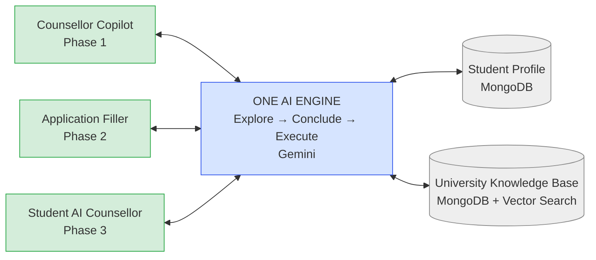
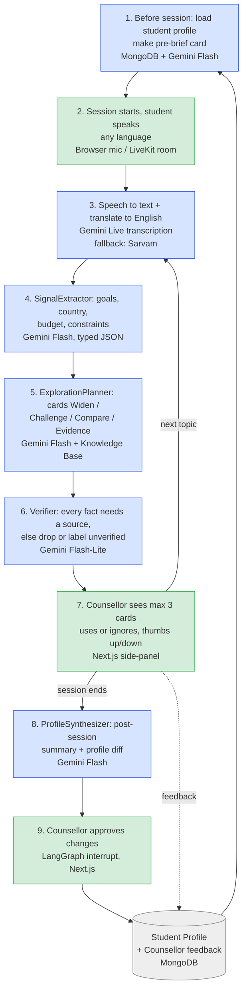
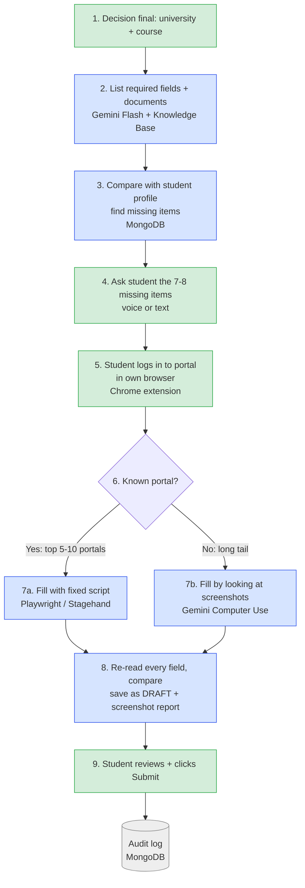

# Vidysea AI Counselling Engine — Plan

**Audience guide:** CEO reads §1, §2, §7. Team reads §2–6. AI coding tool reads §3, §4, §5 (plus the
Mermaid blocks and JSON I/O shapes inline).

---

## 1. Why

North star: **Explore → Conclude → Execute. AI assists, the human decides.** One AI engine turns every
counselling conversation into a structured, cited, longitudinal Student Knowledge Graph, and uses it to
help the counsellor widen and challenge the student's thinking until a decision is reached, then
pre-fills the resulting application for the student to submit. It is not a script — cards carry
questions, comparisons and evidence, never sentences for the counsellor to recite, so this is not a
cheating platform. The bar is decision quality, not just speed: research on 5,179 support agents found
an AI assistant raised issues resolved per hour by 14% on average and by 34% for novice and low-skilled
workers, while the most experienced performers saw small drops in quality when over-assisted — exactly
the profile we want, lifting less-experienced counsellors while giving seniors a "quiet mode." The
moat is not the AI model (any vendor can rent one) — it is the longitudinal student model built up over
years of sessions, plus the counsellor judgement captured and reused through the feedback loop.

---

## 2. Big picture

One engine, three surfaces, phased rollout: Counsellor Copilot (Phase 1) ships first because it is
safest and builds the student model; Application Filler (Phase 2) drafts only, the student always
submits; Student AI Counsellor (Phase 3) comes last, once the engine is proven with a human in the
loop.

One-line message: the engine is one system; only the screen changes. Counsellor screen first (safe),
then application filling, then a student-facing screen.

---

## 3. Phase 1 step-by-step (counsellor session)

Numbered steps:
1. Before the session, the engine loads the student's existing profile and builds a pre-brief card
   (what we already know, what not to re-ask).
2. The session starts; the student speaks in any language, online (LiveKit room) or in person
   (counsellor laptop mic).
3. Speech is transcribed and translated to English; the original-language transcript is kept alongside.
4. SignalExtractor pulls facts (goals, target country, budget, constraints) into typed JSON.
5. ExplorationPlanner turns facts into cards: Widen, Challenge, Clarify, Compare, Evidence — questions
   and comparisons, never scripted sentences.
6. Verifier checks every card has a cited source; uncited cards are dropped or labelled `unverified`.
7. The counsellor sees at most 3 cards at a time in the side-panel, uses or ignores them, and gives
   one-tap feedback; this loops back to step 3 for the next topic.
8. When the session ends, ProfileSynthesizer writes a summary and a proposed profile diff.
9. The counsellor approves the diff (a LangGraph `interrupt()` gate) before anything is written to the
   Student Profile.

**Module I/O (input → output, JSON shape):**
- **Pre-brief (step 1):** `StudentProfile` (Mongo doc) → `PreBriefCard {knownFacts: Fact[], openQuestions: string[], doNotAsk: string[]}`
- **Session start / audio capture (step 2):** `{sessionId, studentId, consentId, mode: "online"|"in-person"}` → `AudioChunk {sessionId, seq, pcm16k, ts}` stream (LiveKit room or laptop mic); no processing without a recorded `consentId`
- **Transcription (step 3):** `AudioChunk` (stream) → `TranscriptTurn {text, lang, translatedText, ts, speaker}`
- **SignalExtractor (step 4):** `TranscriptTurn[]` → `Fact[] {key, value, source:{type:"transcript", quote, turnId}, confidence, validFrom, purposeTags, sensitivity}`
- **ExplorationPlanner / card generator (step 5):** `Fact[] + KBQuery` → `Card[] {type: "widen"|"challenge"|"clarify"|"compare"|"evidence", prompt, sources:[{type, id, quote}], confidence}`
- **Verifier (step 6):** `Card[]` → `Card[]` (uncited cards removed) `+ droppedCount`
- **Side-panel feedback (step 7):** `Card + CounsellorAction {vote: "up"|"down", note?}` → `FeedbackEvent {cardId, action, ts}`
- **ProfileSynthesizer / post-session summary (step 8):** `Session (facts + transcript)` → `{summary: string, profileDiff: FactChange[], citedFactIds: string[]}`
- **Counsellor approval (step 9):** `profileDiff` + `CounsellorDecision {approve: bool, edits?}` → committed `Fact[]` in MongoDB (no write before approval)

---

## 4. Phase 2 step-by-step (application filling)

**Stop rule:** the agent stops at login, 2FA, CAPTCHA, payment and the declaration. The student always
does these steps themselves.

Numbered steps:
1. The decision is final — university and course chosen in Phase 1.
2. The requirements builder reads the portal and course to produce a field map and document list.
3. The engine compares the required fields against the Student Profile and finds gaps.
4. The student is asked only the 7–8 missing items, by voice or text, in any language.
5. The student logs in to the portal themselves, in their own browser (Chrome extension), so
   credentials and 2FA never touch Vidysea's servers.
6. The engine checks whether this is a known top-volume portal.
7. Known portals use a deterministic Playwright/Stagehand script (7a); long-tail portals use Gemini
   Computer Use, which looks at screenshots and acts (7b).
8. Every filled field is re-read from the page and diffed against the packet; the result is saved as a
   DRAFT with a field-by-field screenshot report, never submitted.
9. The student reviews the draft and clicks Submit themselves; the action is written to the audit log.

**Module I/O (input → output, JSON shape):**
- **Decision final (step 1):** approved Phase 1 `Decision {studentId, universityId, courseId, rationale, alternativesConsidered[]}` → `{portalId, courseId}` (starts Phase 2)
- **Requirements builder (step 2):** `{portalId, courseId}` → `RequirementSpec {fields: FieldSpec[], documents: DocSpec[]}`
- **Gap check (step 3):** `RequirementSpec + StudentProfile` → `GapList {missingFields: string[]}`
- **Gap questions (step 4):** `GapList` → `AnswerSet {field, value, source:"student-direct"}[]`
- **Application Packet (assembly):** `StudentProfile + AnswerSet + documents` → `ApplicationPacket {fields: {}, documents: [], lang:"en"}`
- **Student login (step 5):** `ApplicationPacket` + student's own browser session (extension) → `PortalSession {portalId, tabId, loggedIn: bool}`; credentials and 2FA never leave the student's browser
- **Portal router (step 6):** `PortalSession {portalId}` + `KnownPortalRegistry` → `{route: "scripted"|"computer-use", scriptId?}`
- **Portal fill, scripted (7a):** `ApplicationPacket + portal script` → `FillResult {filledFields, failedFields, screenshots[]}`
- **Portal fill, Computer Use (7b):** `ApplicationPacket + screenshot loop` → `FillResult {filledFields, failedFields, screenshots[], actionsLog[]}`
- **Verification (step 8):** `FillResult + live DOM read` → `DraftReport {field, expected, actual, match: bool}[]` saved as `status:"draft"`
- **Submit (step 9):** `DraftReport + StudentAction {submit: bool}` → `AuditEvent {who:"student", ts, portalId, result}` in the Audit log

---

## 5. Tech map

| Step | Job | Technology | Why |
|---|---|---|---|
| Voice input | Student's voice | Browser mic / LiveKit | Works online and in-person; the same room later serves Phase 3 |
| Speech to text | Any language to English | Gemini Live transcription (fallback: Sarvam) | Already the chosen stack, covers 70+ languages |
| Reasoning | Extract facts, build cards | Gemini Flash (structured JSON) | Cheap and fast |
| Fact check | Drop any fact without a source | Gemini Flash-Lite | Cheapest tier, runs on every card |
| Memory | Student profile, feedback, audit | MongoDB Atlas | Already in the stack |
| University data | Courses, fees, deadlines | MongoDB Atlas Vector Search | Facts come from here, not model memory |
| UI | Counsellor side-panel | Next.js | Same stack as the Ikigai prototype |
| Backend | Orchestrator (Explore → Conclude → Execute) | **LangGraph.js 1.x** (see note below) | Typed StateGraph with a Mongo checkpointer and `interrupt()` for counsellor approval |
| Form filling | Known portals | Playwright + Stagehand | Reliable, open source (MIT/Apache) |
| Form filling | Unknown portals | Gemini Computer Use | Reads screenshots and acts when there is no script |
| Avatar (Phase 3) | Face | Simli / HeyGen LiveAvatar (rent) | Building it is expensive; Resso's quote was also expensive |
| Workflow graph | Wires the engine's nodes together | LangGraph.js 1.x, thin `StateGraph`, Mongo checkpointer | Checkpointing and `interrupt()` give counsellor-approval for free (D-002); the graph holds wiring only, logic stays in functions |
| Agents | SignalExtractor, ExplorationPlanner, FitScorer, Verifier, ProfileSynthesizer | Typed Zod nodes inside the graph | Not a free multi-agent swarm — each node has a typed input/output boundary (D-002) |
| Skills | Prompts and soft rules | `skills/<name>/SKILL.md`, loaded on demand | Keeps prompts portable and swappable across model providers (D-005) |
| Tools | External capabilities the graph calls | MCP servers: student-profile, university-kb, session-store, portal-filler (P2) | Standard tool boundary, model-agnostic (D-005) |
| Hard rules | Rules that must never be skipped | Deterministic code guards before any LLM call: no-script, citation-required, crisis, consent | Rules that matter for safety/compliance cannot depend on a prompt being followed (D-005) |
| Knowledge graph | Student Knowledge Graph | Mongo-native: typed collections + an `edges` collection, vector search over summaries/courses | Structured facts plus vectors are enough at this data size; no Neo4j/GraphRAG in V1 (D-003) |
| Observability | Trace every graph run | Langfuse, self-hosted, `TELEMETRY_ENABLED=false` | Traces carry student transcripts, so a hosted tracer would be an external service under the data-boundary rule (D-004) |

**Note on the orchestrator row:** goal.md's original plan and the compass report both specify a plain
Node/TypeScript state machine to keep abstraction cost low for one developer. D-002 overrides this: the
orchestrator is **LangGraph.js 1.x** instead, because it matches the Vidysea agentic-architecture
standard and gives Mongo-backed checkpointing plus `interrupt()` for the counsellor-approval step for
free, while the graph is kept thin (wiring only) to preserve the compass's "fewer abstractions" concern.

**Reuse, don't rebuild** (from ARCHITECTURE.md H6 / D-001 — read-only, never written):

| Sibling repo | Piece reused |
|---|---|
| `D:/vidysea/ikigai-counsellor` | LangGraph template, prompts/rules, crisis-guard, student-memory, grader |
| `D:/ikigai_counsellor` | Gemini Live proxy |
| `D:/KnowledgeBase` | Provider seam, Gemini diarised STT, tenantScope, citation model, recall@k eval |
| `D:/counsellor_validation_judge` | Contradiction detection, mirror-student evidence |
| `D:/sop_mvp` | ContextObject profile, ApplicationConstraints |
| `D:/VirtualCounsellor_Avatar` | Phase 3 avatar |

Nothing described above is built yet in `D:/vc` — this section names what will be ported in, not what
exists today.

---

## 6. Milestones and success metrics

Roadmap timing (compass §6, indicative, one developer with AI coding tools):
- **Phase 0 — Foundations:** Student Knowledge Model + consent schema (2 weeks); University KB v0,
  top 150 universities/courses (3 weeks).
- **Phase 1 — Copilot, ~10–12 weeks total.** Start with the post-session scribe, not live cards — it
  is the lowest-risk, highest-ROI feature and it builds the student model and eval data live cards will
  need. Then live transcription + signal extraction (2 weeks), cards (explore/challenge/compare +
  visuals, 3 weeks), then an eval set + feedback loop + a 5-counsellor pilot (3 weeks).
- **Phase 2 — Execution.** Packet builder + gap questions (2 weeks), top-5 portal scripts draft-only +
  report (4 weeks), Computer Use long-tail + extension (4 weeks).
- **Phase 3 — Student surface.** Voice counsellor, Gemini Live, guardrailed (4 weeks); avatar
  integration + parent view (3 weeks).

**Exit gates (verbatim from the compass §6):**
- **P1 exit:** ≥40% card acceptance; zero uncited facts shown in 50 audited sessions; counsellors rate
  ≥4/5; post-session notes approved with light edits ≥80%.
- **P2 exit:** ≥90% field accuracy on draft fills across the top 5 portals; 0 unintended submissions;
  logged parental/student authorisation per application.
- **P3 exit:** red-team pass on distress, manipulation and prompt injection; human escalation working
  within minutes; ≥100 shadow-mode sessions (AI runs silently next to a counsellor) with acceptable
  agreement.

---

## 7. Risks and FAQ

**"Isn't this just a cheating platform?"**
No. Cards contain only questions, comparisons and evidence — never ready-made sentences for the
counsellor to recite. At most 3 cards are visible at once. A senior counsellor can switch on "quiet
mode" and get only the post-session summary.

**"What if the AI states a wrong fact?"**
Every fact must be sourced from the Knowledge Base or the student profile. The Verifier drops any card
that lacks a source. Nothing is written to the student profile without the counsellor's explicit
approval.

**"Will the application really be done in 15 minutes?"**
The data-entry portion, yes, when the profile already holds the answers. SOP, references, transcripts
and fee payment are not included. The honest promise is: "In 15 minutes we pre-fill everything we
already know, and hand you a checklist for the rest."

**"Why doesn't the AI just click Submit?"**
The student must read the declaration themselves — UCAS explicitly requires the applicant to have
"sufficient time to read, understand and accept the applicant declaration." Many portals prohibit
automated submission outright, and a wrong submission cannot be undone. So the agent always stops
before login, 2FA, CAPTCHA, payment and the declaration.

**"Why no avatar yet?"**
The engine has to be proven safe alongside a human counsellor first. Avatars are a rented commodity
(roughly $0.01–0.10 per minute) — Resso's quote for a custom build was far more expensive and it still
isn't the moat. The moat is the student's longitudinal profile and the counsellors' accumulated
judgement.

**"What does this cost to run?"**
A 45-minute counsellor session costs roughly $1.0–1.5 today, rising to about $2–2.5 after Gemini
Flash's rate doubles on 1 January 2027. At 1,000 sessions plus 300 application drafts a month, that is
roughly $1.8–3k per month. Caching and routing more calls to Flash-Lite will bring this down later.

**"How much time for one developer?"**
Phase 1 is about 10–12 weeks. It starts with the post-session summary feature because that is the
safest piece to ship and it is also what builds the student data the later, live-card features depend
on.

**"What about Hindi and regional languages?"**
The outer layer speaks to the student in their own language. Internally, everything is processed in
English. The original-language transcript is kept alongside the English version, so nothing is lost.

**"What if Gemini goes down or gets expensive?"**
Speech-to-text, text-to-speech and the LLM all sit behind one interface, so switching providers is a
configuration change, not a rewrite. Sarvam is the Indic-language fallback.

**"What's the legal risk with minors' data?"**
India's DPDP Act requires verifiable parental consent for under-18 users; child-data obligations become
enforceable on 13 May 2027. Consent and purpose-tagging are built into the data model from day one, and
a legal review is still required before any real Pathlynks data is joined (see Q3 in
ARCHITECTURE.md — this is not yet resolved).

**"How will we know it's actually working?"**
Phase 1 is judged passed only when: at least 40% of cards get used by counsellors, zero uncited facts
appear across 50 audited sessions, counsellors rate the tool at least 4/5, and at least 80% of
post-session notes are approved with only light edits. Phase 2 and Phase 3 have their own gates (§6).

**Risk table (compass §9):**

| Risk | Severity | Mitigation |
|---|---|---|
| Counsellors ignore cards (noise, latency) | High | Fewer, slower, better cards; event-triggered; acceptance metrics; quiet mode |
| Wrong facts shown to counsellor | High | KB-only facts, citations, verifier pass, "unverified" labels |
| Application agent mis-fills or auto-submits | Very high | Draft-only, DOM re-read diff, student submits, audit log |
| Portal ToS/blocks, CAPTCHAs, 2FA | High | Student-side extension + student login; scripted top portals; accept ~50% autonomous success on the long tail |
| DPDP non-compliance with minors' data | Very high (fines up to ₹200 crore / ₹250 crore per instance, can stack) | Consent layer in Phase 0; legal review before Pathlynks data is joined |
| Solo-developer bus factor and scope creep | High | Strict phase gates; thin code; buy avatar, transport and STT |
| Price shocks (Flash doubling Jan 2027) | Medium | Budget at 2027 rates; caching; Flash-Lite routing |
| Student disengagement with a Socratic AI (Phase 3) | Medium | Balance questions with concrete answers and visuals (Khanmigo lesson) |

## Recovery execution appendix — 2026-09-30 (D-029)

The full Explore -> Conclude -> Execute goal remains active. Application drafting is in the first pilot, per the directly recorded Umesh decision. Pilot exceptions do not constitute full-goal completion. Existing work will be integrated with its original history and independently checked; no new product module is proposed in this unit.

### Next product unit: T-035 safety-data lifecycle (plan pending approval)

**Outcome:** crisis notification/review records are tenant-scoped, discoverable in the student's export, fully erased with independent read-back-zero, and cannot be recreated by a delayed or replayed writer. Registration, export/erasure and fencing ship together; a registration-only or fencing-only slice leaves a known privacy hole.

**Existing files/functions to edit in place:**
- `packages/db/src/collections.ts:24` — `COLLECTION_NAMES`: register `escalation_notifications` and `crisis_flag_reviews`.
- `packages/db/scripts/db-init.ts:82` — `INDEX_PLAN`: tenant-leading student/session lookup indexes for both collections, without any other database access.
- `packages/db/src/erasure.ts:1417` — `ERASURE_PLAN`: phase-1 `byStudent` purge and independent residue checks; `StudentExport:1800` / `exportStudent:1840`: add projected `escalations` and `crisisReviews` arrays, empty for students without records.
- `packages/engine/src/guards/escalation.ts:203` — `notifyAll`, `escalateTurns:254`, `runReview:326`, `acknowledgeEscalation:397`: bounded writer precheck/postcheck and ownership-qualified compensation on every mutating path, using existing `WriterDeadline`, `assertStudentNotFenced` and `compensateIfFenced`.
- `packages/db/tests/db-init.test.ts` — verify both index definitions are tenant-led.
- `packages/db/tests/erasure.test.ts:100` / `:332` — extend existing fixtures and lifecycle/export outcomes.
- `packages/db/tests/db-scope.test.ts:194` / `:257` / `:285` — register both student-data names in the scanner and require actual fenced-writer coverage; no blanket exemption.
- `packages/engine/tests/crisis-escalation.test.ts:328` — replace the stale assertion that the collection is absent; add writer/replay/acknowledgement race coverage in the existing test file.
- `apps/api/src/openapi.ts:250` — describe the additive projected safety export and its staff/provider-field exclusions.

**Export interface:** `escalations` projects escalation/session/student/turn identifiers, guard level and matched flags, student-related severity/reason, existing channel/status, flagged/notified timestamps and nullable acknowledgement timestamp. `crisisReviews` projects session/student/turn identifiers, guard level/matched flags, flagged timestamp, and the classified severity/likelyBenign/rationale/time or the existing unavailable status/reason/time. Use the actual existing enum literals. Omit internal Mongo IDs, staff recipient/acknowledger identities, model/provider/error/debug fields, sampling fields and write-ownership tokens. Preserve one entry per stored notification in deterministic ID order; do not invent aggregation. Keep the export types in existing db code to avoid a db-to-engine dependency cycle.

**Writer protocol:** each bounded write phase observes the student's fence before and after mutation. Insert ownership is recorded atomically through an invocation token on insertion; ambiguous timeouts get a compensator when the operation eventually settles. Compensation may delete only that invocation's inserted records, never a pre-existing deterministic ID. Classifier and acknowledgement annotations use compare-and-set with ownership-qualified rollback; acknowledgement never compensates by deleting the underlying notification. Recheck the fence after classification before any new write, and do not hold one writer deadline across an arbitrarily long classifier run. Dispose deadlines in `finally`.

**Test-first sequence and acceptance:**
1. Establish red tests in the existing test files for both missing lifecycle collections, then implement the combined behavior.
2. Seed tenants A/B with identical student/session/turn IDs. A's export includes only A's projected safety information; A's completed erasure has zero independent full-scan residue; B's raw records remain byte-identical.
3. Hold each writer across fencing: initial review insertion, notification upsert, classifier annotation and acknowledgement. Releasing it cannot recreate erased data; a replay/timeout compensator preserves a previous invocation's legitimate records.
4. Exercise records with no session anchor, unavailable classifier, already-acknowledged notification and ambiguous Mongo outcomes. Assert raw database state and public export JSON, not only helper return values.
5. Independent isolated mutations remove either purge-plan entry, writer precheck or ownership qualification and must make the appropriate outcome assertion fail. The checker owns mutation evidence; no shared-tree mutation is permitted.
6. Run existing db and engine test entrypoints, repository typecheck and the contract validator. Run one post-integration full suite when this unit lands. Tests are offline with fake Mongo and synthetic data.

This unit does not establish actual notification delivery, the no-consent API path, or live Pathlynks integration. Those remain required follow-up units. D-027 still requires identifiers plus a crisis flag only without consent and zero classifier/KB/summary/profile processing in that exception.

### Remaining full-goal tracks

- Resolve and independently test live-card B1/B18 leaks; integrate only with an honest criterion mapping.
- Implement approved-fact/do-not-ask personalization, then complete destination relevance for the full goal.
- Wire safety recipient resolution and real delivery; prove the no-consent crisis exception end to end.
- Establish authenticated Pathlynks integration with real issuer/rotation and webhook-consumer evidence.
- Obtain Sapna ma'am's reference rubric, then measure novice + VC >=90% on matching cases.
- Specify the first application target, implement cited draft/review/checklist behavior, and prove the available-data entry timing and zero unintended submits.
- Build and verify student voice/avatar through the shared engine and the declared Hindi/voice personas.

No application target, expert reference, new source file, external connection, publication or production action is assumed approved by this appendix.