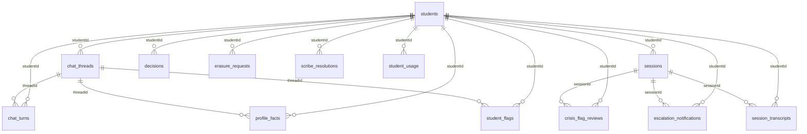

# VC data schema (GENERATED, do not edit)

Generated by `scripts/gen-schema-doc.ts` from `COLLECTION_NAMES`, `INDEX_PLAN`, the `*Doc` interfaces and the zod
schemas in `packages/schemas`. Regenerate after any data-model change; `--check` fails when this file is stale.
All collections live in the single `virtual_counsellor` database (D-008/D-009). External read-only sources
(Pathlynks / Vidysea Postgres) are documented in `docs/data-sources.md`.

Collections: 31 · document interfaces bound: 22 · indexes: 39 · zod object schemas: 52

## Collection index

| Collection | Document type | Indexes | Touched by (src files) |
|---|---|---|---|
| `admin_users` | - | 1 | 1 |
| `anonymous_counters` | AnonymousCounterDoc | 0 | 2 |
| `audit_log` | - | 2 | 1 |
| `chat_gap_counts` | GapCountDoc | 1 | 2 |
| `chat_threads` | ChatThreadDoc | 1 | 2 |
| `chat_turns` | ChatTurnDoc | 2 | 3 |
| `consents` | ConsentDoc | 1 | 2 |
| `courses` | StoredCourseDoc | 0 | 2 |
| `crisis_flag_reviews` | SafetyAccessRow | 2 | 1 |
| `decisions` | DecisionDoc, RejectReasonAuditDoc | 1 | 3 |
| `edges` | EdgeDoc | 2 | 2 |
| `email_outbox` | EmailOutboxDoc | 0 | 1 |
| `erasure_fences` | ErasureFenceDoc | 0 | 1 |
| `erasure_requests` | ErasureRequestDoc | 3 | 1 |
| `escalation_notifications` | SafetyAccessRow | 2 | 1 |
| `facts` | FactDoc | 2 | 2 |
| `profile_facts` | ProfileFactDoc | 1 | 2 |
| `scribe_checkpoint_writes` | - | 1 | 1 |
| `scribe_checkpoints` | - | 1 | 1 |
| `scribe_resolutions` | ScribeResolutionDoc | 2 | 2 |
| `session_transcripts` | TranscriptTurnDoc | 2 | 2 |
| `sessions` | SessionDoc | 1 | 2 |
| `source_artifacts` | - | 1 | 1 |
| `sources` | - | 1 | 1 |
| `student_flags` | StudentFlagDoc | 1 | 2 |
| `student_usage` | StudentUsageDoc | 1 | 3 |
| `students` | StudentDoc | 1 | 2 |
| `turn_usage` | - | 2 | 1 |
| `universities` | - | 0 | 1 |
| `webhook_emit_gaps` | - | 2 | 2 |
| `webhook_outbox` | - | 2 | 2 |

## Relationships (reference fields)

Derived from typed fields only; untyped collections (no `*Doc` bound) cannot show edges.

## Unregistered collections

Reached by a raw string, not `COLLECTION_NAMES` (so erasure/export/index tooling may not know them):

- `partners`: `apps/api/src/partners.ts`

## Collections in detail

### `admin_users`

_No typed document interface bound via `collection<XDoc>()`; see the touching files below._

Indexes:

- `admin_users_role`: {"role":1}

Touched by: `packages/db/src/erasure.ts`

### `anonymous_counters`

**AnonymousCounterDoc** (`packages/db/src/collections.ts`)

| Field | Type | Required |
|---|---|---|
| `_id` | string | yes |
| `date` | string | yes |
| `kind` | "answered" \| "no_answer" \| "sign_in_required" \| "crisis" | yes |
| `count` | number | yes |

Touched by: `packages/db/src/collections.ts`, `packages/db/src/erasure.ts`

### `audit_log`

_No typed document interface bound via `collection<XDoc>()`; see the touching files below._

Indexes:

- `audit_log_at`: {"at":-1}
- `audit_log_actorId_at`: {"actorId":1,"at":-1}

Touched by: `packages/db/src/erasure.ts`

### `chat_gap_counts`

**GapCountDoc** (`packages/db/src/student-logs.ts`)

| Field | Type | Required |
|---|---|---|
| `_id` | string | yes |
| `date` | string | yes |
| `kind` | GapKind | yes |
| `count` | number | yes |

Indexes:

- `chat_gap_counts_tenantId_date`: {"tenantId":1,"date":1}

Touched by: `packages/db/src/erasure.ts`, `packages/db/src/student-logs.ts`

### `chat_threads`

**ChatThreadDoc** (`packages/db/src/chat-threads.ts`)

| Field | Type | Required |
|---|---|---|
| `_id` | string | yes |
| `threadId` | string | yes |
| `studentId` | string | yes |
| `createdAt` | string | yes |
| `lastActivityAt` | string | yes |
| `textStored` | boolean | yes |
| `quest` | { role: "greeter" \| "ikigai" \| "cadence" \| "coach" \| "decide"; island: "hub" \| "dashboard" \| "help" \| "know-yourself" \| "career-selection" \| "profile-building" \| "university-selection" } |  |

Indexes:

- `chat_threads_studentId`: {"studentId":1}

Touched by: `packages/db/src/chat-threads.ts`, `packages/db/src/erasure.ts`

### `chat_turns`

**ChatTurnDoc** (`packages/db/src/chat-threads.ts`)

| Field | Type | Required |
|---|---|---|
| `_id` | string | yes |
| `threadId` | string | yes |
| `studentId` | string | yes |
| `turnId` | string | yes |
| `role` | "user" \| "assistant" | yes |
| `channel` | ChatChannel | yes |
| `text` | string | yes |
| `at` | string | yes |
| `order` | 0 \| 1 | yes |
| `requestHash` | string |  |
| `status` | "in_progress" \| "done" |  |
| `lease` | { token: string; expiresAt: string } |  |
| `response` | Record&lt;string, unknown&gt; |  |
| `publication` | "pending" \| "published" \| "invalidated" |  |
| `publicationLease` | string |  |
| `memorySnapshot` | { revision: string; policy: string } |  |
| `completedAt` | string |  |
| `voiceAudit` | Array&lt;{ reason: string; detail?: string; at: string }&gt; |  |

Indexes:

- `chat_turns_studentId`: {"studentId":1}
- `chat_turns_tenantId_studentId_threadId`: {"tenantId":1,"studentId":1,"threadId":1}

Touched by: `packages/db/src/chat-threads.ts`, `packages/db/src/erasure.ts`, `packages/db/src/profile-facts.ts`

### `consents`

`ConsentDoc`: declaration not found under */src.

Indexes:

- `consents_studentId`: {"studentId":1}

Touched by: `packages/db/src/collections.ts`, `packages/db/src/erasure.ts`

### `courses`

`StoredCourseDoc`: declaration not found under */src.

Touched by: `mcp/university-kb/src/index.ts`, `packages/db/src/erasure.ts`

### `crisis_flag_reviews`

**SafetyAccessRow** (`packages/db/src/erasure.ts`) extends SafetyNotificationExport

| Field | Type | Required |
|---|---|---|
| `_id` | string | yes |
| `guard` | { level: SafetyExportBase["guardLevel"]; matched: string[] } |  |
| `classifier` | SafetyClassifierExport |  |

Indexes:

- `crisis_flag_reviews_tenant_student`: {"tenantId":1,"studentId":1}
- `crisis_flag_reviews_tenant_session`: {"tenantId":1,"sessionId":1}

Touched by: `packages/db/src/erasure.ts`

### `decisions`

`DecisionDoc`: declaration not found under */src.

**RejectReasonAuditDoc** (`packages/db/src/decisions.ts`)

| Field | Type | Required |
|---|---|---|
| `_id` | string | yes |
| `kind` | "per_fact_reject" | yes |
| `threadId` | string | yes |
| `studentId` | string | yes |
| `rejected` | RejectedFactRecord[] | yes |
| `decidedAt` | string | yes |

Indexes:

- `decisions_studentId`: {"studentId":1}

Touched by: `packages/db/src/collections.ts`, `packages/db/src/decisions.ts`, `packages/db/src/erasure.ts`

### `edges`

**EdgeDoc** (`packages/db/src/edges.ts`)

| Field | Type | Required |
|---|---|---|
| `_id` | string | yes |
| `from` | EdgeRef | yes |
| `to` | EdgeRef | yes |
| `rel` | string | yes |
| `createdAt` | string | yes |
| `writerToken` | string |  |

Indexes:

- `edges_from`: {"from.kind":1,"from.id":1}
- `edges_to`: {"to.kind":1,"to.id":1}

Touched by: `packages/db/src/collections.ts`, `packages/db/src/erasure.ts`

### `email_outbox`

**EmailOutboxDoc** (`packages/db/src/erasure.ts`)

| Field | Type | Required |
|---|---|---|
| `_id` | string | yes |
| `kind` | "erasure_approval_request" | yes |
| `to` | string | yes |
| `subject` | string | yes |
| `body` | string | yes |
| `requestId` | string | yes |
| `reason` | ErasureReason | yes |
| `requestedBy` | string | yes |
| `confirmedBy` | string | yes |
| `createdAt` | string | yes |
| `expiresAt` | string | yes |
| `status` | "queued" | yes |

Touched by: `packages/db/src/erasure.ts`

### `erasure_fences`

**ErasureFenceDoc** (`packages/db/src/erasure.ts`)

| Field | Type | Required |
|---|---|---|
| `_id` | string | yes |
| `studentKey` | string | yes |
| `requestId` | string | yes |
| `createdAt` | string | yes |
| `releaseAfter` | string |  |
| `priorReleaseAfter` | string |  |

Touched by: `packages/db/src/erasure.ts`

### `erasure_requests`

**ErasureRequestDoc** (`packages/db/src/erasure.ts`)

| Field | Type | Required |
|---|---|---|
| `_id` | string | yes |
| `studentHash` | string |  |
| `hashSalt` | string | yes |
| `hashScheme` | typeof HASH_SCHEME |  |
| `studentId` | string |  |
| `studentKey` | string |  |
| `requestedBy` | string | yes |
| `reason` | ErasureReason | yes |
| `requestedAt` | string | yes |
| `status` | ErasureStatus | yes |
| `confirmedBy` | string |  |
| `confirmedAt` | string |  |
| `confirmTokenHash` | string |  |
| `confirmTokenExpiresAt` | string |  |
| `secondConfirmedBy` | string |  |
| `secondConfirmedAt` | string |  |
| `approvalRequestedAt` | string |  |
| `approvalExpiresAt` | string |  |
| `outboxId` | string |  |
| `approvedBy` | string |  |
| `approvedAt` | string |  |
| `rejectedBy` | string |  |
| `rejectedAt` | string |  |
| `expiredAt` | string |  |
| `attempts` | number | yes |
| `lastAttemptAt` | string |  |
| `completedAt` | string |  |
| `receipt` | ErasureReceipt |  |
| `carriedSelectors` | CarriedSelectors |  |

Indexes:

- `erasure_requests_studentId`: {"studentId":1}
- `erasure_requests_status`: {"status":1,"requestedAt":1}
- `erasure_requests_open_tenantId_studentKey_unique`: {"tenantId":1,"studentKey":1} unique partial {"status":{"$in":["pending","confirmed","awaiting_approval","approved","failed"]}}

Touched by: `packages/db/src/erasure.ts`

### `escalation_notifications`

**SafetyAccessRow** (`packages/db/src/erasure.ts`) extends SafetyNotificationExport

| Field | Type | Required |
|---|---|---|
| `_id` | string | yes |
| `guard` | { level: SafetyExportBase["guardLevel"]; matched: string[] } |  |
| `classifier` | SafetyClassifierExport |  |

Indexes:

- `escalation_notifications_tenant_student`: {"tenantId":1,"studentId":1}
- `escalation_notifications_tenant_session`: {"tenantId":1,"sessionId":1}

Touched by: `packages/db/src/erasure.ts`

### `facts`

`FactDoc`: declaration not found under */src.

Indexes:

- `facts_tenantId_studentId_key_active_true_unique`: {"tenantId":1,"studentId":1,"key":1} unique partial {"active":true}
- `facts_studentId`: {"studentId":1}

Touched by: `packages/db/src/collections.ts`, `packages/db/src/erasure.ts`

### `profile_facts`

**ProfileFactDoc** (`packages/db/src/profile-facts.ts`)

| Field | Type | Required |
|---|---|---|
| `_id` | string | yes |
| `factId` | string | yes |
| `studentId` | string | yes |
| `key` | string | yes |
| `value` | string | yes |
| `quote` | string |  |
| `sourceLang` | string |  |
| `status` | ProfileFactStatus | yes |
| `source` | "chat" | yes |
| `threadId` | string |  |
| `turnId` | string |  |
| `proposedAt` | string | yes |
| `decidedAt` | string |  |
| `proposalToken` | string |  |
| `proposalPending` | boolean |  |
| `pendingChange` | PendingProfileChange |  |

Indexes:

- `profile_facts_studentId`: {"studentId":1}

Touched by: `packages/db/src/erasure.ts`, `packages/db/src/profile-facts.ts`

### `scribe_checkpoint_writes`

_No typed document interface bound via `collection<XDoc>()`; see the touching files below._

Indexes:

- `thread_ns_checkpoint_task_idx`: {"thread_id":1,"checkpoint_ns":1,"checkpoint_id":1,"task_id":1,"idx":1}

Touched by: `packages/db/src/erasure.ts`

### `scribe_checkpoints`

_No typed document interface bound via `collection<XDoc>()`; see the touching files below._

Indexes:

- `thread_ns_checkpoint_idx`: {"thread_id":1,"checkpoint_ns":1,"checkpoint_id":-1}

Touched by: `packages/db/src/erasure.ts`

### `scribe_resolutions`

**ScribeResolutionDoc** (`packages/db/src/collections.ts`)

| Field | Type | Required |
|---|---|---|
| `_id` | string | yes |
| `threadId` | string | yes |
| `studentId` | string | yes |
| `decision` | CounsellorDecision | yes |
| `response` | Record&lt;string, unknown&gt; | yes |
| `responseHash` | string | yes |
| `claimedAt` | string | yes |
| `approvalMetadata` | { counsellorId: string; editedAt: string } |  |
| `lease` | { token: string; expiresAt: string } |  |

Indexes:

- `scribe_resolutions_tenantId_threadId_unique`: {"tenantId":1,"threadId":1} unique
- `scribe_resolutions_studentId`: {"studentId":1}

Touched by: `packages/db/src/collections.ts`, `packages/db/src/erasure.ts`

### `session_transcripts`

**TranscriptTurnDoc** (`packages/db/src/collections.ts`)

| Field | Type | Required |
|---|---|---|
| `_id` | string | yes |
| `sessionId` | string | yes |
| `studentId` | string | yes |
| `turnId` | string | yes |
| `speaker` | "student" \| "counsellor" | yes |
| `lang` | string | yes |
| `text` | string | yes |
| `translatedText` | string | yes |
| `ts` | number | yes |
| `recordedAt` | string | yes |

Indexes:

- `session_transcripts_studentId`: {"studentId":1}
- `session_transcripts_student_session_ts`: {"studentId":1,"sessionId":1,"ts":1}

Touched by: `packages/db/src/collections.ts`, `packages/db/src/erasure.ts`

### `sessions`

**SessionDoc** (`packages/db/src/collections.ts`)

| Field | Type | Required |
|---|---|---|
| `_id` | string | yes |
| `sessionId` | string | yes |
| `studentId` | string | yes |
| `consentId` | string |  |
| `startedAt` | string |  |
| `endedAt` | string |  |
| `scribeThreadIds` | string[] |  |
| `summary` | string |  |
| `summaryWithheldReason` | string |  |
| `summaryApprovedAt` | string |  |

Indexes:

- `sessions_studentId`: {"studentId":1}

Touched by: `packages/db/src/collections.ts`, `packages/db/src/erasure.ts`

### `source_artifacts`

_No typed document interface bound via `collection<XDoc>()`; see the touching files below._

Indexes:

- `source_artifacts_sourceId_kind_builtAt`: {"sourceId":1,"kind":1,"builtAt":-1}

Touched by: `packages/db/src/erasure.ts`

### `sources`

_No typed document interface bound via `collection<XDoc>()`; see the touching files below._

Indexes:

- `sources_siteId_kind`: {"siteId":1,"kind":1}

Touched by: `packages/db/src/erasure.ts`

### `student_flags`

**StudentFlagDoc** (`packages/db/src/student-logs.ts`)

| Field | Type | Required |
|---|---|---|
| `_id` | string | yes |
| `studentId` | string | yes |
| `threadId` | string | yes |
| `turnId` | string | yes |
| `kind` | StudentFlagKind | yes |
| `at` | string | yes |

Indexes:

- `student_flags_studentId`: {"studentId":1}

Touched by: `packages/db/src/erasure.ts`, `packages/db/src/student-logs.ts`

### `student_usage`

**StudentUsageDoc** (`packages/db/src/chat-threads.ts`)

| Field | Type | Required |
|---|---|---|
| `_id` | string | yes |
| `studentId` | string | yes |
| `month` | string | yes |
| `textTurns` | number | yes |
| `voiceMs` | number | yes |

Indexes:

- `student_usage_studentId`: {"studentId":1}

Touched by: `packages/db/src/chat-threads.ts`, `packages/db/src/erasure.ts`, `packages/db/src/profile-facts.ts`

### `students`

**StudentDoc** (`packages/db/src/collections.ts`)

| Field | Type | Required |
|---|---|---|
| `_id` | string | yes |
| `studentId` | string | yes |
| `createdAt` | string | yes |

Indexes:

- `students_studentId`: {"studentId":1}

Touched by: `packages/db/src/collections.ts`, `packages/db/src/erasure.ts`

### `turn_usage`

_No typed document interface bound via `collection<XDoc>()`; see the touching files below._

Indexes:

- `turn_usage_siteId_at`: {"siteId":1,"at":1}
- `turn_usage_at`: {"at":1}

Touched by: `packages/db/src/erasure.ts`

### `universities`

_No typed document interface bound via `collection<XDoc>()`; see the touching files below._

Touched by: `packages/db/src/erasure.ts`

### `webhook_emit_gaps`

_No typed document interface bound via `collection<XDoc>()`; see the touching files below._

Indexes:

- `webhook_emit_gaps_studentId`: {"studentId":1}
- `webhook_emit_gaps_tenantId_kind`: {"tenantId":1,"kind":1}

Touched by: `packages/db/src/erasure.ts`, `packages/engine/src/webhooks/gaps.ts`

### `webhook_outbox`

_No typed document interface bound via `collection<XDoc>()`; see the touching files below._

Indexes:

- `webhook_outbox_tenantId_status`: {"tenantId":1,"status":1}
- `webhook_outbox_event_data_studentId`: {"event.data.studentId":1}

Touched by: `packages/db/src/erasure.ts`, `packages/engine/src/webhooks/outbox.ts`

## Zod contracts (`packages/schemas/src`)

Validated shapes at module and API boundaries. `?` = optional.

### AnonymousCounterSchema

| Field | Type |
|---|---|
| `date` | string |
| `kind` | "answered" \| "no_answer" \| "sign_in_required" \| "crisis" |
| `count` | number |

### AnonymousTurnRequestSchema

| Field | Type |
|---|---|
| `text` | string |

### AnonymousTurnResponseSchema

| Field | Type |
|---|---|
| `state` | "ok" \| "no_sourced_answer" \| "sign_in_required" \| "escalated" |
| `message` | string? |
| `claims` | object[] |
| `sources` | object[] |

### ApplicationPacketSchema

| Field | Type |
|---|---|
| `fields` | record |
| `documents` | string[] |
| `lang` | string |

### AudioChunkMetaSchema

| Field | Type |
|---|---|
| `sessionId` | string |
| `seq` | number |
| `ts` | number |

### AudioFormatSchema

| Field | Type |
|---|---|
| `format` | "pcm16" |
| `inputSampleRateHz` | 16000 |
| `outputSampleRateHz` | 24000 |

### AuditEventSchema

| Field | Type |
|---|---|
| `who` | string |
| `ts` | number |
| `portalId` | string |
| `result` | string |

### CardSchema

| Field | Type |
|---|---|
| `id` | string |
| `type` | "widen" \| "challenge" \| "clarify" \| "compare" \| "evidence" \| "check-in" |
| `prompt` | string |
| `sources` | object[] |
| `confidence` | number |

### CardSourceSchema

| Field | Type |
|---|---|
| `type` | string |
| `id` | string |
| `quote` | string? |

### ClaimSchema

| Field | Type |
|---|---|
| `text` | string |
| `kind` | "number" \| "country" \| "fact" |
| `sourceIds` | string[] |
| `status` | "verified" \| "attributed" \| "unverified" |

### ConcernRecordSchema

| Field | Type |
|---|---|
| `concernId` | string |
| `studentId` | string |
| `sessionId` | string |
| `level` | "concern" \| "crisis" |
| `reason` | string |
| `matched` | string[] |
| `detector` | "crisis-guard" |
| `citation` | object |

### ConsentSchema

| Field | Type |
|---|---|
| `studentId` | string |
| `guardianConsent` | boolean |
| `purposes` | string[] |
| `recordedAt` | string |
| `minor` | boolean |

### CounsellorDecisionSchema

| Field | Type |
|---|---|
| `approve` | boolean |
| `edits` | object[]? |

### DecisionSchema

| Field | Type |
|---|---|
| `studentId` | string |
| `universityId` | string |
| `courseId` | string |
| `rationale` | string |
| `alternativesConsidered` | string[] |

### DocSpecSchema

| Field | Type |
|---|---|
| `name` | string |
| `required` | boolean |

### DraftReportEntrySchema

| Field | Type |
|---|---|
| `field` | string |
| `expected` | unknown |
| `actual` | unknown |
| `match` | boolean |

### ErasureCarriedSelectorsSchema

| Field | Type |
|---|---|
| `factIds` | string[] |
| `sessionIds` | string[] |
| `threadIds` | string[] |

### ErasureCollectionLineSchema

| Field | Type |
|---|---|
| `collection` | string |
| `outcome` | "purged" \| "failed" \| "deferred" |
| `deleted` | number |
| `remaining` | number |
| `error` | string? |

### ErasureReceiptSchema

| Field | Type |
|---|---|
| `requestId` | string |
| `attempt` | number |
| `verified` | boolean |
| `totalRemaining` | number |
| `collections` | object[] |
| `rounds` | number? |
| `startedAt` | string |
| `verifiedAt` | string |

### FactChangeSchema

| Field | Type |
|---|---|
| `op` | "add" \| "update" \| "remove" |
| `key` | string |
| `before` | unknown? |
| `after` | unknown? |

### FactDecisionRequestSchema

| Field | Type |
|---|---|
| `action` | "confirm" \| "correct" \| "erase" \| "reject" |
| `value` | string? |
| `candidateId` | string? |
| `expectedVersion` | string? |
| `threadId` | string? |

### FactSchema

| Field | Type |
|---|---|
| `key` | string |
| `value` | unknown |
| `source` | discriminatedunion |
| `confidence` | number |
| `validFrom` | string |
| `validTo` | string? |
| `purposeTags` | string[] |
| `sensitivity` | "low" \| "medium" \| "high" |
| `kind` | "value" \| "reasoning"? |
| `explains` | string? |
| `citationMatch` | "verbatim" \| "normalised"? |
| `needsReview` | boolean? |
| `reviewReasons` | string[]? |

### FeedbackEventSchema

| Field | Type |
|---|---|
| `cardId` | string |
| `action` | "up" \| "down" |
| `ts` | number |
| `note` | string? |

### FieldSpecSchema

| Field | Type |
|---|---|
| `name` | string |
| `required` | boolean |

### FillResultSchema

| Field | Type |
|---|---|
| `filledFields` | string[] |
| `failedFields` | string[] |
| `screenshots` | string[] |
| `actionsLog` | string[]? |

### GapListSchema

| Field | Type |
|---|---|
| `missingFields` | string[] |

### LimitsConfigSchema

| Field | Type |
|---|---|
| `requestsPerMinute` | number |
| `anonymousRequestsPerMinute` | number |
| `voiceMinutesPerMonth` | number |
| `voiceSessionMaxMinutes` | number |
| `crisisMaxAudioMsAfterTrigger` | number |
| `audio` | object |

### LimitsOverrideSchema

| Field | Type |
|---|---|
| `requestsPerMinute` | number? |
| `anonymousRequestsPerMinute` | number? |
| `voiceMinutesPerMonth` | number? |
| `voiceSessionMaxMinutes` | number? |
| `crisisMaxAudioMsAfterTrigger` | number? |
| `audio` | object? |

### MemoryConfirmationRefSchema

| Field | Type |
|---|---|
| `candidateId` | string |
| `expectedVersion` | string |
| `value` | string |

### MemoryGraphSchema

| Field | Type |
|---|---|
| `items` | object[] |
| `nodes` | object[] |
| `edges` | object[] |
| `nextCursor` | string? |

### MemoryItemSchema

| Field | Type |
|---|---|
| `factId` | string? |
| `key` | string |
| `value` | string |
| `status` | "confirmed" \| "proposed" |
| `source` | "chat" \| "pathlynks" \| "vidysea" |
| `readOnly` | boolean |
| `pendingChange` | object? |
| `threadId` | string? |
| `turnId` | string? |
| `quote` | string? |
| `sourceLang` | string? |

### MemoryPromptSchema

| Field | Type |
|---|---|
| `candidateId` | string |
| `expectedVersion` | string |
| `value` | string |
| `factId` | string |
| `key` | string |
| `threadId` | string |
| `promptId` | string |
| `currentValue` | string? |

### PendingProfileChangeSchema

| Field | Type |
|---|---|
| `candidateId` | string |
| `version` | string |
| `value` | string |
| `proposedAt` | string |
| `quote` | string? |
| `sourceLang` | string? |
| `threadId` | string? |
| `turnId` | string? |

### PreBriefCardSchema

| Field | Type |
|---|---|
| `knownFacts` | object[] |
| `openQuestions` | string[] |
| `doNotAsk` | string[] |

### ProfileDiffSchema

| Field | Type |
|---|---|
| `studentId` | string |
| `summary` | string |
| `changes` | object[] |
| `citedFactIds` | string[] |

### ProfileFactSchema

| Field | Type |
|---|---|
| `key` | string |
| `value` | string |
| `source` | "pathlynks" \| "vidysea" \| "student-confirmed" |

### ProfileResponseSchema

| Field | Type |
|---|---|
| `facts` | object[] |
| `proposed` | object[] |
| `memory` | object? |

### ProposedFactSchema

| Field | Type |
|---|---|
| `factId` | string |
| `key` | string |
| `value` | string |
| `status` | "proposed" \| "confirmed" |
| `pendingChange` | object? |

### QuestContextSchema

| Field | Type |
|---|---|
| `role` | "greeter" \| "ikigai" \| "cadence" \| "coach" \| "decide" |
| `island` | "hub" \| "dashboard" \| "help" \| "know-yourself" \| "career-selection" \| "profile-building" \| "university-selection" |

### RequirementSpecSchema

| Field | Type |
|---|---|
| `fields` | object[] |
| `documents` | object[] |

### SourceSchema

| Field | Type |
|---|---|
| `id` | string |
| `kind` | "internal-seminar" \| "toc" \| "whatsapp" \| "unknown" \| "web" |
| `title` | string? |
| `url` | string? |
| `stale` | boolean? |
| `dateUnknown` | boolean? |

### ThreadCreatedSchema

| Field | Type |
|---|---|
| `threadId` | string |

### ThreadCreateRequestSchema

| Field | Type |
|---|---|
| `quest` | object? |

### ThreadListSchema

| Field | Type |
|---|---|
| `threads` | object[] |
| `nextCursor` | string? |

### ThreadMetadataSchema

| Field | Type |
|---|---|
| `threadId` | string |
| `createdAt` | string |
| `lastActivityAt` | string |
| `textStored` | boolean |
| `quest` | object? |

### ThreadSchema

| Field | Type |
|---|---|
| `threadId` | string |
| `turns` | object[] |
| `quest` | object? |
| `textStored` | boolean? |

### ThreadTurnSchema

| Field | Type |
|---|---|
| `turnId` | string |
| `role` | "user" \| "assistant" |
| `channel` | "text" \| "voice" |
| `text` | string |
| `at` | string |
| `claims` | object[]? |
| `sources` | object[]? |

### TranscriptTurnRecordSchema

| Field | Type |
|---|---|
| `text` | string |
| `lang` | string |
| `translatedText` | string |
| `ts` | number |
| `speaker` | "student" \| "counsellor" |
| `turnId` | string |

### TranscriptTurnSchema

| Field | Type |
|---|---|
| `text` | string |
| `lang` | string |
| `translatedText` | string |
| `ts` | number |
| `speaker` | "student" \| "counsellor" |

### TurnRequestSchema

| Field | Type |
|---|---|
| `text` | string |
| `clientTurnId` | string? |
| `quest` | object? |
| `memoryConfirmation` | object? |

### TurnResponseSchema

| Field | Type |
|---|---|
| `turnId` | string? |
| `state` | "ok" \| "concern" \| "escalated" \| "no_sourced_answer" \| "sign_in_required" |
| `message` | string? |
| `claims` | object[] |
| `sources` | object[] |
| `profileFactsUsed` | object[] |
| `rankingProfile` | string? |
| `memoryConfirmation` | object? |

### VoiceSessionResponseSchema

| Field | Type |
|---|---|
| `token` | string |
| `wsUrl` | string |
| `expiresAt` | string |
| `sessionMaxMinutes` | number |
| `audio` | object |
