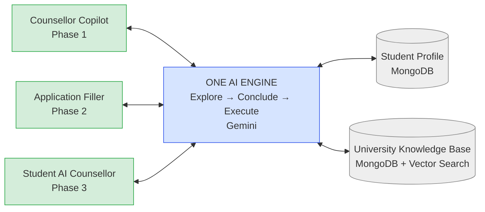
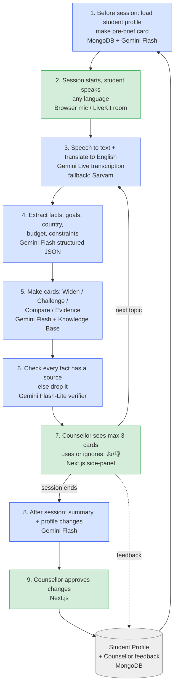
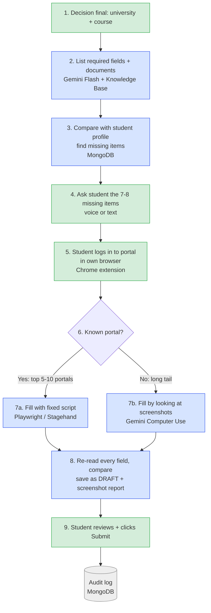

https://docs.google.com/document/d/11PEkFEyI9L67Y1tkTClxUNrDZBIpstVExlAgZqfADh4/edit?usp=sharing

check all the tabs of this directory and also toher prodcucts from the direcorry of th system

iske liye ye dekh konsa multiagentic framework bnaana hai and also knowledgegraph and observablity and also prompts and rules as skills and tools

Is plan ko teen audiences samjhengi: CEO, team, aur AI coding tool. Teenon ko ek hi document mein alag "zoom level" chahiye. Neeche poora structure hai, ready-to-use flowcharts ke saath. Document ka content English mein rakha hai, jaisa aapne pehle bola tha.

## Document structure (is order mein present karo)

1. **Why:** CEO ka North Star, ek paragraph mein. "Explore → Conclude → Execute", AI assists, human decides.
2. **Big picture:** Diagram 1. Ek engine, teen surfaces, teen phases.
3. **Phase 1 step-by-step:** Diagram 2. Counsellor session ka flow, har box pe technology.
4. **Phase 2 step-by-step:** Diagram 3. Application filling ka flow.
5. **Tech map table:** har step pe kaunsi technology, aur kyon.
6. **Milestones and success metrics:** kab "done" maana jaayega.
7. **Risks and FAQ:** cross-questions ke ready answers.

CEO ko sirf sections 1, 2 aur 7 chahiye. Team ko 2 se 6. AI coding tool ko sections 3, 4 aur 5, saath mein Mermaid code.

## Flowchart rules (inse diagram easy rehta hai)

- Ek diagram ek hi sawaal ka jawab de. Max 10–12 boxes.
- Flow ek hi direction mein chale: left-to-right ya top-to-bottom.
- Teen colours: human steps (green), AI steps (blue), data stores (grey). Rang dekhte hi samajh aata hai ki kaun kya kar raha hai.
- Har box mein pehli line mein **kya hota hai**, doosri line mein **[technology]**.
- Steps numbered hon (1, 2, 3…), aur document ke sections same numbers use karein.

## Diagram 1: Big picture (CEO ke liye)

Ek line ka message: engine ek hi hai, sirf screen badalti hai. Pehle counsellor ki screen banegi (safe), phir application filling, phir student-facing.

## Diagram 2: Phase 1, counsellor session step-by-step (team + AI code ke liye)

## Diagram 3: Phase 2, application filling step-by-step

Stop rule (diagram ke neeche likho): login, 2FA, CAPTCHA, payment, aur declaration pe agent ruk jaata hai. Ye steps hamesha student khud karta hai.

## Tech map (section 5)

| Step | Kaam | Technology | Kyon |
|---|---|---|---|
| Voice input | Student ki awaaz | Browser mic / LiveKit | Online + in-person dono, aur Phase 3 mein bhi wahi room chalega |
| Speech to text | Kisi bhi language se English | Gemini Live transcription (fallback: Sarvam) | Existing stack, 70+ languages |
| Reasoning | Facts nikaalna, cards banana | Gemini Flash (structured JSON) | Sasta aur fast |
| Fact check | Bina source ka fact block | Gemini Flash-Lite | Sabse sasta, har card pe chalega |
| Memory | Student profile, feedback, audit | MongoDB Atlas | Pehle se hai |
| University data | Courses, fees, deadlines | MongoDB Atlas Vector Search | Facts yahin se aayenge, model ki memory se nahi |
| UI | Counsellor side-panel | Next.js | Ikigai prototype wala stack |
| Backend | Orchestrator (Explore → Conclude → Execute) | Node/TypeScript state machine | Ek developer ke liye simple |
| Form filling | Known portals | Playwright + Stagehand | Reliable, open source (MIT/Apache) |
| Form filling | Unknown portals | Gemini Computer Use | Screenshot dekh ke fill karta hai |
| Avatar (Phase 3) | Chehra | Simli / HeyGen LiveAvatar (rent) | Khud banana mehnga, Resso ka quote bhi mehnga |

AI coding tool ko dete waqt ye table aur Diagrams 2–3 ka Mermaid code saath do. Saath mein har module ke liye ek line likho: "input kya, output kya (JSON shape)".

## Cross-questions ke answers (section 7)

**"Ye cheating platform hi to nahi ban gaya?"**
Nahi. Cards mein sirf sawaal, comparison aur evidence hote hain, bolne ke liye ready sentences nahi. Max 3 cards dikhte hain. Senior counsellor "quiet mode" on kar sakta hai.

**"AI galat fact bata de to?"**
Har fact ko Knowledge Base ya student profile se source chahiye. Verifier bina source wala card drop kar deta hai. Profile mein kuch bhi counsellor ke approve kiye bina save nahi hota.

**"15 minute mein application ho jaayegi?"**
Form ka data-entry wala hissa haan. SOP, references, transcripts aur fee payment nahi. Promise ye hai: "15 minute mein jo data humare paas hai wo pre-fill, baaki ki checklist."

**"AI khud Submit kyon nahi karega?"**
Declaration student ko khud padhni hoti hai (UCAS ka rule). Bahut se portals automation allow nahi karte. Galat submit hua to reversible nahi hai.

**"Avatar abhi kyon nahi?"**
Pehle engine ko counsellor ke saath safe proof karna hai. Avatar rent hota hai (~$0.01–0.10 per minute), wo moat nahi hai. Moat student ka profile aur counsellors ka experience hai.

**"Kharcha kitna?"**
Ek 45-minute counsellor session ~$1–1.5. January 2027 mein Gemini Flash ke rate double hone ke baad ~$2–2.5. 1,000 sessions + 300 drafts ≈ $1.8–3k per month. Caching aur Flash-Lite se baad mein kam hoga.

**"Ek developer mein kitna time?"**
Phase 1 ~10–12 hafte. Shuruaat post-session summary se, kyunki wahi sabse safe hai aur data bhi wahi banata hai.

**"Hindi / regional language ka kya?"**
Bahar ki layer student ki language mein bolti hai. Andar sab English mein chalta hai. Original transcript bhi save hota hai.

**"Gemini down ho gaya ya mehnga ho gaya to?"**
STT, TTS aur LLM ek interface ke peeche hain, provider badalna config change hai. Indic fallback Sarvam hai.

**"Bacchon ke data ka legal risk?"**
DPDP Act mein under-18 ke liye parental consent zaroori hai. Child-data rules 13 May 2027 se enforce honge. Consent pehle din se data model mein hoga, aur legal review abhi karwana hai.

**"Kaise pata chalega ki kaam kar raha hai?"**
Phase 1 pass tab maana jaayega jab:
- ≥40% cards counsellor use kare
- 50 audited sessions mein ek bhi bina-source fact na dikhe
- counsellor rating ≥4/5

Kya main ise ek shareable Claude Doc mein daal doon, taaki team isko padh aur comment kar sake?